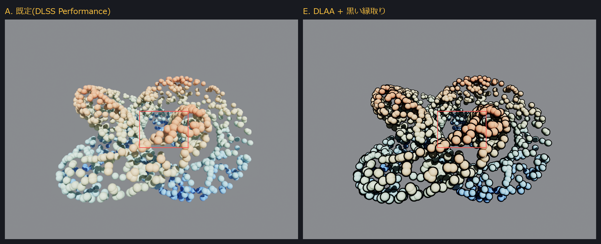
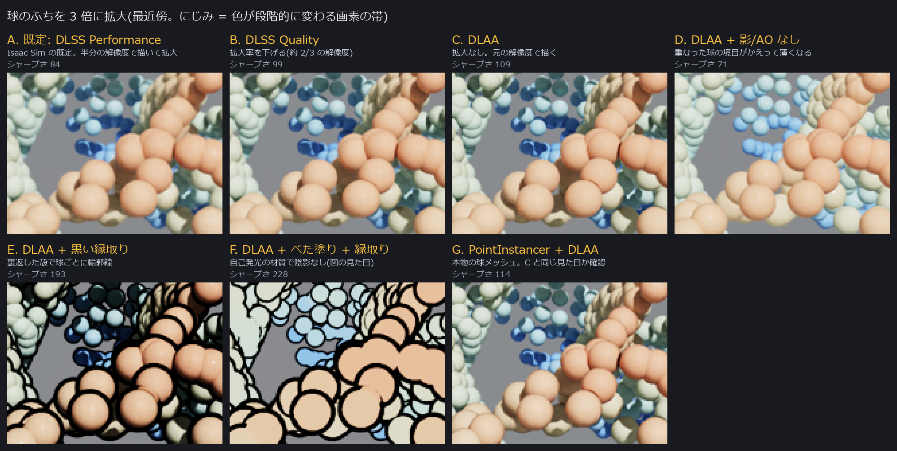
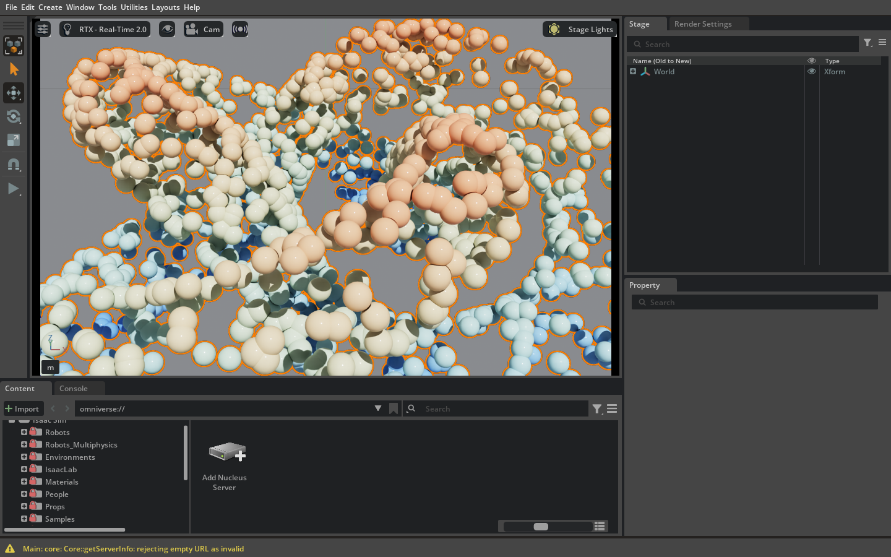
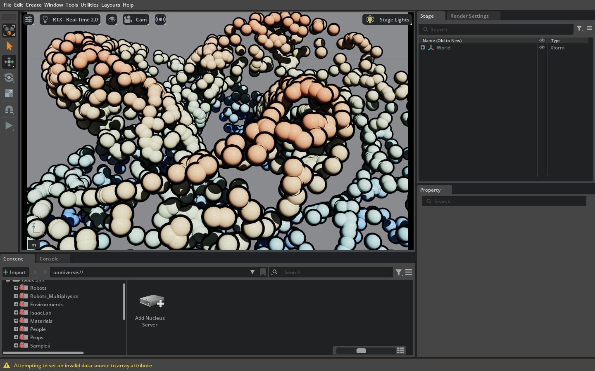
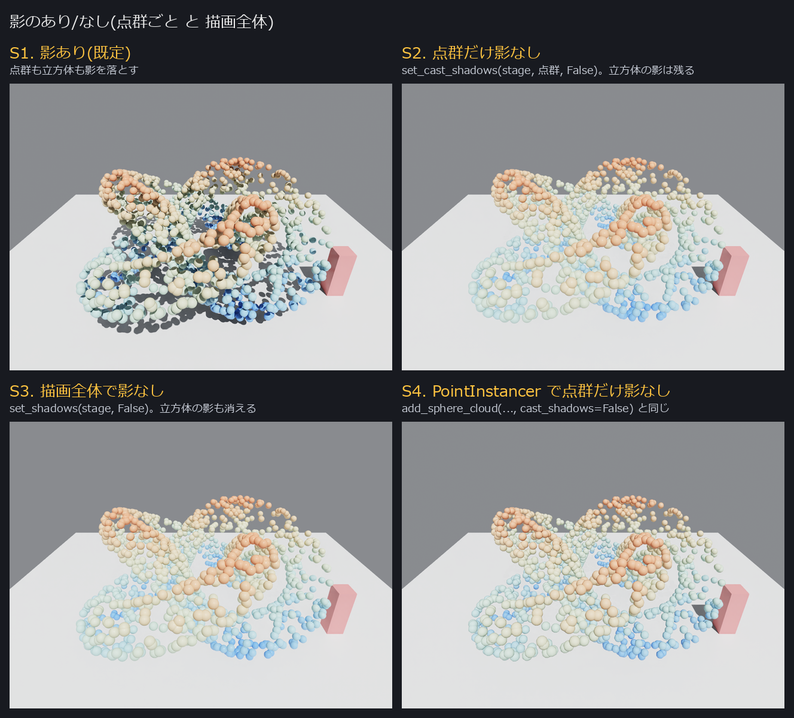

# 点群を球で表示して、球のふちをくっきり見せる（Isaac Sim 6.2）

作成日: 2026-11-12 / Isaac Sim 6.2.0、描画方式 RealTimePathTracing（RTX Real-Time 2.0。6.2 の既定）、RTX 3060 で実測

## 結論

| やりたいこと | やり方 | 関数（[pointcloud_spheres.py](pointcloud_spheres.py)） |
| --- | --- | --- |
| 点を球にする | `UsdGeom.Points` に `widths`（直径）を入れる。RTX は各点を球として描く | `add_points_prim` |
| 本物の球メッシュで出す | `UsdGeom.PointInstancer` ＋ `UsdGeom.Sphere` | `add_sphere_cloud` |
| **にじみを消す（本命）** | アンチエイリアスを **DLAA** にする（`/rtx/post/aa/op = 4`） | `set_crisp_render` |
| さらにふちを効かせる | 球ごとに黒い縁取り（裏返した殻 = inverted hull） | `add_outline_shell` |
| 影のあり/なし | 点群ごと: `primvars:doNotCastShadows`。全体: すべての形状に同じものを付ける | `set_cast_shadows` / `set_shadows` |

にじみの主な原因は **Isaac Sim の既定のアンチエイリアス設定**だった。既定は DLSS の Performance モードで、内部では縦横とも約半分の解像度で描いてから拡大している。そのため球のふちが数画素ぶんの帯になってぼやける。



## 1. 点を球にする

`UsdGeom.Points` に点の位置と直径（`widths`）を入れるだけで、RTX は各点を球として描く（上の図の左側がそれ）。色は `primvars:displayColor` を `vertex` 補間で点ごとに入れる。

```python
from pxr import UsdGeom, Vt
pts = UsdGeom.Points.Define(stage, "/World/Cloud")
pts.CreatePointsAttr(Vt.Vec3fArray.FromNumpy(points))          # (N, 3) float32 [m]
pts.CreateWidthsAttr(Vt.FloatArray([2 * radius] * len(points)))  # 直径
pts.SetWidthsInterpolation(UsdGeom.Tokens.vertex)
pts.CreateDisplayColorPrimvar(UsdGeom.Tokens.vertex).Set(Vt.Vec3fArray.FromNumpy(colors))
```

- `widths` を入れないときの直径は描画設定 `/persistent/rtx/hydra/points/defaultWidth` の値になる。
- `PointInstancer` ＋ `Sphere`（`add_sphere_cloud`）でも見た目はほぼ同じ（下の比較図の G）。材質を色ごとに分けたいとき（べた塗りにするときなど）はこちらを使う。色は k-means で 16 色（`n_bins`）に丸める。

## 2. にじみの原因と対策：DLAA にする

| 設定 | 中身 | 値 |
| --- | --- | --- |
| `/rtx/post/aa/op` | 3 = DLSS（低い解像度で描いて拡大）、4 = DLAA（元の解像度のまま） | 既定 3 |
| `/rtx/post/dlss/execMode` | DLSS の質。0 = Performance、1 = Balanced、2 = Quality、3 = Auto | 既定 0（`apps/isaacsim.exp.base.kit` 163 行目で設定） |

RTX Real-Time の設定画面で選べるのは DLSS と DLAA の 2 つだけ（`omni.rtx.settings.core` の `rt_widgets.py`）。TAA や「アンチエイリアスなし」は選べない。

**GUI で変える**：Window メニューの Render Settings を開き、「Super Resolution」を **DLAA** にする。

**コードで変える**（起動後いつでも）：

```python
import carb.settings
carb.settings.get_settings().set_int("/rtx/post/aa/op", 4)   # DLAA
```

**起動時から DLAA にする**（どちらも実測で `/rtx/post/aa/op` が 4 になることを確認）：

| 起動のしかた | 書き方 |
| --- | --- |
| GUI（`isaac-sim.bat`） | `isaac-sim.bat --/rtx/post/aa/op=4` |
| `python.bat` のスクリプト | `SimulationApp({"anti_aliasing": 4, ...})` |

`SimulationApp` は起動時に、設定項目 `anti_aliasing`（既定 3 = DLSS）で `/rtx/post/aa/op` を上書きする（`isaacsim.simulation_app` の `simulation_app.py` 646 行目）。そのため `extra_args` に `--/rtx/post/aa/op=4` を渡しても 3 に戻る。

下の図は、球のふちを 3 倍に拡大したもの（最近傍で拡大しているので、1 画素が 3×3 のマスになる）。A（既定）では、ふちに色が段階的に変わる帯が見える。C（DLAA）ではその帯が細い。



「シャープさ」の数値は、拡大した範囲の輝度の勾配のうち大きい方から 1% の平均。境目で明るさが急に変わるほど大きくなる。

| | 設定 | シャープさ |
| --- | --- | ---: |
| A | 既定：DLSS Performance | 84 |
| B | DLSS Quality | 99 |
| C | **DLAA** | **109** |
| D | DLAA ＋ 影と AO を切る | 71 |
| E | DLAA ＋ 黒い縁取り | 193 |
| F | DLAA ＋ べた塗り ＋ 縁取り | 228 |
| G | PointInstancer ＋ DLAA | 115 |

D を見ると、影と環境光の遮蔽（AO）を切ると、重なった球どうしの境目がかえって薄くなる。影は、にじみを生んでいるのではなく、むしろ球を見分ける手がかりになっている。

## 3. さらにふちを効かせる：黒い縁取り（inverted hull）

各点に「少し大きい黒い球」を、**面を内向き・片面表示**にして重ねる。カメラ側の半分は裏面になって見えず、奥側の半分の内側だけが元の球の後ろに黒い輪として見える。どの方向から見ても縁取りになる（比較図の E・F）。

```python
add_outline_shell(stage, "/World/Cloud", points, radius=0.008, thickness=0.2)  # 太さは半径に対する比
```

**RTX ではまったところ**（関数の中で対処済み）：

1. RTX は USD の `doubleSided` を**無視する**。`doubleSided=False` と `orientation=leftHanded` の球を置いたら、黒い球がそのまま全部に被さった。
2. 片面にするには、prim に **`singleSided = True`**（bool の属性）を付けて、さらに描画設定 **`/rtx/hydra/faceCulling/enabled = True`** を入れる（Render Settings の「Back Face Culling」の説明文にこの仕様が書いてある）。この設定は `singleSided` を付けた prim にだけ効くので、ほかの物体の見た目は変わらない。
3. 面の向きを確実に内向きにするため、殻は `UsdGeom.Sphere` ではなく、三角形の巻き方向と法線を内向きにした UV 球のメッシュ（24×16 分割）にしている。

注意：

- 縁取りの太さは「半径に対する比」なので、画面上では遠くの球ほど細く見える。
- 描く物体の数は 2 倍になる。
- 縁取りの殻は影を落とさない（`doNotCastShadows`）。後で `set_shadows(stage, True)` を呼んでも、殻は影なしのまま。

### ビューポートの「選択枠」を使う方法について

Kit の選択枠（selection group の outline）でも prim に色付きの縁取りを付けられる（`add_selection_outline`）。実測した結果：

- GUI のビューポートでは、点群と背景の境目（見えている球のふち）にオレンジの線が付いた。同じ点群の中で重なった球どうしの境目には付かない（下の左の図）。
- replicator のカメラ画像（render product）には写らない（オレンジの画素は 0 個だった）。画像や動画に残したいときは使えない。

裏返した殻の縁取りは、ビューポートでもカメラ画像でも同じように効く（下の右の図）。

| 選択枠（ビューポート） | 裏返した殻 ＋ DLAA（ビューポート） |
| --- | --- |
|  |  |

## 4. 影のあり/なし



| 選び方 | 関数 | 中身 |
| --- | --- | --- |
| 点群ごと | `set_cast_shadows(stage, path, False)`。作るときなら `add_points_prim(..., cast_shadows=False)` / `add_sphere_cloud(..., cast_shadows=False)` | `primvars:doNotCastShadows = True` を付ける。その点群が影を落とさなくなるだけで、ほかの物体（図の赤い柱）の影は残る |
| 描画全体 | `set_shadows(stage, False)`（`True` で戻す） | ステージ上のすべての形状に `doNotCastShadows` を付ける。後から足した物体には効かないので、物体を足したら呼び直す |

`set_shadows(stage, True)` は全部を「影あり」に戻すので、`set_cast_shadows` で個別に切った点群も影ありに戻る。

地面の明るさ（影が落ちる辺りの平均）を測った結果：

| | 設定 | 地面の明るさ |
| --- | --- | ---: |
| S1 | 影あり（既定） | 212 |
| S2 | 点群だけ影なし | 223 |
| S3 | `set_shadows(stage, False)` | 224 |
| （確認） | 描画設定 `/rtx/shadows/enabled = False` ＋ 光源の `UsdLux.ShadowAPI`（`inputs:shadow:enable = False`） | 212（**効かない**） |
| S4 | PointInstancer で点群だけ影なし | 223 |

**効かなかったもの**：描画設定 `/rtx/shadows/enabled` と、光源の `inputs:shadow:enable` は、6.2 の既定の描画方式（RealTimePathTracing）では影を消さなかった（属性は False になっていることを確かめた上で、地面の明るさが変わらない）。Render Settings の RTX Real-Time 2.0 の画面にも、影を全体で切る項目はない。そのため `set_shadows` は形状側（`doNotCastShadows`）で切っている。

## ファイル

| ファイル | 中身 |
| --- | --- |
| [pointcloud_spheres.py](pointcloud_spheres.py) | 関数集（球の点群、DLAA、縁取り、影の切り替え、試し用の点群） |
| [example_script_editor.py](example_script_editor.py) | Script Editor に貼って使う例。上の「設定」を書き換えて使う |
| [compare_render.py](compare_render.py) | この md の比較図と数値を作るスクリプト（headless） |
| [viewport_check.py](viewport_check.py) | GUI のビューポートで同じことを確かめるスクリプト（ウィンドウが開く） |
| `media/` | 比較図（`compare_grid.png`、`before_after.png`、`shadow_compare.png`）、撮った絵そのまま（`full_*.png`）、ビューポートの画面（`viewport_*.png`）、数値（`metrics.txt`） |

実行方法（PowerShell）：

```powershell
$env:PYTHONPATH=""; $env:PYTHONUTF8="1"
C:\isaacsim-6.2.0\python.bat compare_render.py --no-ros-env
```

`PYTHONUTF8=1` は、日本語を含むパスとファイルを読むため。

`PointInstancer` を作ると、ログに Fabric の警告 `Unsupported type encountered during VtValue extraction` と `Attempting to set an invalid data source to array attribute` が 1 回だけ出る。空の `PointInstancer` を定義しただけでも出る（実測）。描画には影響しない。Kit の画面撮影（`capture_app_screenshot_async`）は日本語を含むパスに保存できなかったので、`viewport_check.py` は一度 `%TEMP%` に保存してから `media/` に移している。
