# 点群の見た目プリセット リファレンス（画像 ＆ 設定コードカタログ）

`pointcloud_api.py` の `create_pointcloud()` および実行中セッター（`set_appearance()` / `set_outline()` / `set_cast_shadows()` / `set_anti_aliasing()`）を使って生成できる全9パターン（`0`, `A`〜`E`, `F1`〜`F3`）の見た目画像と、そのままコピーして使える設定コードの一覧です。

- **既定値（デフォルト）**: パターン **`F2`**（`unlit=True`, `outline_thickness=0.08`, `anti_aliasing="DLAA"`, `cast_shadows=False`）
- **撮影条件**: Isaac Sim 6.2.0 / `RayTracedLighting` / 約1,500点（`2.0 m × 2.0 m × 1.1 m` の中密度ジッター配置、`point_radius=0.036`）

---

## 1. 全パターン比較一覧画像

### 1-1. パターン `0`・`A`〜`E` 全体ビュー比較
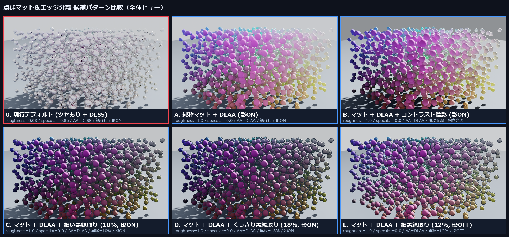

### 1-2. パターン `0`・`A`〜`E` 中央部 3倍拡大クローズアップ
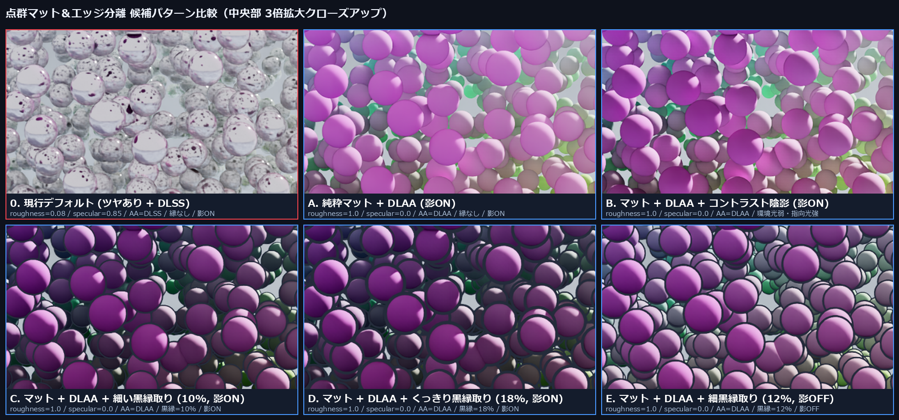

### 1-3. 拡散反射ありマット（`E`） vs 全反射ゼロ完全フラット（`F1`〜`F3`） 3倍拡大比較
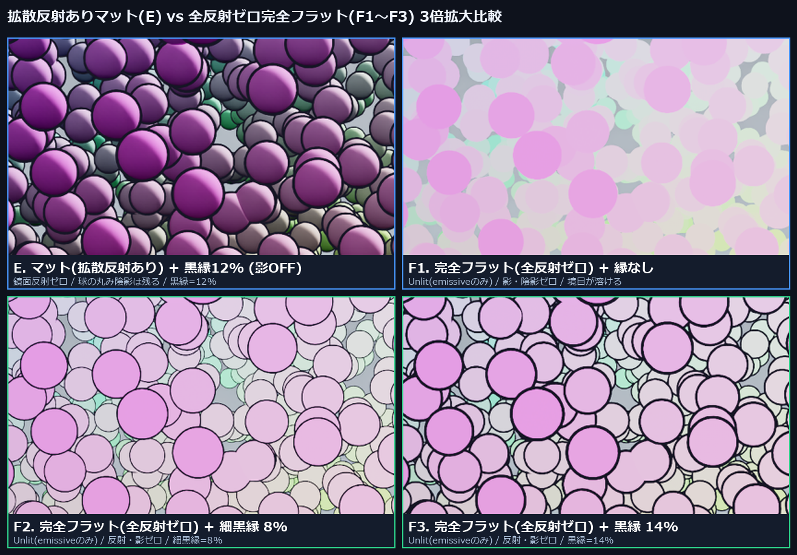

---

## 2. 全9パターン パラメータ対応表

| パターンID | 見た目の特徴 | `unlit` | `glossy` | `roughness` | `metallic` | `specular_level` | `outline_thickness` | `cast_shadows` | `anti_aliasing` | 備考（ライト調整） |
| :--- | :--- | :---: | :---: | :---: | :---: | :---: | :---: | :---: | :---: | :--- |
| **`F2`（既定）** | 全反射ゼロ・細黒縁 8%・影なし | `True` | `False` | — | `0.0` | `0.0` | `0.08` | `False` | `"DLAA"` | 既定引数そのまま |
| **`F1`** | 全反射ゼロ・縁なし・影なし | `True` | `False` | — | `0.0` | `0.0` | `0.0` | `False` | `"DLAA"` | 縁なし（同系色は溶ける） |
| **`F3`** | 全反射ゼロ・黒縁 14%・影なし | `True` | `False` | — | `0.0` | `0.0` | `0.14` | `False` | `"DLAA"` | `F2` より太い黒縁 |
| **`E`** | 拡散反射マット・黒縁 12%・影なし | `False` | `False` | `1.0` | `0.0` | `0.0` | `0.12` | `False` | `"DLAA"` | 球表面の丸み陰影あり |
| **`C`** | 拡散反射マット・細黒縁 10%・影あり | `False` | `False` | `1.0` | `0.0` | `0.0` | `0.10` | `True` | `"DLAA"` | 立体感＋細エッジ |
| **`D`** | 拡散反射マット・黒縁 18%・影あり | `False` | `False` | `1.0` | `0.0` | `0.0` | `0.18` | `True` | `"DLAA"` | 強い黒縁＋影あり |
| **`A`** | 純粋マット・縁なし・影あり | `False` | `False` | `1.0` | `0.0` | `0.0` | `0.0` | `True` | `"DLAA"` | 追加殻なし（軽量） |
| **`B`** | 純粋マット・コントラスト照明・影あり | `False` | `False` | `1.0` | `0.0` | `0.0` | `0.0` | `True` | `"DLAA"` | `DomeLight=140`, `KeyLight=3600` |
| **`0`（旧既定）** | ツヤあり鏡面反射・縁なし・影あり | `False` | `True` | `0.08` | `0.12` | `0.85` | `0.0` | `True` | `"DLSS"` | 鏡面反射＋DLSS |

---

## 3. 各パターンの単体画像と設定コード

すべての例で `pointcloud_api.py` の `create_pointcloud()` を使用しています。`method` は `"octree_lod"` / `"usd_points"` / `"point_instancer"` / `"hybrid_compute_rtx"` / `"naive_spheres"` のいずれでも同じ引数で指定できます。

### パターン `F2`（既定値）：全反射ゼロ完全フラット ＋ 細黒縁 8% ＋ DLAA ＋ 影OFF

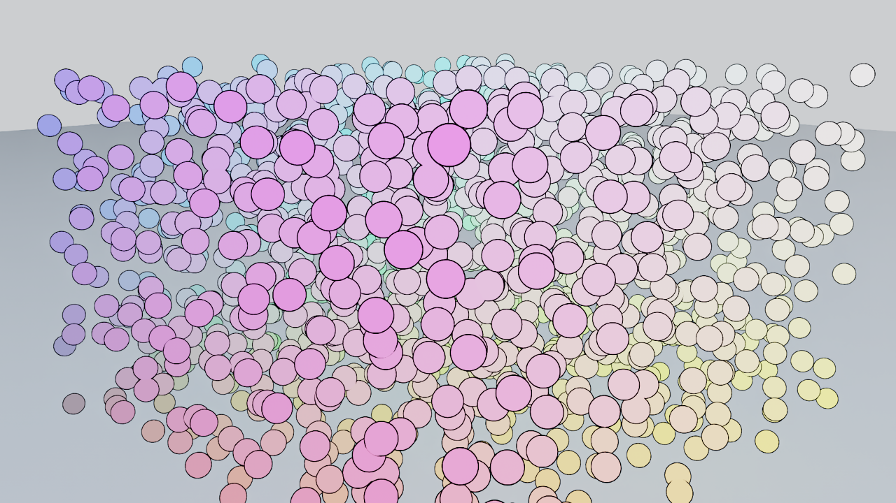

```python
from pointcloud_api import create_pointcloud

# 既定値が F2 のため、見た目オプションを省略するだけでこの見た目になる
pc = create_pointcloud(
    stage,
    positions=pts_np,
    colors=rgb_np,
    method="usd_points",
    point_radius=0.036,
)

# 明示的に指定する場合（既定値と同一）:
# pc = create_pointcloud(
#     stage, positions=pts_np, colors=rgb_np, method="usd_points", point_radius=0.036,
#     unlit=True, outline_thickness=0.08, anti_aliasing="DLAA", cast_shadows=False,
# )
```

---

### パターン `F1`：全反射ゼロ完全フラット ＋ 縁なし ＋ DLAA ＋ 影OFF

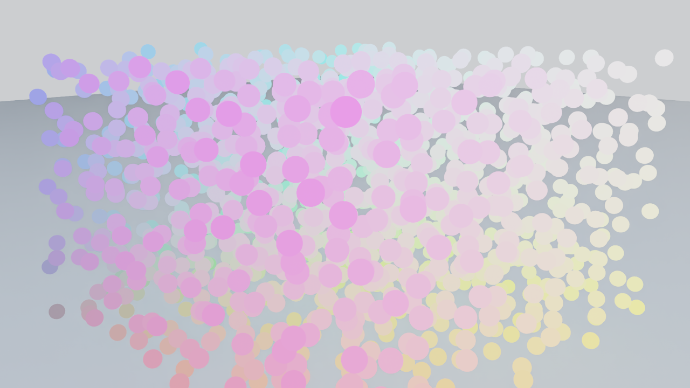

```python
pc = create_pointcloud(
    stage,
    positions=pts_np,
    colors=rgb_np,
    method="usd_points",
    point_radius=0.036,
    unlit=True,
    outline_thickness=0.0,
    anti_aliasing="DLAA",
    cast_shadows=False,
)
```

---

### パターン `F3`：全反射ゼロ完全フラット ＋ 黒縁 14% ＋ DLAA ＋ 影OFF

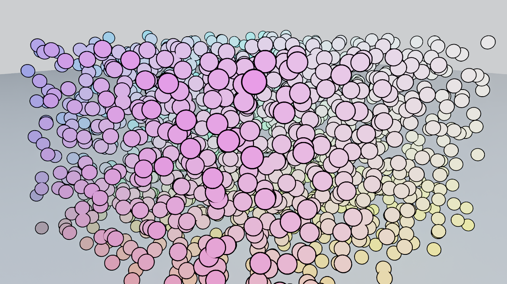

```python
pc = create_pointcloud(
    stage,
    positions=pts_np,
    colors=rgb_np,
    method="usd_points",
    point_radius=0.036,
    unlit=True,
    outline_thickness=0.14,
    anti_aliasing="DLAA",
    cast_shadows=False,
)
```

---

### パターン `E`：拡散反射マット ＋ 細黒縁 12% ＋ DLAA ＋ 影OFF

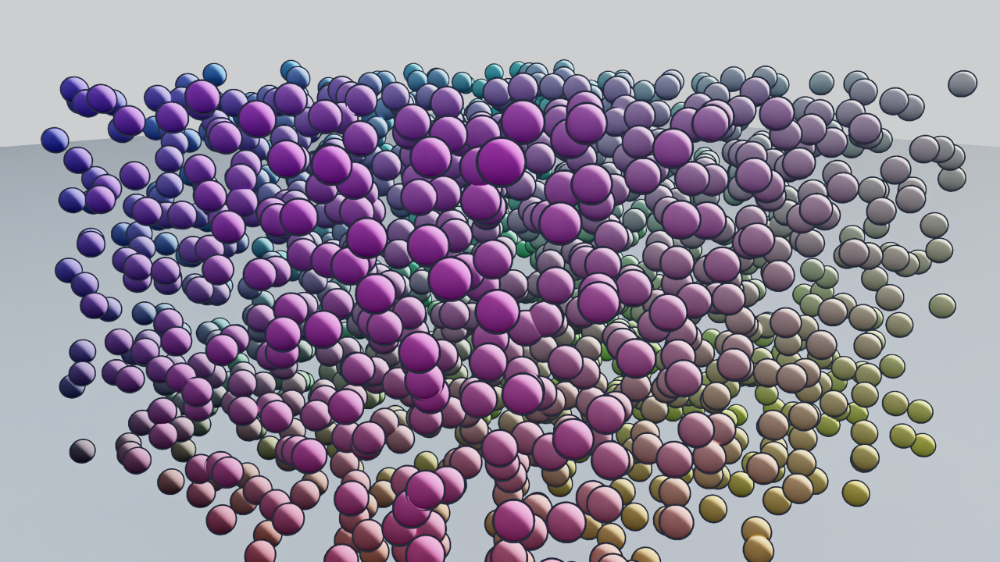

```python
pc = create_pointcloud(
    stage,
    positions=pts_np,
    colors=rgb_np,
    method="usd_points",
    point_radius=0.036,
    unlit=False,
    glossy=False,
    roughness=1.0,
    metallic=0.0,
    specular_level=0.0,
    outline_thickness=0.12,
    anti_aliasing="DLAA",
    cast_shadows=False,
)
```

---

### パターン `C`：拡散反射マット ＋ 細黒縁 10% ＋ DLAA ＋ 影ON

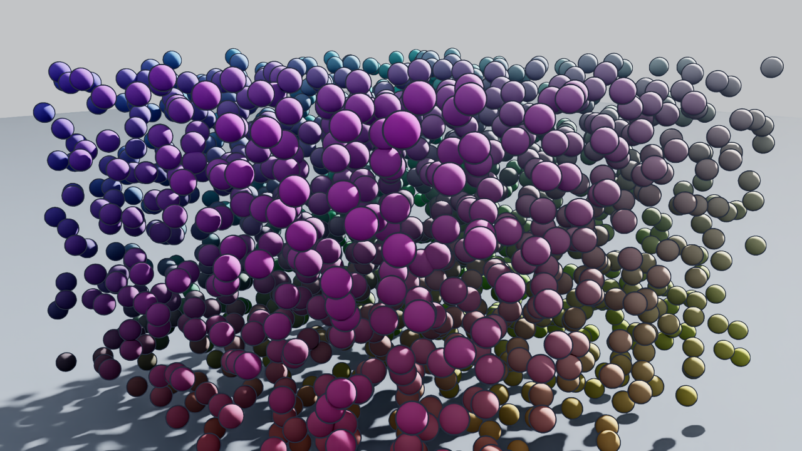

```python
pc = create_pointcloud(
    stage,
    positions=pts_np,
    colors=rgb_np,
    method="usd_points",
    point_radius=0.036,
    unlit=False,
    glossy=False,
    roughness=1.0,
    metallic=0.0,
    specular_level=0.0,
    outline_thickness=0.10,
    anti_aliasing="DLAA",
    cast_shadows=True,
)
```

---

### パターン `D`：拡散反射マット ＋ くっきり黒縁 18% ＋ DLAA ＋ 影ON

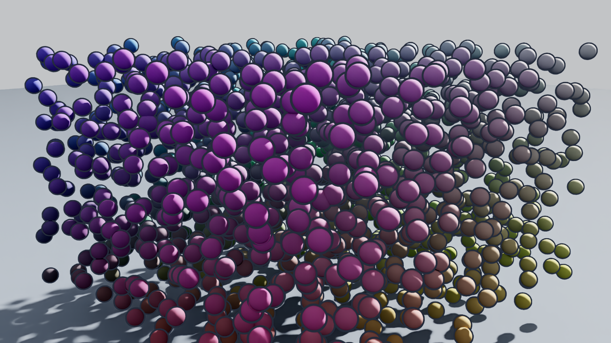

```python
pc = create_pointcloud(
    stage,
    positions=pts_np,
    colors=rgb_np,
    method="usd_points",
    point_radius=0.036,
    unlit=False,
    glossy=False,
    roughness=1.0,
    metallic=0.0,
    specular_level=0.0,
    outline_thickness=0.18,
    anti_aliasing="DLAA",
    cast_shadows=True,
)
```

---

### パターン `A`：純粋マット ＋ 縁なし ＋ DLAA ＋ 影ON

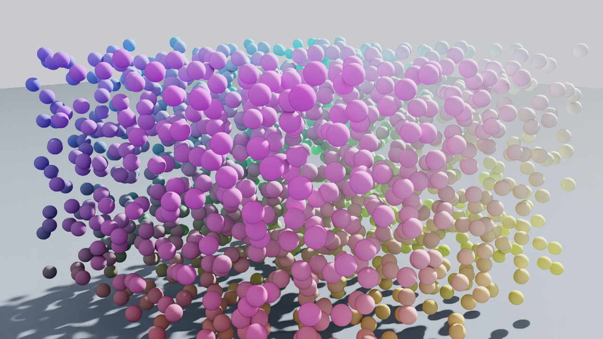

```python
pc = create_pointcloud(
    stage,
    positions=pts_np,
    colors=rgb_np,
    method="usd_points",
    point_radius=0.036,
    unlit=False,
    glossy=False,
    roughness=1.0,
    metallic=0.0,
    specular_level=0.0,
    outline_thickness=0.0,
    anti_aliasing="DLAA",
    cast_shadows=True,
)
```

---

### パターン `B`：純粋マット ＋ コントラスト陰影照明 ＋ DLAA ＋ 影ON

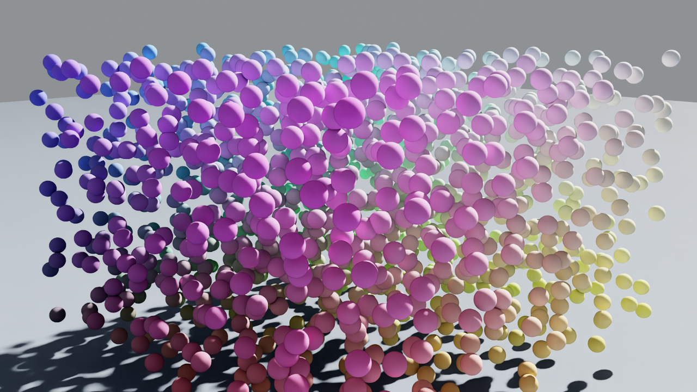

```python
from pxr import UsdLux

pc = create_pointcloud(
    stage,
    positions=pts_np,
    colors=rgb_np,
    method="usd_points",
    point_radius=0.036,
    unlit=False,
    glossy=False,
    roughness=1.0,
    metallic=0.0,
    specular_level=0.0,
    outline_thickness=0.0,
    anti_aliasing="DLAA",
    cast_shadows=True,
)

# 環境光を抑えて指向光を強めることで球表面の陰影コントラストを強調
UsdLux.DomeLight(stage.GetPrimAtPath("/World/DomeLight")).GetIntensityAttr().Set(140.0)
UsdLux.DistantLight(stage.GetPrimAtPath("/World/KeyLight")).GetIntensityAttr().Set(3600.0)
```

---

### パターン `0`（比較ベースライン・旧既定）：ツヤあり鏡面反射 ＋ 縁なし ＋ DLSS ＋ 影ON

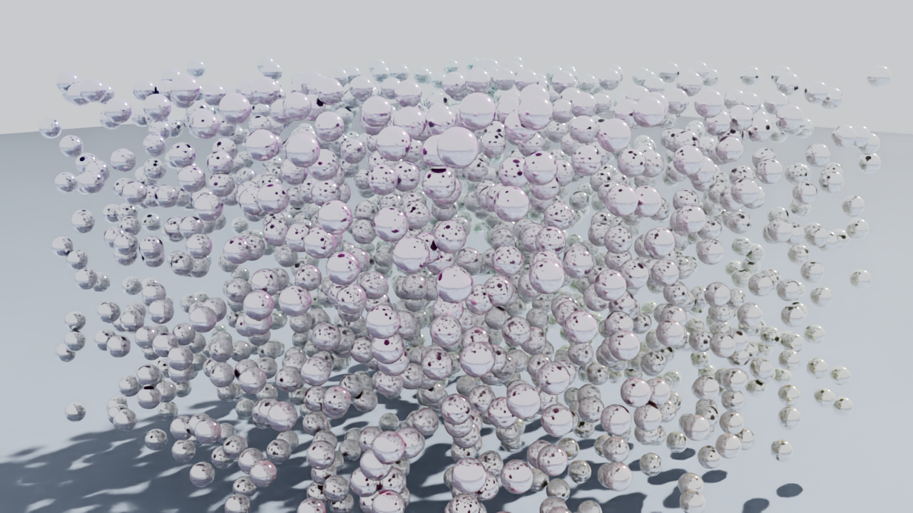

```python
pc = create_pointcloud(
    stage,
    positions=pts_np,
    colors=rgb_np,
    method="usd_points",
    point_radius=0.036,
    unlit=False,
    glossy=True,
    roughness=0.08,
    metallic=0.12,
    specular_level=0.85,
    outline_thickness=0.0,
    anti_aliasing="DLSS",
    cast_shadows=True,
)
```

---

## 4. 実行中セッターによるリアルタイム切替リファレンス

点群を生成した後も、再生成せずに見た目だけを変更できます。

```python
# 反射モードの切替
pc.set_appearance(unlit=True)                                                          # 全反射ゼロ（F1〜F3）
pc.set_appearance(unlit=False, glossy=False, roughness=1.0, metallic=0.0, specular_level=0.0)  # 拡散マット（A〜E）
pc.set_appearance(unlit=False, glossy=True, roughness=0.08, metallic=0.12, specular_level=0.85) # ツヤあり（0）

# 黒縁取り（Inverted Hull）の太さ・色切替
pc.set_outline(0.08)                         # 細黒縁 8%（F2 既定）
pc.set_outline(0.14)                         # くっきり黒縁 14%（F3）
pc.set_outline(0.0)                          # 黒縁取り OFF（F1 / A / B / 0）
pc.set_outline(0.10, color=(0.05, 0.05, 0.1)) # 縁取り色の変更

# アンチエイリアス・影・半径・色・位置の切替
pc.set_anti_aliasing("DLAA")                 # "DLAA" (4) または "DLSS" (3)
pc.set_cast_shadows(False)                   # True=影あり / False=影なし
pc.set_point_radius(0.050)                   # 球半径 [m]（黒縁取りも連動してスケーリング）
pc.set_colors((0.18, 0.85, 0.55))            # 単色または (N, 3) 配列
pc.set_world_offset((0.0, 0.0, 0.5))         # 点群全体の移動（黒縁取りも連動）
```
