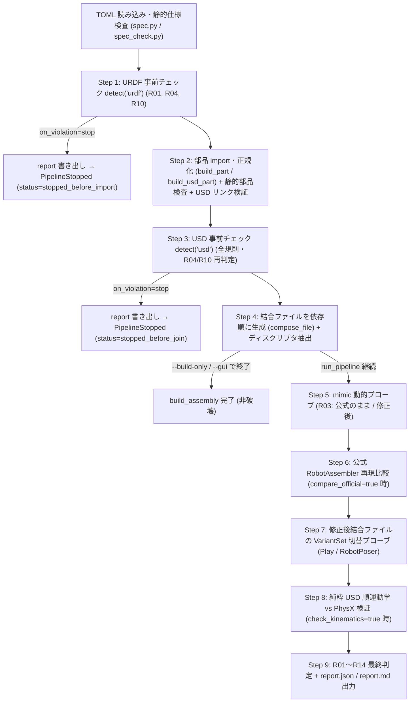

# myext.robot.assembly_pipeline.v2 内部仕様書

対象バージョン: Isaac Sim 6.2.0（URDF Importer 3.11.12 / Robot Assembler 3.3.9）

この仕様書は `myext.robot.assembly_pipeline.v2` の用語定義、内部処理フロー、変更検知とキャッシュの仕組み、USD レイヤー構造、規則 R01〜R14 の判定ロジック、動的プローブ・順運動学検証の計算式を記録する正本です。
概要の把握や TOML の書き方・コマンドの手作業手順は [README.md](./README.md) を参照してください。

---

## 目次

1. [用語集](#用語集)
2. [処理フロー（Step 1〜9）](#処理フローstep-19)
3. [変更検知・キャッシュ・冪等性の仕組み](#変更検知キャッシュ冪等性の仕組み)
4. [USD レイヤー構造と「結合の中身（7 つの書き込み）」](#usd-レイヤー構造と結合の中身7-つの書き込み)
5. [構成要素とディスクリプタ（AssembledRobotDescriptor）](#構成要素とディスクリプタassembledrobotdescriptor)
6. [規則 R01〜R14 と最終判定の仕様](#規則-r01r14-と最終判定の仕様)
7. [動的プローブと順運動学検証の仕組み](#動的プローブと順運動学検証の仕組み)
8. [出力ファイル一覧と JSON 構造](#出力ファイル一覧と-json-構造)
9. [TOML JSON Schema の同期仕組み](#toml-json-schema-の同期仕組み)
10. [既知の制約](#既知の制約)

---

## 用語集

本拡張およびドキュメント全体で、以下の用語を記載の意味に統一して使用します。

### 基本用語（ファイル・結合・比較）

| 用語 | 意味 |
|---|---|
| usda | `defaultPrim` を持つ USD ファイル。部品 usda または結合ファイルを指す。TOML 内でもログでも常にファイル名（`arm.usda` のように拡張子 `.usda` まで）で識別する（TOML のキー名 `usda` は「出力するファイル名」を表す） |
| 部品 usda | `[[urdf_to_usda]]` または `[[usd_to_usda]]` から生成する単一部品の usda。生成物 USD や既存 USD を直接編集せず、正規化層として `<output_dir>/<usda>` に出力する |
| 正規化層 | URDF Importer の生成物または既存 USD アセットを Reference し、`over` だけで `Physics` variant 選択（R06）と mimic follower の drive ゼロ化（R03）を適用した薄い `.usda` レイヤー |
| 結合 | 子の usda を、親の usda のリンクに固定する 1 回の操作。具体的な USD 書き込みは [結合の中身（7 つの書き込み）](#結合の中身7-つの書き込み) の 7 段階で構成される |
| 結合ファイル | 親の usda に 1 回以上の結合を書き込んだ、新しい usda（`[[join_file]]` の出力）。次の結合の親（`parent_usda`）にも子（`child_usda`）にもできる |
| 一番上の prim | usda の `defaultPrim`。名前は usda のファイル名の `.usda` より前（`robot.usda` なら `/robot`） |
| 一番上の部品 | usda の一番上の prim の中身を作ったリーフ入力（`[[urdf_to_usda]]` または `[[usd_to_usda]]`）。結合ファイルの場合は `parent_usda` をリーフまで再帰的にたどって行き着いた入力 |
| 一番上の URDF | 一番上の部品が URDF 由来である場合の URDF ファイル（一番上の部品が `[[usd_to_usda]]` の場合は存在しない） |
| 公式のまま | URDF Importer の出力を Isaac Sim 公式の `RobotAssembler` でそのまま結合した状態。比較用にパイプライン内部で再現して実測する |
| 修正後 | 本パイプラインが出力した部品 usda・結合ファイル |
| 修正 | 既知の不具合を回避するために本パイプラインが適用する補正。規則ごとに `[checks.rules.<規則>]` の `fix = "skip"` で解除できる（一部規則を除く） |
| 非破壊ビルド | `build_assembly` が実行する Step 1〜4 の処理。アクティブなグローバル USD Stage や Timeline を一切変更せず、部品 usda・結合ファイルの生成とディスクリプタ抽出だけを行う |

### 物理・USD・検証用語

| 用語 | 意味 |
|---|---|
| 剛体 | 物理で動く物体（`UsdPhysics.RigidBodyAPI` が付いた prim）。URDF のリンクはゴーストリンクを除いて剛体になる |
| ゴーストリンク | URDF 上で visual・collision が無く、かつ inertial が無いか質量が 0 の空リンク。URDF Importer で剛体にならない |
| joint の body の解決 | joint の `body0`・`body1` が指す prim から祖先へたどり、最初に見つかった剛体をその側の物体とする（剛体が無ければ最初に見つかったコライダー）。`body` が空のとき、またはたどっても見つからないときは、その側を**ワールド**（動かない空間）とする。PhysX と同一の解決規則 |
| ワールド固定 joint | `joint の body の解決` において、片側が剛体・もう片側がワールドになる joint。URDF Importer が生成する `root_joint` は `body0` に一番上の prim（剛体ではない）、`body1` にルートリンクを書くため、`body0` 側がワールドに解決される。`body0`・`body1` が空の joint だけを指すのではない |
| 子の外につながる joint | 結合で子を置いた後、子の prim 配下にある joint のうち、`joint の body の解決` で片側だけが子の中の剛体になる joint（もう片側はワールド、または子の外の剛体）。子の中のワールド固定 joint は、子を剛体の子に置くとワールド側が親の剛体に解決されてこれに該当する |
| 剛体の子に置く | 子を置く prim（`place_child_under` で決まる prim）自身か、その祖先のいずれかが剛体であること。既定の置き場所（`parent_link` の prim）はリンク階層が入れ子になるため通常は剛体の子に置くことになる。`place_child_under = "."`（一番上の prim）は自身も祖先も剛体ではないため剛体の子に置かない |
| 子のルートリンク | 子の usda の一番上の URDF における木の根のリンク。子が結合ファイルであっても、その中で結合した別の子部品のリンクは含まない |
| 浮遊ベース | `fix_base = false` 等によりワールド固定 joint を持たず、空間を自由に動けるベース（移動ロボット・ヒューマノイド等） |
| Articulation Root | 関節でつながった剛体の集まり（Articulation）の根を示す API（`UsdPhysics.ArticulationRootAPI` / `NewtonArticulationRootAPI` / `PhysxArticulationAPI` 等）。1 つの Articulation につき 1 か所だけにする |
| mimic の leader / follower | URDF の `<mimic>` 関係。follower 関節は leader 関節の位置に比例して追従する |
| 結合面 | 結合で一致させる 2 つのリンク（`parent_link` と `child_link`）の座標系（`offset_xyz` / `offset_rpy` を含む） |
| teleport | 物理ステップを回さず、関節値から各リンクの位置を直接書き換える操作（`RobotPoser` の `apply_joint_state` が Stop 中に行う） |
| 構成要素 | 組み立て済みロボットを構成する部品単位（`components`）。結合ファイルのルート prim 自身、および `IsaacRobotAPI` を持つ子 prim・メタデータから識別される |
| ディスクリプタ | `AssembledRobotDescriptor`。組み立て済みロボットの `prim_path`・`components`・`articulation_root_path`・`link_prim_paths`・`joint_prim_paths`・`variant_sets` を保持する外部連携用の不変レコード |
| manifest ファイル | `<output_dir>/_import/<stem>.manifest.json`。URDF 再 import の要否判定に使う SHA-256 ハッシュと生成物 USD パスを記録する JSON |
| ステージング領域 | `<output_dir>/.staging/<stem>/`。R13 対策で URDF Importer の出力を一時的に受け、完了後に `<output_dir>/_import/<stem>/` を丸ごと置換するための一時フォルダ |
| 判定 / 症状 / 最終判定 | 判定 = 事前チェック（`detect`）で「公式のままだとこの問題が起きる」と予測した結果（`Finding`）。症状 = 実際に測定した結果（`Side`）。最終判定 = 判定と公式のまま・修正後の症状から決める結論（`Outcome.verdict`） |

---

## 処理フロー（Step 1〜9）

パイプラインは `pipeline.py` の 2 つの公開エントリに分かれます。

- `build_assembly(spec)`（非破壊ビルド）: Step 1〜4 のみ実行。`--build-only` と `--gui` が使用する。
- `run_pipeline(spec)`（フル検証）: 内部で `build_assembly(spec, check_idempotency=True)` を呼んだ後、Step 5〜9 を実行して `report.json` / `report.md` を出力する。

### 各ステップの責務

| ステップ | 実装モジュール | 実行内容 |
|---|---|---|
| 事前検証 | `spec.py`, `spec_check.py` | TOML キー検証、usda 重複・Windows 大文字小文字衝突、結合 DAG 循環検出、URDF リンク名・VariantSet 選択の静的検証（Isaac Sim 不要） |
| Step 1 | `rules.py` | URDF XML のみで判定可能な規則（R01・R04・R10）を判定。`on_violation = "stop"` 該当時は `stopped_before_import` で停止 |
| Step 2 | `part_import.py`, `probes.py`, `pipeline.py` | URDF のハッシュキャッシュ判定と import、正規化層 `<output_dir>/<usda>` の生成、`reload_layers_under`、`static_part` 静的検査、`[[usd_to_usda]]` 対象のリンク・VariantSet 実在確認（`_validate_usd_links`） |
| Step 3 | `rules.py` | import 後の静的情報を用いて全規則を判定（R04・R10 は確定した `collision_from_visuals` で再判定して上書き）。`on_violation = "stop"` 該当時は `stopped_before_join` で停止 |
| Step 4 | `compose.py`, `descriptor.py` | `spec.file_order()` のトポロジカル順に結合ファイルを生成。`check_idempotency=True` 時は各ファイルを 2 回生成し 2 回目の変更有無を `recompose_changed` に記録。各結合ファイルから `AssembledRobotDescriptor` を抽出 |
| Step 5 | `probes.py` | mimic を持つ URDF / USD 部品について、公式生成物と正規化層の両方で柔らかい drive による mimic 追従を測定 |
| Step 6 | `official.py`, `probes.py` | `compare_official = true` のとき、各結合（リンク名に `/` が無く一番上の URDF 間の結合）を公式 `RobotAssembler` で再現して Play / RobotPoser / 2 回結合（R14）を測定 |
| Step 7 | `probes.py`, `runtime.py` | 各結合ファイルについて、`_selections()` で求めた最小カバー VariantSet 選択ごとに使い捨てステージで Play・接触・閉ループログ・RobotPoser teleport を測定 |
| Step 8 | `kinematics_check.py` | `check_kinematics = true` のとき、各結合ファイル（既定の VariantSet 選択）の純粋 USD 順運動学と PhysX `ArticulationView` のリンク位置・DOF 名を突き合わせる |
| Step 9 | `rules.py`, `report.py` | R01〜R14 の `Outcome` を確定し、前回の `report.json` があれば `report_previous.json` へ退避して差分を算出し、`report.json` と `report.md` を書き出す |

---

## 変更検知・キャッシュ・冪等性の仕組み

本パイプラインの変更検知は、対象ファイルの役割に応じた **3 層構造** になっています。

### 層 1: URDF Importer の再実行判定（manifest ファイルの SHA-256 ハッシュ）

重い URDF Importer の再実行を避けるため、`part_import.py` の `build_part()` は部品ごとに **manifest ファイル** `<output_dir>/_import/<stem>.manifest.json` を使って変更検知を行います。

1. **ハッシュの計算対象（`input_hash()`）**:
   以下の項目を `json.dumps(payload, sort_keys=True)` で正規化し、SHA-256（16 進 64 文字）を算出します。

   | ペイロードキー | 内容 |
   |---|---|
   | `urdf` | 入力 URDF ファイル本文の SHA-256（`model.text_sha256`） |
   | `meshes` | URDF が参照する全メッシュファイルの `{basename: SHA-256}`（存在しないファイルは `<missing>` のハッシュ） |
   | `cfv` | 実効の `collision_from_visuals`（`bool`。省略時は `not model.has_collisions()`） |
   | `collision_type` | 衝突近似形状の文字列 |
   | `ros` | 解決済み `ros_package_paths` のリスト |
   | `stiffness` | `joint_drive_stiffness`（`float` または `null`） |
   | `damping` | `joint_drive_damping`（`float` または `null`） |
   | `normalize` | `part_import.NORMALIZE_VERSION`（現在 `"1"`。正規化ロジック変更時にインクリメント） |
   | `importer` | 有効な `isaacsim.asset.importer.urdf` の拡張 ID（バージョン文字列込み） |
   | `fix_base` | `part.fix_base` が `None` 以外のときだけ追加（`bool`） |

2. **キャッシュ再利用条件**:
   manifest ファイルが存在し、以下の 2 条件を両方満たす場合だけ URDF Importer をスキップします（`PartBuild.imported = False`）。
   - `manifest["hash"] == digest`
   - `manifest["generated_usd"]` に記録されたファイルがディスク上に実在する

3. **不一致時の再 import とステージング置換（R13 対策）**:
   - 規則 R13 の修正が有効（既定）な場合、URDF Importer を空のステージング領域 `<output_dir>/.staging/<stem>/` へ実行し、完了後に `<output_dir>/_import/<stem>/` を削除して丸ごと移動置換します（Importer 既定の `<stem>_1` 連番フォルダ増殖を防止）。
   - 置換直後に `reload_layers_under()` で該当ディレクトリ配下の読み込み済み `Sdf.Layer` キャッシュを強制リロード（`layer.Reload(force=True)`）し、同一 Kit プロセス内で古いレイヤーが参照されるのを防ぎます。
   - manifest ファイルを `{"hash": digest, "generated_usd": generated, "stem": stem}` で更新します。

4. **`[[usd_to_usda]]` の扱い**:
   既存 USD アセット入力は URDF Importer を実行しないため、`_import/` および manifest ファイルを作成しません。変更検知は「層 2: 正規化 `.usda`・結合ファイル `.usda` の差分書き出し」で行われます。

### 層 2: 正規化 `.usda`・結合ファイル `.usda` の差分書き出し（テキスト完全一致）

部品 usda（`write_normalized` / `build_usd_part`）および結合ファイル（`compose_file`）は、manifest のハッシュではなく **毎回メモリ上で一から生成し、シリアライズ結果のテキストを既存ファイルと完全一致比較する** 方式（`usd_util.py` の `open_for_rewrite()` + `write_if_changed()`）を採用しています。

1. `open_for_rewrite(path)` で対象パスに対応する空の `Sdf.Layer` を準備する。
2. レイヤーを構築した後、`write_if_changed(layer, path)` が `layer.ExportToString()` とディスク上の既存ファイル全文（UTF-8）を比較する。
3. 1 文字も違いが無ければ `layer.Save()` を呼ばずに `False` を返す（ファイル内容・タイムスタンプ不変）。差分がある場合のみ保存して `True` を返す。
4. `run_pipeline()` では `check_idempotency=True` として各結合ファイルを 2 回連続で `compose_file()` し、2 回目が `changed == False` であることを R14（冪等性）の検証材料にします。

### 層 3: レポートの前回差分比較（`report_previous.json`）

`report.py` の `write_report()` は、出力先に既存の `report.json` がある場合に内容を `report_previous.json` へ退避し、今回と前回の `(rule, target)` ごとに `official.occurred` と `verdict` の変化を `changes_since_previous` に記録します。これにより Isaac Sim のアップデートで公式側の不具合が直ったタイミングを自動検出できます。

---

## USD レイヤー構造と「結合の中身（7 つの書き込み）」

### 部品 usda（正規化層）の構造

`<output_dir>/<usda>` は以下の構造を持ちます。

- `defaultPrim`: `/<stem>`（`Xform`。例: `arm.usda` → `/arm`）
- `upAxis` / `metersPerUnit`: 入力 USD（URDF Importer 生成物または既存 USD）から継承
- `Reference`: 出力ディレクトリ基準の相対パス（`./_import/arm/...` またはローカル相対パス、URI の場合はそのまま）で入力 USD を参照
- `customLayerData["myext.robot.assembly_pipeline.v2"]`: `normalize_version` と入力元識別情報
- `over` 書き込み:
  - `[[usd_to_usda]]` の `variant_selections` で指定した VariantSet 選択
  - R06 有効時: `Physics` VariantSet の明示選択（`[[usd_to_usda]]` で既に有効な選択がある場合は `keep_existing=True` で維持）
  - R03 有効時: `NewtonMimicAPI` または `PhysxMimicJointAPI` を持つ関節の `UsdPhysics.DriveAPI`（`angular` / `linear`）の `stiffness = 0.0`, `damping = 0.0`

### 結合ファイルのルート構造と `parent_prim_name`

`compose_file()` が `<output_dir>/<join_file.usda>` を生成するとき、親 `parent_usda` の配置方法は 2 通りあります。

1. **通常合成（`parent_prim_name` 未指定かつ VariantSet 衝突なし）**:
   - `/<usda stem>` に `parent_usda` を直接 Reference 合成する。
   - 例: `usda = "robot.usda"`, `parent_usda = "base.usda"` → `/robot/Geometry/...`（`base` という prim 名は消え `/robot` になる）。
2. **親ホルダー配置（`parent_prim_name` 指定時、または親の `defaultPrim` が結合側と同名の VariantSet を持つ場合）**:
   - `holder_name = parent_prim_name`（衝突による自動退避時は `parent_usda` の `.usda` より前）として、親を `/<usda stem>/<holder_name>` の 1 段下に Reference 配置する。
   - 例: `usda = "robot.usda"`, `parent_usda = "base.usda"`, `parent_prim_name = "base"` → Stage 上の階層は `/robot/base/...` となり、子・孫を結合すると `/robot/base/.../child/.../grandchild` のように一番親の部品名も prim 名・構成要素名として残る。
   - 親が `IsaacRobotAPI` を持つ場合、最上位 `/<usda stem>` にも `IsaacRobotAPI` を適用し、`isaac:physics:robotLinks` / `isaac:physics:robotJoints` に `/<usda stem>/<holder_name>` を登録する。

### 結合の中身（7 つの書き込み）

`compose.py` の `_join()` は、1 回の結合（`[[join_file.join]]`）につき以下の 7 段階の書き込みを順に実行します。

| 段階 | USD への書き込み内容 | 公式 `RobotAssembler` との差分（対応規則） |
|---|---|---|
| 1 | `place_child_under`（省略時は `parent_link` の prim）の子 `<配置先>/<child_prim_name>` に `child_usda` を Reference 配置する。配置先が `instanceable` なら解除する | 公式は配置先を選べず、`instanceable` な prim 配下では書き込み失敗する（R05） |
| 2 | 子の prim のローカル Transform を、`parent_link` 座標系（+ `offset_xyz` / `offset_rpy`）と `child_link` 座標系が一致する値に設定する（URDF 由来かつ R04 有効時は URDF 順運動学 `fk_zero` を使用、USD 部品または R04 skip 時は USD prim 姿勢を使用） | 公式は prim 位置だけで合わせるため末端リンクの座標ずれで結合面がずれる（R04）。offset 指定も無い |
| 3 | 親剛体と子剛体をつなぐ `UsdPhysics.FixedJoint` を固定パス `<子の prim>/JoinJoint` に 1 本作成する。`child_link` の prim に剛体が無ければ、fixed joint でつながる子孫の剛体へ接続する。なお子ツリーに剛体が 1 つも無い複合部品（例: バックパック）は固定関節を作らず親剛体配下の複合要素として扱う | 公式は再結合のたびに別名の固定関節が増殖する（R14）。子のリンクに剛体が無いと失敗する（R08） |
| 4 | 子の外につながる joint（[用語集](#用語集) 参照）を名前ではなく構造で探索し、すべて無効化する | 公式は `body0` または `body1` が空の joint しか無効化せず、`body0` に一番上の prim が書かれた `root_joint` が残る（R02・R09） |
| 5 | 子ツリー内の Articulation Root（`UsdPhysics.ArticulationRootAPI` / `NewtonArticulationRootAPI` / `PhysxArticulationAPI`）をすべて外す | 公式は `UsdPhysics` 側しか外さず、`NewtonArticulationRootAPI` 経由で Articulation Root が残る（R07） |
| 6 | 親の剛体と子の全剛体の組を `UsdPhysics.FilteredPairsAPI` に登録して衝突除外する | 公式は衝突除外を行わない（R11） |
| 7 | `JoinJoint` に `IsaacJointAPI` を付与し、結合ファイル最上位の `isaac:physics:robotLinks` / `isaac:physics:robotJoints` の**末尾**に子を追加し、無効化したワールド固定 joint を子の `robotJoints` から削除する | 公式は先頭に追加するため `RobotPoser` の木の根が子になり、さらに無効化済み joint も参照してしまう（R12） |

### VariantSet を使う結合の書き込みと選択復元

- `variant_set` を持つ結合は、「結合の中身（7 つの書き込み）」の段階 1〜7 をすべて結合ファイルの一番上の prim の `VariantEditContext` 内に書き込みます。
- 複数 `VariantSet` を持つ結合ファイル（例: `left_hand` / `right_hand` / `Thor`）で後続結合が親ステージの姿勢を読む際に他 VariantSet の編集状態が干渉しないよう、ループ開始前にすべての `VariantSet` と選択肢（自動追加の `"None"` を含む）を登録して既定選択（`variant_defaults` 優先、未指定時は先頭結合の `variant`）に揃え、各 `VariantEditContext` の `finally` で毎回既定選択へ戻します。

---

## 構成要素とディスクリプタ（`AssembledRobotDescriptor`）

### メタデータの二重保存

`compose_file()` は構成要素の相対パス辞書 `components_rel` を、以下の 2 か所に `CUSTOM_LAYER_KEY = "myext.robot.assembly_pipeline.v2"` として書き込みます。

1. `layer.customLayerData[CUSTOM_LAYER_KEY]`
2. `top_prim.customData[CUSTOM_LAYER_KEY]`

結合ファイルがさらに別のステージへ Reference 合成されると、`customLayerData` は合成先ルートレイヤーから直接見えなくなるため、`top_prim.customData` にも同じ辞書を保存することで多段 Reference 越しに構成要素を発見できるようにしています。

### `discover_components()` の 3 段階マージ

`descriptor.py` の `discover_components(stage, robot_prim_path, include_inactive_variants=True)` は以下の順序で構成要素マップ `{構成要素名: 絶対 prim パス}` を構築します。

1. **実測収集（最優先）**: `robot_prim_path` 配下を走査し、現在ステージ上で展開されている `IsaacRobotAPI` 付き prim を階層順に登録する。
2. **各構成要素 prim のメタデータ補完**（`include_inactive_variants=True` のとき）: 発見したルートおよび各構成要素 prim の `customData` と `primStack` 各レイヤーの `customLayerData` を強い意見から順に読み、現在 `"None"` 等で非展開の構成要素を `setdefault` で補う。
3. **ルートレイヤー補完**: 結合ファイルを直接 `Usd.Stage.Open` した場合に備え、`stage.GetRootLayer().customLayerData` からも補完する。

### 構成要素名とリンク置き換え接頭辞の違い

- **リンクの書き方の接頭辞**: 常に `[[join_file.join]]` の `name` を使う（例: `arm1/flange`）。
- **構成要素名（`components` のキー）**: `child_prim_name`（省略時は `name`）を階層順に `/` で連結した名前になる（例: `arm1`、`arm1/end_effector`。ルート自身は `display_name(root_prim)` で、子の名前にルート名は前置しない）。`parent_prim_name` を指定した場合は親も `<parent_prim_name>` として登録され、その配下の子は `<parent_prim_name>/<child_prim_name>` の階層になる。

---

## 規則 R01〜R14 と最終判定の仕様

### 全 14 規則の判定・実測・修正仕様

規則一覧は `kinds.py` の `RuleId` と `rules.py` の `RULES` で管理され、インポート時に完全一致をアサートします。

| ID | 対象種別 | 事前チェックフェーズ | 静的判定条件（`detect`） | 予想症状 | 実測対象（`symptom`） | `fix = "skip"` の挙動 |
|---|---|---|---|---|---|---|
| `R01` | 部品 | `urdf` | ルートリンクがゴーストリンク | ワールド固定 joint が `root_joint` という名前にならない | 生成物のワールド固定 joint 名 / 結合後の残留ワールド固定 joint | 独自修正なし（R02 の修正で解消。R02 の `fix` で切替） |
| `R02` | 結合 | `usd` | 子に `body0`・`body1` 両方が埋まったワールド固定 joint があり、子を剛体の子に置かない | 親の関節が動かない | 親関節の到達誤差・結合のずれ | 子の外につながる joint の無効化を外す |
| `R03` | 部品 (`部品:follower`) | `usd` | mimic follower の drive に `stiffness != 0` または `damping != 0` | leader が目標に届かない | 柔らかい drive で動かした leader 位置（10・30・60・最終ステップ）と mimic 誤差 | 正規化層での follower drive ゼロ化を外す |
| `R04` | 部品 | `urdf`（`usd` で再判定） | 子の形状が 1 つだけの末端リンク | リンク座標のずれ | prim と URDF 順運動学の差・結合面のずれ | 結合時の位置合わせを URDF 順運動学から USD prim 位置へ戻す |
| `R05` | 結合 | `usd` | 子を置く prim または子リンクが `instanceable` | 結合の失敗 | 結合の成否 | `instanceable` 解除を外す |
| `R06` | 部品 | `usd` | 出力 USD の `Physics` VariantSet が未選択 | 剛体も関節も無い | 剛体の数 | 正規化層での `Physics` variant 選択を外す |
| `R07` | 結合 | `usd` | 子に `NewtonArticulationRootAPI` がある | Articulation Root が残る | 結合後の子の Articulation Root 数 | 子の Articulation Root 削除を外す |
| `R08` | 結合 | `usd` | 子リンクの位置にも祖先にも剛体が無い | 結合の失敗 | 結合の成否・固定関節の子側剛体 | fixed 子孫剛体へのフォールバックを外す |
| `R09` | 結合 | `usd` | 子を剛体の子に置き、子に `body0`・`body1` 両方が埋まったワールド固定 joint がある | 閉ループのエラー | Play 中の `closed articulation` ログ件数 | 独自修正なし（R02 の修正で解消。R02 の `fix` で切替） |
| `R10` | 部品 | `urdf`（`usd` で再判定） | visual と collision が同一メッシュかつ `collision_from_visuals = false` | 衝突メッシュが見える | `purpose` が `guide` でなく visual と同一位置・大きさの collider | 修正なし（Asset Transformer rules 1.7.7 以降は公式のままでも起きないため測定のみ） |
| `R11` | 結合 | `usd` | 結合が存在するたびに必ず判定 | 子と親の接触 | Play 中の接触報告 | `FilteredPairsAPI` 登録を外す |
| `R12` | 結合 | `usd` | 子を剛体の子に置かない、または `child_link` が子のルートリンクでない | teleport で子が置いて行かれる | `RobotPoser` teleport 後の結合のずれ・親剛体の順運動学差 | `IsaacRobotAPI` / `robotJoints` 補正を外す |
| `R13` | 部品 | `usd` | import 開始時に `_import/<stem>/` が空でない | 別名（`_1`）フォルダへの出力 | 公式パス解決結果・実際の出力先 | `.staging/` 経由の置換を外し `_import/` へ直接出力 |
| `R14` | 結合 | `usd` | 結合が存在するたびに必ず判定 | やり直すと固定関節が増える | 公式 2 回結合後の本数 / 結合ファイルの固定関節本数と 2 回生成時の差分有無 | 外せない（常に `<子>/JoinJoint` を 1 本作成） |

### 最終判定（`Outcome.verdict`）の優先順位

`rules.py` の `_judge()` は、事前予測（`predicted`）・公式実測（`official.occurred`）・修正後実測（`fixed.occurred`）から以下の優先順位で `verdict` を決定します。

| 優先順位 | 条件 | `verdict` | 意味 | パイプライン状態 |
|---|---|---|---|---|
| 1 | `fixed.occurred is True` | `still_broken` | 修正後（または skip 出力）でも症状が発生 | `problems`（終了コード 1） |
| 2 | 予測あり かつ `official.occurred is True` | `fixed` | 公式のままで症状あり、修正後で解消 | `ok` |
| 3 | 予測あり かつ `official.occurred is False` | `upstream_fixed` | 公式のままでも症状なし（公式修正または形状非接触等） | `ok` |
| 4 | 予測なし かつ `official.occurred is True` | `unexpected` | 事前チェックで予測できなかった症状が公式のまま発生 | `problems`（終了コード 1） |
| 5 | 両方未測定、または予測ありかつ公式未測定 | `not_measured` | 結合不能または公式比較非対応（前置き付きリンク等）で未測定 | `ok` |
| 6 | 優先順位 1〜5 のいずれにも該当しない | `ok` | 予測なし・症状なし | `ok` |

---

## 動的プローブと順運動学検証の仕組み

### VariantSet 最小カバー集合（`_selections()`）

`pipeline.py` の Step 7 では、複数 VariantSet の全直積による組合せ爆発を避けるため、各結合ファイルに対して以下の最小カバー集合で測定します。

1. 全 VariantSet を既定選択のまま 1 回（`{}`）
2. 各 VariantSet の 2 番目以降の選択肢（`"None"` 除く）を 1 つずつ切り替え、他の VariantSet は既定のまま測定

### 関節目標値の算出式（`probes.py`）

Play プローブおよび `RobotPoser` プローブでは、mimic follower 関節と `excludeFromArticulation` 関節を除いた全可動関節を以下の目標値で駆動します。

- **回転関節（`revolute`）**:
  - 可動域 `[lower, upper]`（rad、有限かつ `upper > lower`）がある場合、両端 10% の安全マージンを引いた区間へ `revolute_target` をクランプする（`_clamp_revolute_target`）。
    $$m = 0.1 \times (\text{upper} - \text{lower}), \quad q_{\text{target}} = \operatorname{clip}(\text{revolute\_target},\; \text{lower} + m,\; \text{upper} - m)$$
  - これにより、`0` を含まない可動域（例: Franka `panda_joint4` の `[-3.0718, -0.0698] rad`）でも可動域外へはみ出さずに到達検証できます。
  - 可動域を持たない回転関節（`continuous` 等）は `revolute_target` をそのまま使います。
- **直動関節（`prismatic`）**:
  - 可動域 `[lower, upper]`（m、未定義時は `[0.0, 0.1] m`）に対して次式で算出します。
    $$q_{\text{target}} = \text{lower} + \text{prismatic\_ratio} \times (\text{upper} - \text{lower})$$

### 症状判定に使う許容誤差

- `angle_tol_deg`（既定 `1.0 deg`）: 回転関節の目標到達誤差、結合面の向きずれ、teleport 後の結合面の向きずれがこれより大きい場合に症状ありと判定（等しい場合は症状なし）。
- `length_tol_m`（既定 `0.001 m`）: 直動関節の目標到達誤差、結合面の位置ずれ、teleport 後の位置ずれ、順運動学と PhysX のリンク位置差がこれより大きい場合に症状ありと判定。

### mimic プローブ（R03）

`probe_mimic` / `probe_mimic_usd` は leader 関節に意図的に弱い drive（直動: `mimic_leader_stiffness_linear` / `mimic_leader_damping_linear`、回転: `mimic_leader_stiffness_angular` / `mimic_leader_damping_angular`）を与え、`mimic_steps`（既定 300）ステップ動かして 10・30・60 ステップ目と最終ステップで leader の到達と follower の追従誤差を測ります。follower に不要な drive が残っていると弱い leader が引きずられて目標に届かなくなるため、R03 の不具合を確実に検出できます。

### 純粋 USD 順運動学 vs PhysX 検証（`kinematics_check.py`）

外部の運動学ライブラリを使わず、OpenUSD の `UsdPhysics.Joint` と剛体ツリーのみから順運動学木（`_KinematicTree`）を構築し、ランダムな関節姿勢サンプル（可動域の 20%〜80%）を PhysX `ArticulationView` へ適用して全リンク姿勢を比較します。

- **浮遊ベース対応**: ワールド固定 joint を持たないロボットは無重力下での反動回転でベース自体が動くため、ワールド絶対位置ではなくルート剛体からの相対姿勢で誤差を計算します。
- **閉ループ機構対応**: `excludeFromArticulation` 関節やサイクル辺を含むロボット（例: Robotiq 2F-85 / 2F-140）では、PhysX が制約を解いた後の実測関節角 `av.get_dof_positions()` を使って順運動学を再計算して比較します。
- **mimic 符号規約**: `NewtonMimicAPI` と `PhysxMimicJointAPI` の符号規約の違いを内部で吸収して follower 関節角を算出します。

---

## 出力ファイル一覧と JSON 構造

`output_dir` 配下に生成されるファイルは以下のとおりです。

| パス | 生成元 | 内容 |
|---|---|---|
| `<output_dir>/<part>.usda` | `part_import.py` | 部品 usda（正規化層） |
| `<output_dir>/<join_file>.usda` | `compose.py` | 結合ファイル（単体で GUI / Stage から開ける） |
| `<output_dir>/_import/<stem>/` | `part_import.py` | URDF Importer の生成物（直接編集しない） |
| `<output_dir>/_import/<stem>.manifest.json` | `part_import.py` | URDF 再 import 判定用 manifest（`{"hash", "generated_usd", "stem"}`） |
| `<output_dir>/.staging/<stem>/` | `part_import.py` | R13 対策の一時 import 領域（置換完了後に削除） |
| `<output_dir>/report.json` | `report.py` | `run_pipeline` の構造化検証レポート |
| `<output_dir>/report.md` | `report.py` | `report.json` の人間向け Markdown 版 |
| `<output_dir>/report_previous.json` | `report.py` | 1 回前の `report.json` の退避コピー |

### `report.json` のトップレベルキー

- `status`: `"ok"` / `"problems"` / `"stopped_before_import"` / `"stopped_before_join"`
- `time`: 実行日時（`YYYY-MM-DD HH:MM:SS`）
- `findings`: 事前チェックの `Finding` 一覧
- `outcomes`: 規則 R01〜R14 の `Outcome` 一覧（`rule`, `title`, `target`, `predicted`, `reason`, `official`, `fixed`, `fix_mode`, `verdict`, `message`）
- `changes_since_previous`: `report_previous.json` からの変化一覧
- `spec_description`: `spec_check.describe()` のサマリ行
- `kinematics`（互換キー `geometric`）: 結合ファイルごとの順運動学 vs PhysX 検証結果
- `outputs`: 生成した全 usda の `{ファイル名: 絶対パス}`
- `descriptors`: 結合ファイルごとの `AssembledRobotDescriptor.to_dict()`
- `join_errors`: 結合時の例外メッセージ辞書
- `measurements`: `statics` / `mimic_official` / `mimic_fixed` / `official` / `fixed` / `official_reassemble` / `official_skip` / `official_join_errors`

---

## TOML JSON Schema の同期仕組み

- `schema.py` は外部ライブラリ非依存で `spec.py` のデータクラス群と `kinds.py` の `Literal` 列挙型から Draft-07 JSON Schema を生成します（`build_json_schema()` / `write_json_schema()`）。
- 出力先ファイルは [schema/assembly_pipeline.schema.json](../schema/assembly_pipeline.schema.json) で、[.taplo.toml](../.taplo.toml) および各サンプル TOML 先頭の `#:schema` ディレクティブから参照されます。
- `verify_schema_sync()` が `spec.py` の全フィールド集合・`kinds.py` の全列挙値とスキーマ JSON の完全一致を検査し、`tests_kit/run_tests.py` の Test 21（`test_toml_json_schema_sync_and_examples`）で毎回自動検証されます。
- `spec.py` や `kinds.py` を変更したときは `C:\isaacsim-6.2.0\tools\myext\run_sim.bat run_pipeline.py --export-schema` でスキーマ JSON を再生成します。

---

## 既知の制約

- `run_pipeline()` は Kit のフレーム更新と Timeline を自分で進めるため、GUI 起動済み Isaac Sim の Script Editor からは呼べません（CLI の headless 実行専用）。生成した `.usda` は GUI からそのまま開けます（または `--gui` モードで開けます）。
- `--check` と `--export-schema` は Isaac Sim を起動せずに動作します。
- 公式のまま（`RobotAssembler`）との比較は、親・子とも一番上の URDF のリンク同士の結合（リンク表記に `/` が無い結合）だけが対象です。前置き付きリンクや USD 入力のみの結合は `not_measured` になります。
- 修正後の動的プローブは最小カバー集合（既定選択 1 回 + 各 VariantSet の 2 番目以降の選択肢を 1 つずつ）のみ測定します。複数 VariantSet の全直積や、生成後に USD 上で手動切替した状態は自動測定しません。
- スケールの付いたリンクは想定していません（URDF から生成したリンクには通常付きません）。
- ロボットの質量・慣性・関節剛性が既定プローブ条件に合わない場合は、TOML の `[probe]` セクションで `drive_stiffness`・`drive_damping`・`steps`・許容誤差を調整してください。
