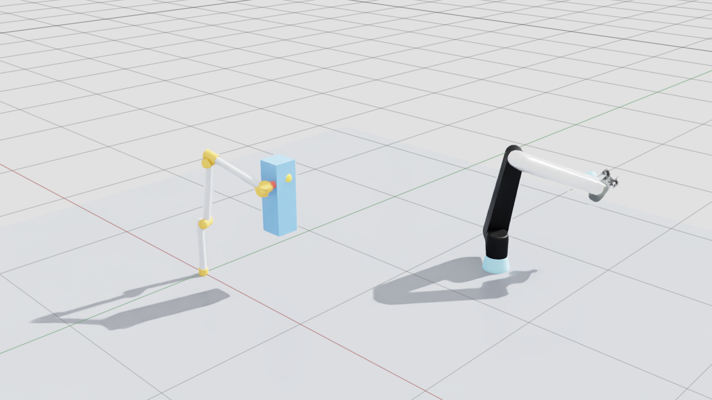

# MyExt Geometric Robot（myext.robot.geometric）

作成日：2026-11-16　対象：Isaac Sim 6.2.0

物理ソルバーも Drive も使わず、**関節値からリンクの Transform を計算して書く**ロボットの Python API。

- **Sublayer を付けると幾何モード、外すと元の Articulation 構成に戻る。** 元のロボットの USD は書き換えない。
- Collision は残る（CollisionAPI にも形状にも触らない）。Play していなくても干渉を調べられる。
- メソッド名・引数・単位は `isaacsim.core.experimental.prims.Articulation` に合わせてある。
- 既存の Articulation のほか、標準 DH・修正 DH・スクリュー軸・URDF からも作れる。mimic、IK（ソルバー差し替え可）、ロボットの結合に対応。
- UI は無い。Python から使う。

## すぐ試す

| やり方 | 手順 |
|---|---|
| デモ（単独で起動） | `try_geometric_robot.bat` をダブルクリック。または `C:\isaacsim-6.2.0\python.bat demo\demo_geometric_robot.py`。起動中の Isaac Sim とは別のウィンドウが開く |
| 起動中の Isaac Sim で | `demo\demo_script_editor.py` の中身を Script Editor に貼って実行する。**開いているステージは破棄される** |
| テスト | `powershell -ExecutionPolicy Bypass -File run_tests.ps1`（約 1 分） |

デモの画面（左：修正 DH から組んだアームが黄色の球を IK で追い、箱に当たったリンクが赤くなる。右：既存の Articulation を幾何モードで動かし、約 10 秒ごとに Sublayer を外して物理に戻す）：



## 使い方

### 既存の Articulation を幾何モードにする

```python
import omni.usd
from myext.robot.geometric import GeometricRobot

stage = omni.usd.get_context().get_stage()
robot = GeometricRobot.from_articulation(stage, "/World/Robot")   # Joint prim を読み、Sublayer を付ける
print(robot.dof_names)                                            # Play した Articulation と同じ名前・同じ並び

robot.set_dof_positions([0.1, -1.2, 1.0, 0.0, 0.5, 0.0])          # ラジアン。リンクの Transform が書かれる
robot.set_dof_positions([0.4], dof_indices=robot.get_dof_indices("elbow_joint"))
positions, quaternions = robot.get_link_world_poses()             # (num_links, 3), (num_links, 4) = (w, x, y, z)
print(robot.check_collisions())                                   # Play していなくても、いまの関節値で判定

robot.layer.remove()      # 元の Articulation 構成に戻る（Play すれば物理で動く）
robot.layer.apply()       # もう一度、幾何モードにする
robot.close()             # 後片付け（Sublayer も外す）
```

- つながり・関節の位置と軸・回転の正負・可動範囲・mimic は、Joint prim（`body0/1`、`localPos0/1`、`localRot0/1`、`axis`、`lowerLimit/upperLimit`、`PhysxMimicJointAPI` / `NewtonMimicAPI`）から読む。URDF は要らない。
- リンクの prim の親子関係は、リンクの親子関係と違っていてよい（全部兄弟でも、入れ子でも、混ざっていても）。

### パラメータから作る

```python
import numpy as np
from myext.robot.geometric import GeometricRobot, MDHParameters, MDHRow, DHParameters, DHRow, ScrewParameters, ScrewAxisRow

mdh = MDHParameters(rows=[MDHRow(alpha=0.0, a=0.0, theta=0.0, d=0.4), MDHRow(alpha=-np.pi / 2, a=0.05, theta=0.0, d=0.0)])
robot = GeometricRobot.from_mdh(stage, mdh, "/World/Arm")          # 簡易形状の prim を組む（Articulation も剛体も作らない）

GeometricRobot.from_dh(stage, DHParameters(rows=[DHRow(theta=0.0, d=0.3, a=0.2, alpha=0.0)]), "/World/Arm2")
GeometricRobot.from_screw(stage, ScrewParameters(rows=[ScrewAxisRow.through(point=(0, 0, 0.3), direction=(0, 1, 0))]), "/World/Arm3")
GeometricRobot.from_urdf(stage, r"C:\path\robot.urdf", "/World/Arm4")   # 運動学だけ読む。形は簡易形状
```

| 生成元 | データクラス | 中身 |
|---|---|---|
| 既存の Articulation | `UsdArticulationSource` | prim パス、構成要素の分け方、DOF の並びの指定など |
| 標準 DH | `DHParameters` / `DHRow` | 行ごとに (theta, d, a, alpha)。リンクの変換 = Rz(theta) Tz(d) Tx(a) Rx(alpha) |
| 修正 DH | `MDHParameters` / `MDHRow` | 行ごとに (alpha, a, theta, d)。リンクの変換 = Rx(alpha) Tx(a) Rz(theta) Tz(d) |
| スクリュー軸 | `ScrewParameters` / `ScrewAxisRow` | 根の座標系で表した軸 (direction, moment) と、関節値 0 のときの手先の姿勢 |
| URDF | `UrdfSource` | ファイルパス |

どれも `to_model()` で内部モデル `GeometricRobotModel`（リンクと関節の木。numpy だけで動く）になる。

### IK

```python
from myext.robot.geometric import IKSolverConfig

solver = robot.create_ik_solver("jacobian", base_link="link0", tip_link="tool")      # "ikpy" にすると IKPy を使う
result = robot.solve_ik(solver, target_position, target_orientation)                 # ワールド座標。成功したら関節値に反映
print(result.success, result.position_error)

solver.set_active_dofs(["joint1", "joint2", "joint3"])     # 使う軸を後から変える（名前でも bool の列でも）
solver.set_config(orientation_mode="none")                 # 位置だけ合わせる
solver = robot.create_ik_solver("jacobian", "link0", "tool", IKSolverConfig(active_dof_mask=[True, True, True, False, False, False]))
```

- ソルバーの共通インターフェースは `IKSolver`（`solve` / `set_active_dofs` / `get_active_dofs`）。自分のソルバーは `IKSolver` を継承して `register_ik_solver("名前", クラス)` で足す。
- ソルバーが相手にするのは `KinematicChain`（`robot.get_kinematic_chain(base, tip)`）だけで、Play の ON/OFF にも USD にも関係しない。
- **mimic は鎖の側で畳んである**：鎖の変数は独立な軸だけで、従動軸は式（従動 = 倍率 × 参照 + offset）で決まる。`"jacobian"` は鎖の途中に mimic があっても、制約を常に厳密に満たす解を返す。`"ikpy"` はその場合エラーにする（鎖の外の mimic は影響しない）。
- `"ikpy"` は初めて使うときに `ikpy` を import し、無ければ Kit の pip 機能で入れる（ネットワークが必要）。
- `chain.to_urdf(path)` / `robot.model.to_urdf(path)` で、運動学だけの URDF を書き出せる（ほかのソルバーに渡す用）。

### 干渉チェックと「範囲」

「自分自身との干渉」に固定の意味を持たせず、**呼んだ相手が持つリンク集合の内側**と決めてある。

```python
robot.check_collisions("within")         # このロボットのリンク同士
robot.check_collisions("environment")    # ロボット以外のコライダーと
robot.check_collisions("all")            # 両方
left = robot.get_component("left")       # 結合したロボットの構成要素
left.check_collisions("within")          # 左アームのリンク同士だけ（結合の前後で意味が変わらない）
robot.collision_checker.check_between(left.link_set, robot.get_component("right").link_set)
```

- 結果は `GeometricCollisionPair` の列。`kind` が `within_component`（同じ構成要素の中）/ `between_components`（構成要素の間）/ `between_robots` / `environment` で、`component_a` / `component_b` も入る。
- `scope` を省略すると、元の Articulation が `enabledSelfCollisions = false` なら `"environment"`、それ以外は `"all"`。
- 無視する組は `robot.collision_filter`（`GeometricCollisionFilter`）。関節でつながった隣同士（`reason="adjacent"`）と取り付け部（`"mount"`）は最初から入っている。

```python
f = robot.collision_filter
f.add_pair("link3", "link5", reason="常に近接")                 # 組を名指し
f.add_pattern("left/finger_*", "right/*", reason="指")           # 名前のパターン
f.add_rule(lambda a, b: a == "base" and b.startswith("wheel"))   # 関数
f.remove_pair("link1", "link2"); f.remove_by_reason("指")        # 外す
robot.check_collisions("within", extra_filter=lambda a, b: ...)  # この 1 回だけ追加で無視
robot.ignore_touching_pairs()    # いまの姿勢で重なっている組を全部「無視する組」に足す（簡易形状のロボット向け）
```

### ロボットの結合

```python
from myext.robot.geometric import GeometricRobotModel, GeometricLinkSpec
from myext.robot.geometric import transforms as tf

arm = mdh.to_model()
cart = GeometricRobotModel("cart", (GeometricLinkSpec("body"),), ())
both = cart.attach(arm, "body", tf.translation(y=0.25), name="left").attach(arm, "body", tf.translation(y=-0.25), name="right")
robot = GeometricRobot.from_model(stage, both, "/World/Dual")      # 名前は left/joint1, right/joint1, ...
```

結合済みの USD（ロボット同士が FixedJoint でつながっているもの）は、`from_articulation` でそのまま 1 本の木として読める。構成要素に分けるときは `UsdArticulationSource(path, components={"arm": "/World/Robot", "gripper": "/World/Robot/Gripper"})`。

### 複数台をまとめる

```python
from myext.robot.geometric import GeometricRobotView

view = GeometricRobotView.from_articulations(stage, ["/World/Robot0", "/World/Robot1", "/World/Robot2"])
view.set_dof_positions(positions)                                   # (台数, num_dofs)
view.set_dof_positions([[0.5]], indices=[1], dof_indices=[2])       # Articulation と同じ引数
view.get_dof_positions().numpy()                                    # 戻り値は wp.array
```

順運動学は全台をまとめて 1 回で計算し、Transform の書き込みも全台分を 1 回で行う。

## Articulation との対応

| Articulation | GeometricRobot / GeometricRobotView | 備考 |
|---|---|---|
| `num_dofs` `dof_names` `dof_paths` `dof_types` | 同名 | 並びは Play した Articulation と同じ（下の「確かめたこと」） |
| `num_joints` `joint_names` `joint_paths` `joint_types` | 同名 | |
| `num_links` `link_names` `link_paths` | 同名 | 同名リンクの 2 個目以降は `_0`, `_1`, ... |
| `get_dof_indices` `get_joint_indices` `get_link_indices` | 同名 | |
| `set_dof_positions` `get_dof_positions` | 同名 | 書いた時点でリンクの Transform を更新 |
| `set_dof_position_targets` `get_dof_position_targets` | 同名 | `set_dof_positions` と同じ動作（移し替え用の別名） |
| `get_dof_limits` `set_dof_limits` | 同名 | `(下限, 上限)` |
| `get_world_poses` `set_world_poses` `get_local_poses` `set_local_poses` | 同名 | 根リンクの姿勢 |
| `get_jacobian_matrices` | 同名 | 形は (num_links, 6, num_dofs)。行は [速度 3; 角速度 3] |
| `set_default_state` `get_default_state` `reset_to_default_state` | 同名 | 位置・向き・関節値だけ |
| （無い） | `get_link_world_poses` `get_link_local_poses` `get_link_world_matrices` | 追加 |
| 速度・力・ゲイン・質量・ソルバー設定の類 | 無い | 呼ぶと `AttributeError` |

`GeometricRobot` は 1 台用で、配列は `(num_dofs,)` の numpy、`indices=` 引数は無い。`GeometricRobotView` は配列の形 `(台数, num_dofs)`・`indices=` / `dof_indices=`・戻り値 `wp.array` まで Articulation と同じ。

## 設定

`config/extension.toml` の既定値。起動引数（`--/exts/myext.robot.geometric/write_target=usd` など）や、コンストラクタの引数でも変えられる。

| 設定 | 値 | 意味 |
|---|---|---|
| `layer_target` | **`session`** / `root` | Sublayer を差し込む場所。`session` は保存しても元ファイルに混ざらない。`root` は `root_layer_file` に Sublayer のファイルパスが必要 |
| `collision_mode` | **`static`** / `kinematic` | `static`：リンクを静的コライダーにする（Play しなくても干渉を調べられる）。`kinematic`：kinematic 剛体にする（Play 中に Contact Report が使える） |
| `write_target` | **`fabric`** / `usd` / `both` | リンクの姿勢の書き込み先。`fabric`：Fabric に書く（干渉チェックの直前だけ USD にも書く）。`usd`：毎回 USD（Sublayer）に書く |

```python
from myext.robot.geometric import GeometricLayerOptions

robot = GeometricRobot.from_articulation(stage, "/World/Robot", write_target="usd", layer_options=GeometricLayerOptions(collision_mode="kinematic"))
```

## 仕組み

### Sublayer に書くもの

| 対象 | 上書き |
|---|---|
| ArticulationRoot の prim | `physxArticulation:articulationEnabled = false` |
| 各 Joint | `physics:jointEnabled = false` |
| 各リンク（`static`） | `physics:rigidBodyEnabled = false` |
| 各リンク（`kinematic`） | `physics:kinematicEnabled = true`、ContactReportAPI（threshold 0）、隣のリンクへの FilteredPairsAPI |
| PhysicsScene（`kinematic`） | `reportKinematicKinematicPairs` / `reportKinematicStaticPairs = true` |
| 各リンク | `xformOpOrder = [xformOp:transform:geometric]` と、その行列（姿勢の書き込み先） |

`robot.layer.report.changes` に、書いた上書きの一覧（前の値と後の値）が入る。

### 書き込み先（Fabric と USD）

- `write_target="fabric"`（既定）：`set_dof_positions` は Fabric にだけ書く。描画には出るが、USD の値は変わらない。
- Stop 中の PhysX は USD に書かれた姿勢しか見ないので、**干渉チェックの直前に、たまっている姿勢を USD（Sublayer）へ自動で書く**。USD を読むほかの処理に今の姿勢を見せたいときは `robot.flush_to_usd()` を呼ぶ。
- USD に書いた直後は、Kit の「USD → Fabric の同期」で古い姿勢に戻されないよう、数フレームの間は update のたびに Fabric へ書き直している。

### `kinematic` を使うとき

```python
from myext.robot.geometric import GeometricContactMonitor, GeometricLayerOptions

robot = GeometricRobot.from_articulation(stage, "/World/Robot", layer_options=GeometricLayerOptions(collision_mode="kinematic"))
monitor = GeometricContactMonitor(robot)      # Play 中に Contact Report を受け取る
# ...Play して robot.set_dof_positions(...) と update を繰り返す...
monitor.penetrating()                         # いまめり込んでいる組（separation <= 0）
```

- 報告は、姿勢を書いてから 2 回目の update で届く。一度も動いていない組は届かない。
- Stop 中の `check_collisions` は例外になる（書いた姿勢が PhysX に入らないため）。Play 中は使えるが、反映は次の update。

## 確かめたこと（2026-11-16、テストで毎回確認している）

| 項目 | 結果 |
|---|---|
| リンク名・DOF 名・並び | Play した Articulation と一致（6 軸アーム、6 軸アーム + グリッパ、手組み 2 種）。並びは「根から幅優先、兄弟は Joint prim の並び順」 |
| 順運動学 | Play した Articulation のリンクの姿勢との差は最大 5.1e-7 m（逆向きの Joint、スケール付きリンク、剛体の子 prim を指す Joint を含む） |
| mimic | `PhysxMimicJointAPI`（従動 = −gearing × 参照 − offset）と `NewtonMimicAPI`（従動 = coef0 + coef1 × 参照）の両方で、PhysX が動かした従動軸の値と一致。offset の単位は、回転が度、直動がステージの長さ |
| ワールドに対して動く Joint | Articulation は DOF に数えない。既定ではそれに合わせる（`world_joints="dof"` で DOF にできる） |
| Sublayer の付け外し | 外した後の合成結果は付ける前と差分 0、Root Layer の文字列も一致。幾何モード中に Play してもロボットは動かない。外すと元の Articulation として動く |
| 書き込み | USD・Fabric（1 個ずつ / 一括）のどれでも、リンクのワールド姿勢が計算値と一致。prim が入れ子でも一致 |
| 干渉 | Stop のまま、関節値を変えた直後のチェックに反映される。結合ロボットで、構成要素の内側・構成要素の間・環境が正しく振り分けられる |
| 別実装との突き合わせ | 順運動学を Pinocchio と比較（書き出した URDF 4 種 + 同梱のサンプル URDF）。差は 1e-9 以下 |

デモ（6 軸アーム、リンク 8 個、headless・描画あり）での 1 フレームあたりの時間（中央値）：IK 1.1 ms、関節値の書き込み 0.23 ms、干渉チェック 1.5 ms。

## 制約と注意

- **閉じた輪（閉リンク機構）は扱えない。** 輪を作る Joint は木に入れず、警告を出す。
- 対応する Joint は revolute / prismatic / fixed。ほかの種類は `UsdArticulationSource(unsupported_joints="fixed" か "ignore")` で扱いを選ぶ（既定は例外）。
- 種類の違う関節への mimic（回転に従う直動など）は、独立な軸として読む（警告を出す）。
- `write_target="fabric"` のとき、**USD から読んだリンクの姿勢は古いことがある**（`flush_to_usd()` か干渉チェックで追いつく）。
- 干渉チェックは PhysX のシーンクエリ（`overlap_shape`）を使う。メッシュのコライダーは、調べる側だけ凸包で近似される。重なりの有無だけが分かり、めり込み量は分からない（`kinematic` + `GeometricContactMonitor` なら分かる）。
- Stop 中に PhysX へ読み込んだシーンは、後から足した prim を拾わない。prim の追加・削除を検知して次のチェックの前に読み直しているが、コライダー形状を足したロボットは `robot.refresh_colliders()` を呼ぶ。
- 簡易形状で組んだロボットは、短いリンクをはさんだ 2 リンクが関節の所で常に重なる。`robot.ignore_touching_pairs()` で外す。
- Sublayer の付け外しは Stop 中に行う。Play 中に呼ぶと、タイムラインを止めてから行う（物理の設定は Play 開始時に読まれるため）。
- `"jacobian"` の IK は、関節値 0 から始めて到達可能な姿勢 400 個のうち 398 個を解いた（初期値を変えたやり直し 20 回まで）。いまの関節値に近い目標なら 1 回で収束する。
- 長さの単位はステージの単位、角度はラジアン。

## テスト

```powershell
powershell -ExecutionPolicy Bypass -File run_tests.ps1          # 両方（約 1 分）
powershell -ExecutionPolicy Bypass -File run_tests.ps1 -Pure    # numpy だけの部分（数秒）
powershell -ExecutionPolicy Bypass -File run_tests.ps1 -Kit -Only collision
```

失敗が 1 つでもあれば終了コード 1。

| 種類 | 場所 | 走らせ方 | 本数 |
|---|---|---|---|
| numpy だけの部分 | `tests_pure/` | `unittest`。pixi の環境（numpy と、答え合わせ用の Pinocchio）で回す。pixi が無ければ Isaac Sim の Python | 36（うち IKPy の 3 本は、その環境に ikpy が無ければ飛ばす） |
| USD / PhysX に触る部分 | `tests_kit/` | GUI とは別プロセスの headless Isaac Sim（描画なしの軽量構成 `geo_tests.kit`） | 19（IKPy のテストを含む） |

`tests_kit/last_run.json` に、テストの中で測った値（PhysX との差など）が残る。

## ファイル構成

```
myext.robot.geometric/
  config/extension.toml
  myext/robot/geometric/
    model/              numpy だけ（Isaac Sim の外でも import できる）
      transforms.py       同次変換の道具
      spec.py             GeometricRobotModel / GeometricJointSpec / GeometricLinkSpec / GeometricMimicSpec
      sources.py          DHParameters / MDHParameters / ScrewParameters / UrdfSource
      urdf.py             URDF の読み書き
      chain.py            KinematicChain
      ik.py, ik_ikpy.py   IKSolver / JacobianIKSolver / IKPySolver
      collision_filter.py GeometricCollisionFilter
    usd_reader.py       既存ロボットの読み取り（UsdArticulationSource）
    layer.py            GeometricLayer（Sublayer）
    writer.py           GeometricUsdWriter / GeometricFabricWriter
    robot.py            GeometricRobot / GeometricRobotComponent / GeometricJoint / GeometricLink
    robot_view.py       GeometricRobotView
    collision.py        GeometricCollisionChecker / GeometricLinkSet / GeometricContactMonitor
    builder.py          簡易形状の prim を組む（GeometricVisualStyle）
  demo/                 デモ 2 本
  tests_pure/, tests_kit/, run_tests.ps1
```

## 設計案からの変更点

設計案：[設計案_GeometricRobot.md](../../../geometric_robot_design/設計案_GeometricRobot.md)（この拡張機能を含むリポジトリの `geometric_robot_design/`）

| 項目 | 設計案 | 実装 |
|---|---|---|
| コリジョンの方式 | 静的コライダーだけ（kinematic は列挙のみ） | 静的コライダーが既定。`collision_mode="kinematic"` と `GeometricContactMonitor` も実装した |
| Kit 側のテスト | `omni.kit.test` | headless の Isaac Sim で走るスクリプト（1 コマンドで終了コードが返る） |
| DH・スクリューの土台 | 既存の別パッケージを使う | この拡張機能の中に自前で持つ（単独で動くように） |
| URDF の書き出し | コリジョンの簡易形状も付ける | 運動学だけ |
| ワールドに対して動く Joint | 記載なし | 既定では DOF にしない（Articulation と同じ）。`world_joints="dof"` を追加 |
| mimic の読み取り | `PhysxMimicJointAPI` | `NewtonMimicAPI` も読む（前者は非推奨と書かれているため） |
