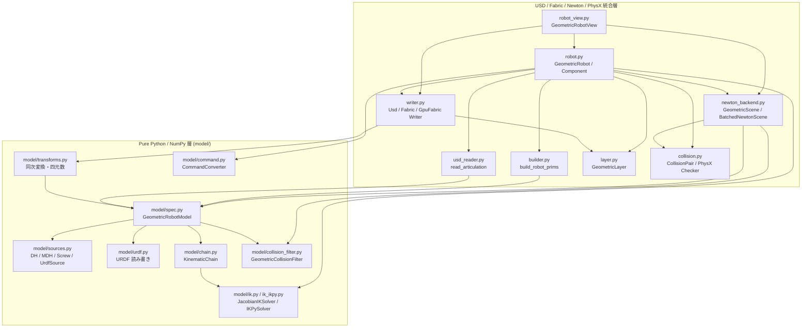
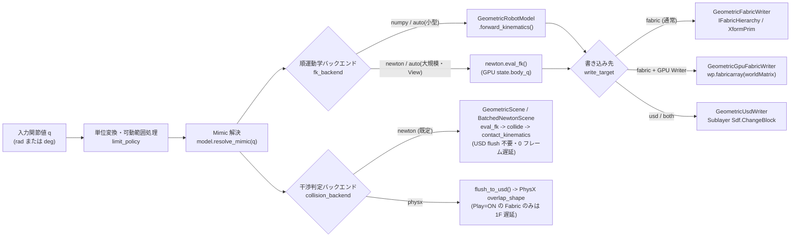

# アーキテクチャ解説・コード編集ガイド（`myext.robot.geometric_newton`）

この文書は、`myext.robot.geometric_newton` の内部構造、座標系・数値表現の規約、主要な設計判断の理由、およびコードを変更・拡張する際の編集箇所を解説する**解説（Explanation）**ドキュメントです。

- 具体的な利用手順とコード例は [howto_recipes.md](howto_recipes.md) を参照してください。
- 各クラス・メソッドの正確なシグネチャと設定キー一覧は [reference_api.md](reference_api.md) を参照してください。

---

## 1. モジュール依存関係

`myext.robot.geometric_newton` は、Isaac Sim に依存しない **Pure Python + NumPy 層（`model/`）** と、USD / Fabric / Newton / PhysX に接続する **Kit・Newton 統合層（トップレベル）** の 2 層で構成されています。



`myext/robot/geometric_newton/__init__.py` は `model/` 配下を即時公開し、USD / Kit / Newton に触れるクラスは `__getattr__` による遅延 import としています。この構造により、`tests_pure/` のうち NumPy モデルのみのテストは Isaac Sim なしで実行でき、`test_newton_backend.py` は Kit を起動せずに OpenUSD + Newton 単体で実行できます。

---

## 2. エンドツーエンドのデータフロー

単体ロボット（`GeometricRobot`）および複数台バッチ（`GeometricRobotView`）で、`set_dof_positions()` から描画更新・干渉判定へ至る経路を示します。



---

## 3. 座標系・四元数・行列・単位の規約

コード編集時にバグを生みやすい数値規約を一覧化します。変換境界は `usd_reader.py`、`writer.py`、`newton_backend.py` に閉じ込めています。

| 項目 | `myext.robot.geometric_newton` 内部 (`model/`) | OpenUSD (`pxr.Gf`) / Fabric (`usdrt`) | Newton 1.6.1 / Warp (`wp`) |
|---|---|---|---|
| 同次変換行列（4×4） | **列ベクトル規約**：平行移動は第 4 列 `M[:3, 3]`、合成は `A @ B` | **行ベクトル規約**：平行移動は第 4 行 `M[3, :3]`（転置関係） | `wp.mat44d` は列ベクトル規約だが、Fabric `omni:fabric:worldMatrix` へ書く際に `wp.transpose(...)` で転置して行 3 へ並べる |
| 四元数（quaternion） | **スカラ先頭** `(w, x, y, z)` | `Gf.Quatd(w, x, y, z)`（スカラ先頭） | **スカラ末尾** `wp.quat(x, y, z, w)` および `wp.transform(px, py, pz, qx, qy, qz, qw)` |
| 角度の単位 | 内部は常に **ラジアン（rad）**。`angle_unit="deg"` または `unit="deg"` 指定時のみ入出力境界で変換 | USD Joint の `lowerLimit` / `upperLimit`、および回転軸の `PhysxMimicJointAPI` / `NewtonMimicAPI` の offset は **度（deg）** | 回転関節座標 `joint_q` は **ラジアン（rad）** |
| 長さの単位 | ステージの単位（通常メートル）。直動関節は `angle_unit` の影響を受けない | ステージの `metersPerUnit` に従う | ステージの単位と一致させて構築 |
| カプセル・円柱・円錐の軸 | USD `axis` 属性（`"X"` / `"Y"` / `"Z"`）をそのまま保持 | `UsdGeom.Capsule` / `Cylinder` / `Cone` は `"X"` / `"Y"` / `"Z"` を持つ | Newton 形状は常に **Z 軸基準**。`newton_backend.py` の `_axis_rot_to_z()` で X/Y 軸を Z 軸へ回転補正 |
| 符号付き距離 `separation` | 負＝めり込み、0＝接触、正＝クリアランス（[m]） | `GeometricContactMonitor` の `separation` と同符号規約 | `eval_rigid_contact_kinematics` の `out_distance` と一致 |

### 順運動学の関節変換式

`model/spec.py` の `GeometricRobotModel` は、親リンク `p` から子リンク `c` への変換を次の 1 式で定義しています。

```text
X_wc = X_wp @ parent_frame @ motion(axis, q) @ inv(child_frame)
```

- `parent_frame` は親リンク座標系における関節フレーム（USD Joint の `localPos0` / `localRot0` に対応）。
- `child_frame` は子リンク座標系における関節フレーム（USD Joint の `localPos1` / `localRot1` に対応）。
- `motion(axis, q)` は回転関節なら `axis` 周りの回転 `q`、直動関節なら `axis` 方向の並進 `q`、固定関節なら単位行列です。
- USD 上で `body1` が木の親、`body0` が木の子になっている逆向き Joint（`UsdRobotInfo.reversed_joints`）は、`usd_reader.py` が `parent_frame` と `child_frame` を入れ替え、`axis` の符号を反転することで、式を変えずに一致させています。

---

## 4. 主要な設計判断の理由（Why）

### 4.1 なぜ `builder.add_usd()` ではなく `GeometricRobotModel` から Newton を構築するのか

Newton には USD を直接読む `newton.ModelBuilder.add_usd(stage)` がありますが、`GeometricScene` と `BatchedNewtonScene` では採用せず、`GeometricRobotModel` + USD `CollisionAPI` 形状から手動で `ModelBuilder` を組み立てています。理由は 4 つあります。

1. **`GeometricLayer` との衝突回避**：`GeometricLayer.apply()` は PhysX を止めるために `articulationEnabled = false`、`jointEnabled = false`、`rigidBodyEnabled = false` を Session Sublayer に書きます。この状態で `builder.add_usd()` を呼ぶと、既定の `only_load_enabled_joints=True` では全リンクが 6 自由度の浮遊剛体（UR10e で 42 DOF）になり、`only_load_enabled_joints=False` では `articulationEnabled = false` の影響で `ValueError: Orphan joints` が発生します。
2. **逆向き Joint（`body1` が親）への対応**：`builder.add_usd()` は一部構成の逆向き Joint で `ValueError` を送出しますが、`usd_reader.py` がすでに正規化した `GeometricRobotModel` を使えば 100% 一貫して構築できます。
3. **非 USD 生成元への統一対応**：`from_dh()`、`from_mdh()`、`from_screw()`、`from_urdf()`、`attach()` で組み立てたロボットは USD 上に Joint prim や ArticulationRoot を持ちません。`GeometricRobotModel` 起点なら全ソースで同じコードパスになります。
4. **DOF 並びと `VariantSet` の整合**：`UsdArticulationSource(dof_order=...)` の任意並びや `VariantSet` 切り替え後の再構築を `dof_to_newton_q` 写像だけで安全に維持できます。

### 4.2 なぜ `Play=ON` × Fabric 駆動で PhysX は 1 フレーム遅れ、Newton は 0 フレーム遅延なのか

`write_target="fabric"` のまま `Play=ON` で `set_dof_positions()` を呼ぶと、リンクの最新姿勢は Fabric だけに書かれ、USD は更新されません。

- **PhysX `overlap_shape`（Fabric のみ）**：問い合わせ側の 1 リンクは最新の Fabric 位置で評価されますが、PhysX の空間構造（BVH）側にある他リンクは `app.update()` が 1 回回るまで移動前の姿勢に「置き去り」になります。そのため、UR10e の自己干渉テスト（全 5 組）では Frame 0 で根元 2 組（`base_link` / `shoulder_link` と `forearm_link`）しか検出されず、両方とも大きく移動した `upper_arm_link` と `wrist_1_link`〜`wrist_3_link` の 3 組は Frame +1 まで見逃されます。
- **PhysX `GeometricContactMonitor`（`collision_mode="kinematic"`）**：Contact Report のイベント配送は物理ステップを挟むため 2 update 遅れます。
- **Newton `GeometricScene`**：`check_collisions()` の内部で最新の `q` と `base` を Warp 配列へ転送し、`newton.eval_fk()` が書き込んだ `state.body_q` に対して同一呼び出し内で `CollisionPipeline.collide()` と `eval_rigid_contact_kinematics()` を実行します。USD への書き出し（`flush_to_usd()`）も `app.update()` の待機も発生せず、Frame 0 から全組と符号付き距離が確定します。

### 4.3 なぜ `builder.rigid_gap = 0.0` と実行時 `model.shape_gap` 切替を使うのか

Newton 1.6.1 の `ModelBuilder` は既定値 `rigid_gap = 0.1` [m] を持ち、0.1 m 以内の非貫通ペアも接触候補として返します。`newton_backend.py` では構築時に `rigid_gap = 0.0` / `default_shape_cfg.gap = 0.0` / `margin = 0.0` とし、`finalize()` 直後に `model.shape_gap.zero_()` を実行します。

- 干渉判定（`clearance == 0.0`）では `shape_gap` を `0.0` にして貫通（`separation <= 0.0`）だけを抽出します。
- クリアランス計測（`compute_clearances(max_distance=d)` や `check_collisions(clearance=d)`）では、モデルを再構築せず `model.shape_gap` を `0.5 * d` に書き換えるだけで、2 形状の和 `gap_a + gap_b = d` 以内のペアと厳密な符号付き距離を同一パイプラインで取得できます。
- 接触バッファ溢れによる `IndexError` を防ぐため、読み取り件数は常に `min(int(rigid_contact_count[0]), int(rigid_contact_max))` でクランプしています。

### 4.4 なぜ `sync_environment()` の既定値が `use_fabric="auto"` なのか

環境コライダーの最新姿勢がどこにあるかは、タイムラインの状態と剛体設定によって異なります。

- **`Play=ON` 中に物理シミュレーションされている動的剛体**（`RigidBodyAPI` があり `rigidBodyEnabled=True`）：PhysX が毎ステップ Fabric のワールド行列だけを更新し、USD の `xformOp` は初期値のままです。したがって Fabric から読む必要があります。
- **静的コライダーや `Stop` 中にスクリプトから USD `xformOp` で動かした障害物**：`app.update()` を呼ぶ前の同一フレームでは Fabric へまだ同期されておらず、USD `XformCache` 側だけが最新です。

`use_fabric="auto"` は `_is_timeline_playing()` と `_has_active_rigid_body(prim)` を prim ごとに判定し、`Play=ON` の有効な剛体のみ Fabric から、静的障害物と `Stop` 中は USD `XformCache` から読みます。さらに `set_obstacle_pose()` で手動上書きされた障害物には `manual_override` フラグを立て、自動同期で上書きされないよう保護しています。

### 4.5 なぜ `GeometricGpuFabricWriter` は毎回 `SelectPrims` を呼び `localMatrix` を除去するのか

`writer.py` の `GeometricGpuFabricWriter` は、Isaac Sim の `isaacsim.physics.newton/impl/fabric.py` と同じ設計パターンを採用しています。

1. **毎回 `SelectPrims` をフレッシュ取得する理由**：`flush_to_usd()`、`app.update()`、`timeline.play()` のタイミングで Fabric の内部バケット構造が再編成されるため、`__init__` で `wp.fabricarray` のポインタをキャッシュすると陳腐化して書き込みが無効になります。
2. **`omni:fabric:localMatrix` を除去する理由**：`omni:fabric:localMatrix` が残っていると、次の `app.update()` で `IFabricHierarchy` が古いローカル行列から `omni:fabric:worldMatrix` を再計算して上書きします。タグ付け時に `localMatrix` を外し、毎フレーム `worldMatrix` へ直接書くことで `Play=ON` の `app.update()` を越えて姿勢を維持します。
3. **`wp.synchronize_device(device)` を呼ぶ理由**：Warp カーネル起動は非同期のため、同一フレーム内の後続処理や描画が未完了バッファを読む競合を防ぎます。

### 4.6 `GeometricLayer` が非破壊 Sublayer を使う理由と `Play=ON` での必須性

`GeometricLayer` は、既定で `Session Layer` の先頭に匿名 Sublayer（`LAYER_MARKER = "myext.robot.geometric_newton"`）を挿入し、次の 5 種類の属性だけを上書きします。

- ArticulationRoot：`physxArticulation:articulationEnabled = false`
- 各 Joint：`physics:jointEnabled = false`
- 各リンク（`collision_mode="static"`）：`physics:rigidBodyEnabled = false`
- 各リンク（`collision_mode="kinematic"`）：`physics:rigidBodyEnabled = true`、`physics:kinematicEnabled = true`、`PhysxContactReportAPI`、隣接リンクへの `UsdPhysics.FilteredPairsAPI`（Joint 無効化で消える隣接除外を復元するため）
- 各リンクの姿勢書き込み先：`xformOpOrder = ["xformOp:transform:geometric"]`

Root Layer や参照先のロボット USD には一切書き込まないため、`layer.remove()` で差分ゼロの元状態へ戻せます。`Play=ON` で `GeometricLayer` を外したまま Fabric へ書くと、最初の `app.update()` で PhysX Articulation がリンク姿勢を物理計算値で上書きします（UR10e 実測誤差 `0.422 m`）。`GeometricLayer` を適用していれば、同じステージ上の別 PhysX 動的剛体を落下・衝突させながら、ロボット側の Fabric 姿勢誤差を `0.0 m` に保てます。

### 4.7 `newton.eval_fk` と `MimicSpec`・`KinematicChain` の扱い

- **Newton 側（`newton_backend.py`）**：Newton 1.6.1 の `newton.eval_fk()` は `model.constraint_mimic` を評価しません。そのため `GeometricScene` と `BatchedNewtonScene` は、`joint_q` を Warp 配列へ転送する直前に `GeometricRobotModel.resolve_mimic(q)` を実行し、従動軸の座標を確定させてから `eval_fk()` を呼びます。
- **IK 側（`model/chain.py` / `model/ik.py`）**：`KinematicChain` は鎖に含まれる mimic 従動軸を独立変数の線形結合（`joint_matrix @ vars + joint_offset`）へ畳み込み、ヤコビアン列も `J_ref += multiplier * J_follower` として合成します。これにより `JacobianIKSolver` は鎖内に mimic 軸があっても拘束を厳密に満たします。鎖内に mimic 軸がある場合は `IKPySolver` が明示的にエラーを出します。

---

## 5. コード編集ガイド（変更目的別ファイル早見表）

コードを自分で変更・拡張するときは、変更目的に対応するファイルとシンボルから着手してください。

| やりたいこと・変更したい内容 | 対象ファイル | 主な確認・編集箇所 |
|---|---|---|
| 新しい USD コライダー形状や近似方式を追加する | `myext/robot/geometric_newton/newton_backend.py` | `_add_usd_collider_shape()`、`_axis_rot_to_z()` |
| Newton の broad phase 選択条件や `rigid_contact_max` を調整する | `myext/robot/geometric_newton/newton_backend.py` | `GeometricScene.finalize()`、`BatchedNewtonScene.__init__()` |
| 環境障害物の同期ルール（Fabric vs USD）を変える | `myext/robot/geometric_newton/newton_backend.py` | `GeometricScene.sync_environment()`、`_is_timeline_playing()`、`_has_active_rigid_body()` |
| `fk_backend="auto"` の NumPy / Newton 切替しきい値を変える | `myext/robot/geometric_newton/newton_backend.py` | `_AUTO_FK_MIN_DOFS`（単体既定 32）、`_AUTO_FK_MIN_BATCH`（View 既定 16） |
| 干渉判定の戻り値フィールドやフィルタ条件を拡張する | `myext/robot/geometric_newton/collision.py`、`newton_backend.py`、`model/collision_filter.py` | `GeometricCollisionPair`、`GeometricScene._run_collide()`、`_make_robot_pair()`、`_make_env_pair()`、`_filter_within()` / `_filter_between()` / `_filter_environment()`、`GeometricCollisionFilter` |
| Fabric 書き込み方式やバッチ切替しきい値を変える | `myext/robot/geometric_newton/writer.py` | `FABRIC_BATCH_MIN_PRIMS`（既定 24）、`GeometricFabricWriter`、`GeometricGpuFabricWriter` |
| Sublayer に書く物理無効化属性を追加・変更する | `myext/robot/geometric_newton/layer.py` | `GeometricLayer._author()`、`GeometricLayerOptions` |
| USD からの Joint・mimic・Variant 読み取りロジックを直す | `myext/robot/geometric_newton/usd_reader.py` | `read_articulation()`、`_LAYER_MARKERS`、`UsdArticulationSource` |
| 単体ロボット API・`set_dof_positions`・`set_variant` の挙動を変える | `myext/robot/geometric_newton/robot.py` | `GeometricRobot._push()`、`_rebuild()`、`check_collisions()`、`compute_clearances()` |
| 複数台 View のバッチ FK・バッチ干渉・GPU Fabric 連携を変える | `myext/robot/geometric_newton/robot_view.py` | `GeometricRobotView._push()`、`check_collisions_batch()`、`_gpu_fabric()` |
| 順運動学の数式・ヤコビアン・`attach()` 結合仕様を変える | `myext/robot/geometric_newton/model/spec.py`、`model/transforms.py` | `GeometricRobotModel.forward_kinematics()`、`jacobian()`、`attach()` |
| DH / MDH / Screw / URDF からのモデル生成や簡易形状を変える | `myext/robot/geometric_newton/model/sources.py`、`model/urdf.py`、`builder.py` | `DHParameters`、`MDHParameters`、`ScrewParameters`、`build_robot_prims()` |
| 自作 IK ソルバーを追加・チューニングする | `myext/robot/geometric_newton/model/ik.py`、`model/chain.py` | `IKSolver`、`JacobianIKSolver`、`register_ik_solver()`、`IKSolverConfig` |
| 外部コマンド変換（単位・符号・非線形補間）を追加する | `myext/robot/geometric_newton/model/command.py` | `GeometricCommandConverter`、`LinearCommandConverter`、`InterpCommandConverter` |
| 拡張機能の既定設定値を変更する | `config/extension.toml` | `[settings]` セクションの `exts."myext.robot.geometric_newton".*` |
| 回帰テストを追加・実行する | `tests_pure/test_newton_backend.py`、`tests_kit/run_kit_tests.py`、`run_tests.ps1` | pure テスト（57 本）と Kit `Play=ON` テスト（34 本） |
