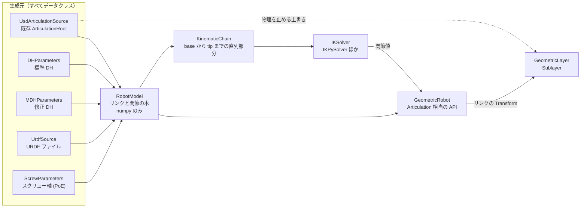
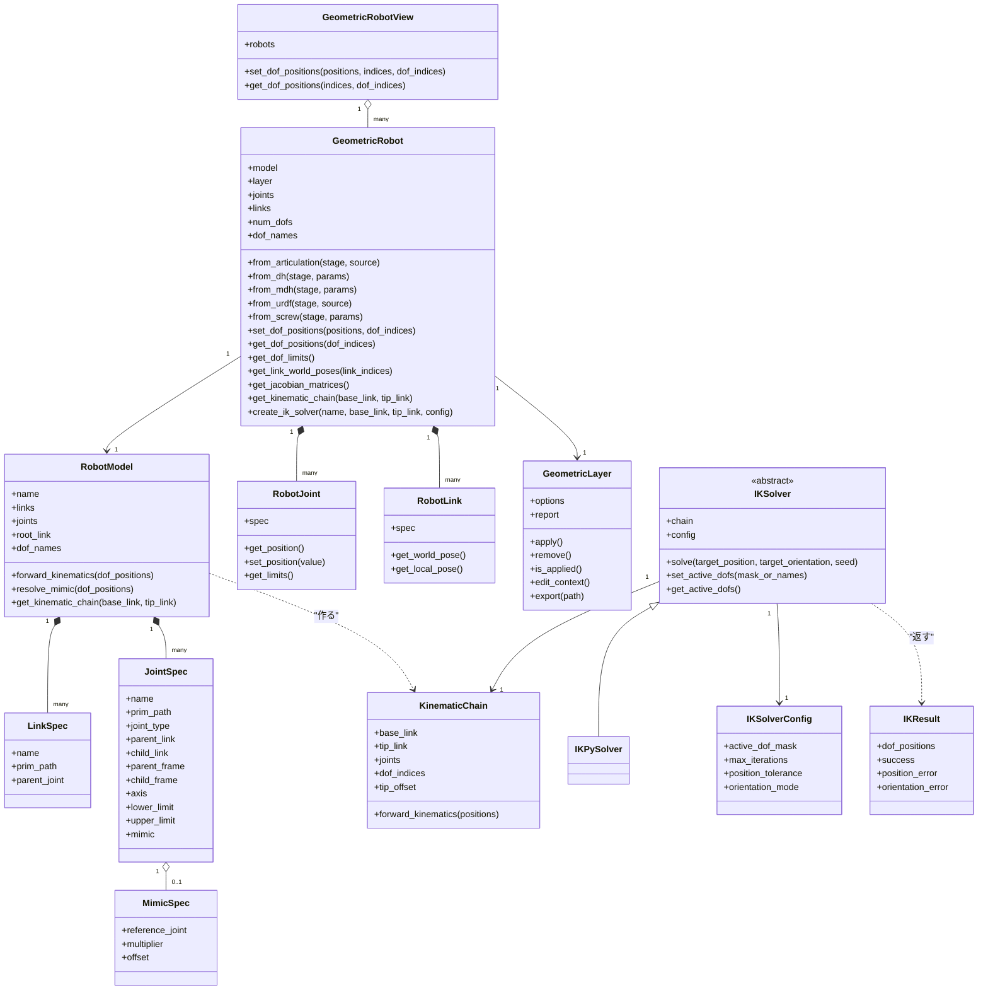
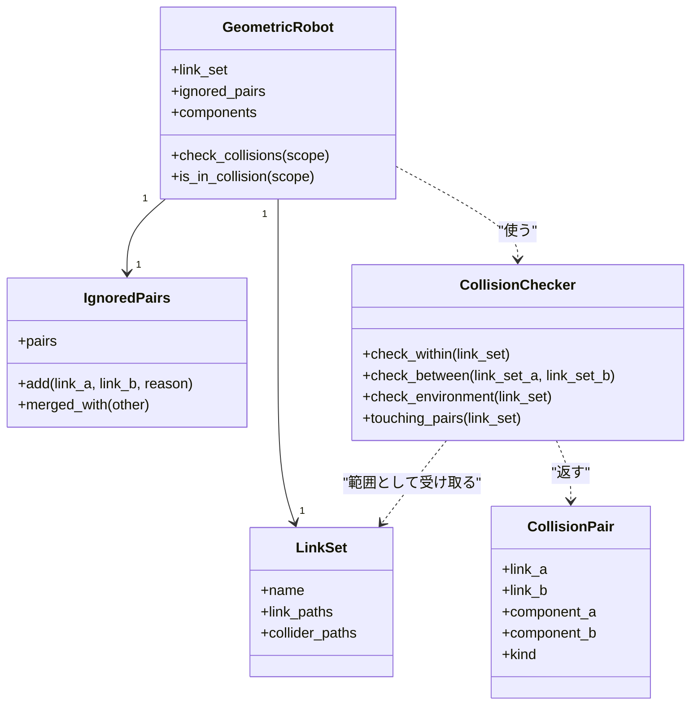

# 設計案：幾何モードのロボット API（GeometricRobot）

作成日：2026-11-10（同日に §9〜§13 を追加）　対象：Isaac Sim 6.2.0　状態：**設計案（未実装）**。§14 の未回答を決めてもらってから実装に入る。

## 1. 骨子

1. 中心に置くのは、Kit にも USD にも依存しない **`RobotModel`**（リンクと関節の木構造を持つデータクラス）。既存 Articulation・DH・修正 DH・URDF・スクリュー軸のどれから作っても、いったんこの形に揃える。
2. **`GeometricRobot`** が `RobotModel` と USD 上のリンク prim を結び付け、関節値からリンクの Transform を計算して書く。メソッド名・引数・単位（rad / m）は `isaacsim.core.experimental.prims.Articulation` に合わせる。
3. **Sublayer は「既存 Articulation から作るとき」の前準備**として `GeometricLayer` が担当する。物理を止める上書きと、リンクの Transform の書き込み先を兼ねる。外せば元の Articulation に戻る。
4. IK は **`IKSolver` 抽象クラス + `KinematicChain` データクラス**。最初の実装は `IKPySolver`。使う軸のマスクは生成時にも後からも変えられる。
5. mimic は `RobotModel` の関節が持つ `MimicSpec` で表し、順運動学の前に従動側の関節値を解決する。



既存 Articulation 以外の生成元では、リンク prim がまだ無いので `GeometricRobot` を作るときにステージへ prim を新しく組む（Articulation も剛体も付けない）。この場合は止める物理が無いので、Sublayer は Transform の書き込み先としてだけ使う。

## 2. ユーザー要件と、実装方法の検討事項

### 2.1 ユーザー要件（変えない）

| # | 要件 |
|---|---|
| R1 | Articulation を指定すると幾何モード用 Sublayer を生成・適用できる。解除で元の構成に戻る |
| R2 | 元のロボット USD を書き換えない |
| R3 | 幾何モードでは物理ソルバーも Drive も使わず、関節値からリンクの Transform を計算して書く |
| R4 | Collision は残す（削除も無効化もしない） |
| R5 | 入力は USD 内の Articulation / Joint / リンクの情報。URDF があることを前提にしない |
| R6 | Play していない状態で使える Articulation 相当の API を持つ Robot / RobotView クラス |
| R7 | 生成元は 既存 ArticulationRoot / DH / 修正 DH / URDF / スクリュー軸 |
| R8 | パラメータ類はすべてデータクラス |
| R9 | mimic joint に対応 |
| R10 | IK に対応。ソルバーは共通インターフェースで差し替え可能。最初は IKPy。Robot から KinematicChain を作れる |
| R11 | 使う軸のマスク（active joint）を、ソルバー生成時にも後からも設定できる |
| R12 | 命名は Articulation に寄せる。ただし既存クラスと名前が衝突しない |

### 2.2 実装方法の検討事項（こちらで案を出す。根拠の種類を明記）

| # | 検討事項 | 案 | 根拠 |
|---|---|---|---|
| D1 | Sublayer を差し込む場所 | Session Layer の下（保存しても混ざらない）を既定。ファイルに書き出して Root Layer 側に差す方法も選べるようにする | 2026-11-02 の実測：外した後の合成結果は差分 0（[検証結果](../geometric_mode_verification/検証結果_幾何モード.md)） |
| D2 | Collision の残し方 | 2 種類のプロファイルを用意。**STATIC**（剛体を止めて静的コライダーとして扱う。Stop 中に `overlap_*` で干渉を調べる）を既定、**KINEMATIC**（kinematic 剛体 + 接触レポート。Play が必要）を選択可 | 2026-11-05 の実測：静的コライダーは Stop 中でも xformOp の書き込みに即追従。kinematic は Stop 中は追従しない。入れ子の kinematic は接触が出ない |
| D3 | 剛体を止める書き方 | `physics:rigidBodyEnabled = false` を Sublayer に書く | **2026-11-10 実測済み（G01 の D-01・D-02）**：Stop 中、Sublayer に姿勢を書いた直後に PhysX が追従。ヒンジ 1 本のアーティキュレーションで、適用中は Play しても落ちず（40 update で z 変化 0）、外すと元どおり落ちた（適用前と同じ z = 0.9071）。ログに Error / Warning なし |
| D4 | Articulation と Joint の扱い | `physxArticulation:articulationEnabled = false`、各 Joint は `physics:jointEnabled = false`、Joint が持っていた隣接リンクの衝突除外は `FilteredPairsAPI` で書き直す | 2026-11-02 の実測（v04）。除外を書き直さないと隣接リンクが常に接触になる |
| D5 | 関節変換の式 | 子リンク = 親リンク × (localPos0, localRot0) × 関節の動き(q) × (localPos1, localRot1) の逆。軸は `physics:axis` | USD Physics の Joint 定義。リンクに scale がある場合の扱いは実装時に実アセットで確認 |
| D6 | DOF の並び順 | 木を幅優先でたどった順を既定にし、名前で引く `get_dof_indices(names)` を必ず用意 | **未測定**：PhysX の Articulation と同じ並びになる保証は無い。一致が必要なら、一度 Play して Articulation から並びを取り込むオプションを付ける |
| D7 | Transform の書き方 | 書き込み先を差し替え式にする（USD の Sublayer / Fabric / 書かない）。詳細は §9 | §9 に実測値 |
| D13 | 関節の向きと正負の読み取り | Joint prim の `physics:body0` / `body1`、`localPos0/1`、`localRot0/1`、`physics:axis` から、つながり・軸の位置・軸の向き・正の回転方向（body0 から見た body1 の、軸まわり右ねじ方向）が決まる。木の親が body1 側の Joint は向きを反転して扱う | USD Physics の定義。実装手順 3 で、Play した Articulation の姿勢と突き合わせて確かめる |
| D14 | 既存 Articulation の mimic | `PhysxMimicJointAPI`（`physxMimicJoint:rotX` などのインスタンス）の参照関節・gearing・offset を読んで `MimicSpec` を作る。読めない形式の mimic があれば警告する | 属性名は同梱ソースで確認。符号は D9 |
| D8 | 関節値の置き場所 | `GeometricRobot` が持つ配列を正とする。Sublayer の `JointStateAPI` にも写すかはオプション | — |
| D9 | mimic の符号 | USD の `physxMimicJoint:*:gearing` は「従動 + gearing × 参照 + offset = 0」。内部は URDF 式（従動 = multiplier × 参照 + offset）に直して持つので multiplier = −gearing、offset = −offset | 同梱ソース 2 か所の記述（`isaacsim.asset.exporter.urdf` の joint_reader.py、newton の import_usd.py）。回転関節の offset の単位（度かラジアンか）は未確認 |
| D10 | IKPy の入れ方 | 拡張機能の依存として pip で入れる | 実測：Isaac Sim 6.2.0 の python に `ikpy` は入っていない |
| D11 | IKPy と mimic | IKPy は直列の鎖しか扱えない。鎖の途中に mimic の従動軸がある場合、初版の `IKPySolver` はエラーにする（グリッパの mimic は鎖の外なので影響しない） | IKPy の仕様についての私の理解。実装時にソースで確認する |
| D12 | URDF の読み方 | 初版は運動学（関節の位置・軸・可動範囲・mimic）だけ読み、見た目は簡易形状。メッシュ付きで使いたい場合は URDF Importer で USD にしてから `from_articulation` | — |

## 3. クラス構成



- 上半分（`RobotModel` / `LinkSpec` / `JointSpec` / `MimicSpec` / `KinematicChain` / `IKSolver` 一式）は numpy だけで動く。Isaac Sim の外（pixi 環境）でテストできる。
- `GeometricRobot` / `GeometricRobotView` / `GeometricLayer` が USD に触る層。
- `GeometricRobot` は 1 台用（配列は `(num_dofs,)` の numpy）。`GeometricRobotView` は複数台をまとめ、`Articulation` と同じ形（`(台数, num_dofs)`、`indices=` / `dof_indices=`、戻り値は `wp.array`）にする。Articulation 用に書いたコードの移し替えは View のほうが楽。

## 4. データクラス

| 種類 | クラス | 中身 |
|---|---|---|
| 生成元 | `UsdArticulationSource` | `root_prim_path`、リンクや関節の除外指定 |
| 生成元 | `DHParameters` / `DHRow` | 標準 DH。軸ごとに (theta, d, a, alpha)、関節の種類、可動範囲 |
| 生成元 | `MDHParameters` / `MDHRow` | 修正 DH。軸ごとに (alpha, a, theta, d)、同上 |
| 生成元 | `ScrewParameters` / `ScrewAxisRow` | 軸ごとにルート座標系の (direction, moment)、ツールのホーム姿勢 |
| 生成元 | `UrdfSource` | `urdf_path`、ルートリンク名 |
| 内部モデル | `RobotModel` / `LinkSpec` / `JointSpec` / `MimicSpec` | §3 のとおり |
| Sublayer | `GeometricLayerOptions` | コリジョンのプロファイル（STATIC / KINEMATIC）、差し込み先（session / root）、接触レポートの有無 |
| Sublayer | `GeometricLayerReport` | 上書きした値の一覧（前の値・後の値）、警告 |
| IK | `KinematicChain` / `IKSolverConfig` / `IKResult` | §3 のとおり |
| 表示 | `VisualStyle` | DH などから prim を組むときの簡易形状の太さ・色 |

DH・修正 DH・スクリューの行は、既存の `robot_repr`（`DHAxis` = 修正 DH、`ScrewAxis`、`LineChain`）を土台にする。`robot_repr` に無いのは標準 DH・分岐・mimic なので、標準 DH を足し、`LineChain` から `RobotModel` への変換を 1 本書く。

## 5. Articulation との API 対応

| Articulation | GeometricRobot / View | 備考 |
|---|---|---|
| `num_dofs` `dof_names` `dof_paths` `dof_types` | 同名 | 並び順は D6 |
| `num_joints` `joint_names` `joint_paths` `joint_types` | 同名 | fixed 関節を含む |
| `num_links` `link_names` `link_paths` | 同名 | |
| `get_dof_indices` `get_joint_indices` `get_link_indices` | 同名 | |
| `set_dof_positions` `get_dof_positions` | 同名 | 書いた時点でリンクの Transform を更新 |
| `set_dof_position_targets` `get_dof_position_targets` | 同名 | Drive が無いので `set_dof_positions` と同じ動作（移し替え用の別名） |
| `get_dof_limits` `set_dof_limits` | 同名 | 範囲外の値は 切り詰め / 警告 / エラー を設定で選ぶ |
| `get_world_poses` `set_world_poses` `get_local_poses` `set_local_poses` | 同名 | ルートリンクの姿勢 |
| `get_jacobian_matrices` | 同名 | 幾何的に計算 |
| `set_default_state` `get_default_state` `reset_to_default_state` | 同名 | |
| （Articulation には無い） | `get_link_world_poses` `get_link_local_poses` | 追加 |
| 速度・力・ゲイン・質量・ソルバー設定の類 | **作らない** | 呼ぶと `AttributeError`。黙って何もしない実装にはしない |

## 6. Sublayer に書く内容（既存 Articulation から作る場合）

| 対象 | 上書き | 目的 |
|---|---|---|
| ArticulationRoot の prim | `physxArticulation:articulationEnabled = false` | Articulation として解かせない |
| 各 Joint | `physics:jointEnabled = false` | 関節の拘束と Drive を止める |
| Joint の両端のリンク | `FilteredPairsAPI` に相手を追加 | Joint が持っていた隣接リンクの衝突除外を保つ |
| 各リンク（STATIC） | `physics:rigidBodyEnabled = false` | 静的コライダーとして残す（D3、未測定） |
| 各リンク（KINEMATIC） | `physics:kinematicEnabled = true`、ContactReportAPI | kinematic 剛体として残す |
| PhysicsScene（KINEMATIC のみ） | kinematic 同士・kinematic と静的の組の報告フラグ | 無いと接触が 0 件（実測） |
| 各リンク | xformOp の値 | 関節値から計算した姿勢 |

**CollisionAPI とコリジョン形状には一切触らない**（R4）。重力は、ロボット以外の物体に影響するので既定では変えない。

## 7. mimic の扱い

- `JointSpec.mimic` に `MimicSpec(reference_joint, multiplier, offset)` を持つ。
- `dof_names` には従動軸も含める（PhysX の Articulation と同じ数え方）。
- `set_dof_positions` → `RobotModel.resolve_mimic` が従動軸の値を「multiplier × 参照軸 + offset」で上書き → 順運動学。従動軸に直接値を書いた場合は参照軸の値が勝つ（警告を出すかは設定）。
- `get_dof_positions` は解決後の値を返す。

## 8. IK の使い方（案）

```python
robot = GeometricRobot.from_articulation(stage, UsdArticulationSource("/World/Robot"))
robot.layer.apply()

chain = robot.get_kinematic_chain(base_link="base_link", tip_link="tool0")
solver = IKPySolver(chain, IKSolverConfig(active_dof_mask=[True, True, True, True, True, False]))
# robot.create_ik_solver("ikpy", "base_link", "tool0", config) でも同じものが作れる（名前で登録・差し替え）

result = solver.solve(target_position, target_orientation, seed=robot.get_dof_positions(dof_indices=chain.dof_indices))
if result.success:
    robot.set_dof_positions(result.dof_positions, dof_indices=chain.dof_indices)

solver.set_active_dofs(["joint1", "joint2", "joint3"])  # 後から変更。名前でもマスクでも
robot.layer.remove()                                     # 元の Articulation 構成に戻る
```

- 目標姿勢は `KinematicChain` の base リンク座標系で渡す。ワールド座標から渡す補助関数を `GeometricRobot` 側に付ける。
- マスクで外した軸は seed の値のまま固定する。
- `IKPySolver` は `KinematicChain` から `ikpy.chain.Chain` を組み、`active_links_mask` にマスクを写す。

## 9. 計算速度（2026-11-10 追加）

速度に効くのは「ステージに書く回数」と「Python のループ回数」の 2 つ。次の 3 段に分ける。

| 段 | 内容 | ステージへの書き込み |
|---|---|---|
| ① 計算だけ | 順運動学・ヤコビアン・IK を配列でまとめて計算する。`RobotModel.forward_kinematics` は `(B, num_dofs)` を受けて `(B, num_links, 4, 4)` を返す（B は姿勢の数。台数でも、IK の候補数でもよい） | **しない** |
| ② 表示だけ | リンクの姿勢を Fabric にまとめて書く。描画には出るが USD には残らない | Fabric |
| ③ 干渉も見る | リンクの姿勢を Sublayer（USD）に `Sdf.ChangeBlock` でまとめて書く | USD |

`GeometricRobot` / `GeometricRobotView` には書き込み先を選ぶ `TransformWriter`（`UsdLayerWriter` / `FabricWriter` / `NullWriter`）を差す。

根拠にした実測（[08_重い処理と軽くする方法](../isaac-sim-backend-lab/05_観測Snippet/08_重い処理と軽くする方法.md)、[APIバックエンドとパイプライン](../backend_pipeline_verification/検証結果_APIバックエンドとパイプライン.md)、[干渉検出API比較](../physx_overlap_contact_verification/検証結果_LN-PhysX干渉検出API比較.md)）：

- prim 1000 個の姿勢の読み出しは usd 24.7 ms、fabric 0.24 ms。ただし **1 個だけなら usd 100 µs、fabric 208 µs で usd のほうが速い**（fabric は呼ぶたびに固定費がある）。→ ロボット 1 台（リンク数十個）なら USD、多数台をまとめる View なら Fabric、という使い分けになる見込み。境目の個数は未測定。
- 1 個ずつループで書くと 100 個で 11.5 ms、まとめて書くと 0.089 ms。→ 台数ぶんの Python ループは作らない。
- 描画は Fabric を映す。Fabric から USD へ戻る流れは無い。PhysX は USD から作られる。
- 静的コライダーは、USD を書き換えた直後から `overlap_*` に反映された（36/36）。

Fabric に書いた値は Sublayer を外しても USD 側の操作では消えないので、`GeometricLayer.remove()` は Fabric を USD の値に同期し直す処理を含める。

### 9.1 実測（2026-11-10、G01）

コード：[verify/code/g01_fabric_static.py](verify/code/g01_fabric_static.py)　結果：[verify/results/](verify/results/)（`g01_fabric_static.json`、`g01_fabric_static__physx_fabric.json`）。GUI とは別プロセスの headless、描画なしの軽量 kit、CPU 物理。omni.physx.fabric の有無で結果は同じだった（ただし omni.physx.fabric 有効時は PhysX の結果が USD に出ないので、D-02 の「Play で落ちる／落ちない」の読み取りは既定構成の値だけが有効）。リンク = Xform + 子の Cube コライダー、全リンク兄弟並び。

**書き込み時間（N 個のリンクの姿勢を 1 回書く。中央値、µs）**

| 書き方 | N=10 | N=30 | N=100 | N=300 | N=1000 |
|---|---:|---:|---:|---:|---:|
| USD：属性を 1 個ずつ `Set` | 254 | 781 | 2657 | 7851 | 27000 |
| USD：Sublayer の Sdf 属性を `Sdf.ChangeBlock` でまとめて書く | 121 | 356 | 1164 | 3477 | 12337 |
| `XformPrim.set_world_poses`（usd） | 1253 | 2844 | 8390 | 24001 | 79544 |
| `XformPrim.set_world_poses`（fabric 指定） | 289 | 626 | 1796 | 5305 | 19069 |
| Fabric：`IFabricHierarchy.set_local_xform` を 1 個ずつ | 45 | 133 | 458 | 1403 | 4609 |
| **Fabric：`XformPrim.set_local_poses`（fabric、Warp 配列で一括）** | **134** | **141** | **133** | **154** | **162** |
| 参考：`overlap_shape` を全コライダーに 1 回ずつ | 379 | 1050 | 3118 | 9731 | 32841 |

- **Fabric の一括書き込みは N によらず約 0.13〜0.16 ms。USD（ChangeBlock）は 1 リンク約 12 µs で N に比例する。境目はリンク約 11 個。** それより多ければ Fabric が速く、1000 個では約 76 倍。
- `set_world_poses` は fabric を指定しても 1 個ずつのループになる（[xform_prim.py:597](../../exts/isaacsim.core.experimental.prims/isaacsim/core/experimental/prims/impl/xform_prim.py#L597) で usdrt に読み替え）。一括になるのは `set_local_poses` だけ。→ ローカル姿勢を自分で計算して `set_local_poses` 相当の一括書き込みを使う。
- 干渉を見る場合、書き込みより **`overlap_shape` の問い合わせ（1 コライダー約 30 µs）のほうが時間を使う**。30 リンクなら USD 書き込み 0.36 ms、問い合わせ 1.05 ms。
- USD に書いた後の `app.update()` は、N=1000 で何もしないときより約 12.5 ms 長い（Fabric に書いた後は約 4 ms）。N=100 以下では差は 1.5 ms 以内。

**Fabric だけに書いた姿勢が PhysX に届くか**

| 状態 | 書き込み先 | PhysX 側の位置（小球の `overlap_sphere` で確認） |
|---|---|---|
| Stop、静的コライダー | USD | **書いた直後に追従** |
| Stop、静的コライダー | Fabric のみ | **追従しない**（update 4 回、`update_simulation`、`force_load_physics_from_usd` の後も元の位置） |
| Play、静的コライダー | Fabric のみ | 直後は元の位置、**update 1 回後に追従** |
| Play、kinematic 剛体 | Fabric のみ | 直後は元の位置、**update 1 回後に追従** |
| Play、静的コライダー | USD | 書いた直後に追従 |
| Play、kinematic 剛体 | USD | update 1 回後に追従 |

- Stop 中に Fabric だけへ書いた場合でも、**そのコライダー自身を問い合わせ形状にした `overlap_shape` は Fabric の位置で判定された**（Fabric 上の位置にだけ置いた障害物にヒット。1 ケースのみ）。つまり「動かしたリンク 対 動かしていない環境」は拾えるが、「動かしたリンク同士」は相手が PhysX 上で元の位置のままなので拾えない。

**結論**

| やりたいこと | Fabric だけで可能か |
|---|---|
| 表示（関節を動かして見る） | 可能。Stop でも Play でも |
| 干渉チェック、Stop 中 | **不可**（リンク同士が拾えない）。USD への書き込みが必要 |
| 干渉チェック、Play 中 | 可能。ただし反映は update 1 回後 |

→ 書き込み先は `GeometricTransformWriter` で切り替える（`fabric` / `usd` / `both` / `none`）。既定は「表示は Fabric、干渉チェックを呼んだ時点で Stop 中なら USD にも書く」とし、常時 USD に書く設定も持つ。設定は拡張機能の設定とコンストラクタ引数の両方から変えられる。

### 9.2 実測：Stop 中の `update_simulation()` と、kinematic 剛体だけのシーン（2026-11-10、G02）

コード：[verify/code/g02_update_simulation.py](verify/code/g02_update_simulation.py)　結果：`verify/results/g02_update_simulation.json`、`g02_update_simulation__physx_fabric.json`（2 構成で同じ結果）。すべてタイムラインは Stop のまま。

**`update_simulation(dt, t)` がすること**

| 確認したこと | 結果 |
|---|---|
| 物理が進むか | **進む**。重力 9.81 の動的剛体が 30 回（各 1/60 s）で z = 5.0 → 3.7329（ステップごとに速度→位置の順で更新した場合の計算値 3.7329 と一致）。タイムラインは Stop のまま |
| kinematic 剛体の USD の姿勢を取り込むか | **取り込む**。USD に書いただけでは PhysX は元の位置（`app.update()` 2 回後も同じ）。`update_simulation` 1 回で追従 |
| Fabric の姿勢を取り込むか | **取り込まない**。Fabric だけに書いて 4 回ステップしても元の位置 |
| 結果を USD に書くか | **書かない**。USD の値は 5.0 のまま。`update_transformations(False, True)` を呼ぶと書かれ、その値は **Root Layer に入る**（3.7329） |

**kinematic 剛体 2 個だけのシーン（兄弟並び）**

| 状況 | `overlap_shape` | Contact Report |
|---|---|---|
| 最初から重なっている、動かさずに 3 ステップ | ヒット | 0 件 |
| 上の状態から 1 cm 動かして 1 ステップ | ヒット | FOUND |
| 離れた位置から USD で重ねる、ステップ前 | **ヒット**（問い合わせた側の形状は新しい位置で判定される）。ただし PhysX 上のその剛体は元の位置のまま | — |
| 同、1 ステップ後 | ヒット、PhysX 上の位置も追従 | 0 件 |
| 同、さらに 2 ステップ後（動かさない） | ヒット | FOUND と PERSIST（**書いてから 2 ステップ目以降に届く**） |
| 報告フラグなしで重ねて 1 ステップ | ヒット | 0 件 |

- `overlap_*` は kinematic 同士でもフラグなしで拾える。フラグが要るのは Contact Report だけ。
- Stop 中に `overlap_*` を使う限り、kinematic でも USD への書き込みは必要（Fabric だけでは届かない）で、さらに `update_simulation` が 1 回要る。静的コライダーに対する利点は Contact Report が使えることだけ。
- シーンに動的剛体があると、`update_simulation` のたびに PhysX 上でそれが動く。kinematic 方式を Stop 中に使うなら「動的剛体が無い」ことが条件になる。

## 10. Prim の親子関係とリンクの親子関係を切り離す（2026-11-10 追加）

- `LinkSpec.prim_path` は任意のパス。リンクの親子（`JointSpec.parent_link` / `child_link`）は USD の階層と無関係に持つ。全リンクが兄弟（flat）でも、リンクの親子どおりの入れ子（nested）でも、混ざっていても扱う。
- 順運動学は常にワールド座標の姿勢を出す。書くときに「その prim の USD 上の親のワールド姿勢」で割ってローカル姿勢にする。USD 上の祖先に別のリンクがある場合は、そのリンクの**新しい**姿勢を使う（USD の浅い prim から順に処理）。
- 既知の制約（2026-11-05 の実測）：入れ子の kinematic 剛体は、自分の xformOp を変えると接触ペアが作られない。→ KINEMATIC プロファイルは flat のときだけ許可し、入れ子なら生成時にエラーにする。STATIC にはこの制約は見つかっていない。

## 11. ロボットの結合（2026-11-10 追加）

同梱の `isaacsim.robot_setup.assembler`（`RobotAssembler`）は、ベース側と取り付け側を FixedJoint でつなぎ、つないだ 2 物体に `FilteredPairsAPI` で衝突除外を書く（[robot_assembler.py:563](../../exts/isaacsim.robot_setup.assembler/isaacsim/robot_setup/assembler/robot_assembler.py#L563)）。これに合わせて 2 通りの入口を用意する。

| 入口 | 内容 |
|---|---|
| 結合済みの USD を読む | `UsdArticulationSource` に複数のルートを渡せるようにし、ロボット間をつなぐ FixedJoint もたどって 1 本の木にする。どの prim がどの構成要素かは、ルートごとの prim パスで決める |
| モデル同士を結合する | `RobotModel.attach(other, parent_link, mount_transform, name)` が新しい `RobotModel` を返す。元の 2 つは変えない。同じロボットを複数台つなげるよう、リンク名・関節名には構成要素名を前に付ける（例 `left/joint1`） |

- 結合後のモデルは `components`（構成要素名 → そのリンク・関節・DOF の番号）を持つ。
- `robot.get_component("left")` は、同じ状態を共有する部分ロボットを返す。API は `GeometricRobot` と同じで、DOF はその構成要素の分だけ。
- `get_kinematic_chain` は構成要素をまたいで取れる（例：台車の根元から、取り付けたアームの先端まで）。

## 12. 干渉チェックと「Self」の範囲（2026-11-10 追加）

問題：`robot.is_collision_happening()` の「自分自身」は、結合すると範囲が変わる。

方針：**「Self」という固定の意味を持たせない。干渉チェックは必ず「どのリンク集合と、どのリンク集合の間か」を指定する。**「Self」は「呼んだ相手が持つリンク集合の内側」と定義する。



- 単体ロボット A の `A.check_collisions(scope=WITHIN)` は「A のリンク同士」。
- A を 2 台つないだ結合ロボット C の `C.check_collisions(scope=WITHIN)` は「C の全リンク同士」。左右のアーム間もここに入る。
- `C.get_component("left").check_collisions(scope=WITHIN)` は、結合後も「左アームのリンク同士」のまま。**単体のときと同じ意味が保たれる。**
- 結果の `CollisionPair` は、どの構成要素とどの構成要素の組か（`component_a` / `component_b`）と種類（同じ構成要素の中 / 構成要素の間 / 環境）を持つ。C の結果 1 回から「左アーム内」「左右間」「環境」を後で振り分けられる。
- `scope` は `WITHIN`（内側）/ `ENVIRONMENT`（ロボット以外）/ `ALL`。別のロボットとの間は `checker.check_between(a.link_set, b.link_set)`。
- 無視する組（関節でつながった隣同士、常に触れている組）は `IgnoredPairs` に持つ。結合時は両方の `IgnoredPairs` を名前を付け替えて合わせ、取り付けでつながった 2 リンクの組を足す。既存 Articulation から作るときは、Joint の `physics:collisionEnabled` と既存の `FilteredPairsAPI` を初期値として読む。
- 元の Articulation の `enabledSelfCollisions` は幾何モードでは PhysX に効かない（Articulation を無効にするため）。値は読み取って `check_collisions` の scope 省略時の既定（false なら内側を見ない）に使う。明示した scope が優先。

実装は `robot_repr` の [collision.py](../LearnOmni_repo/RobotRepresentation/robot_repr/collision.py) と同じく、コライダー 1 個ずつ `overlap_shape` で重なりを問い合わせ、組の振り分けと除外は Python 側で行う。CollisionGroup は `overlap_*` に効かない（2026-11-02 の実測）ので、範囲の制御は PhysX 側の設定に頼らない。問い合わせるのは範囲に入るコライダーだけにして回数を減らす。

## 13. mimic に対応した IK ソルバー（2026-11-10 追加）

| ソルバー | mimic | 根拠 |
|---|---|---|
| Pinocchio 3 系 | 対応。URDF 読み込みで `mimic=True` を渡すと mimic 関節として読む（既定は無視）。`buildMimicModel` で後から変換も可 | 公式 API ドキュメント。対応が入った版は未確認 |
| PyRoki | 対応とされる（mimic 関節の IK の例がある）。ただしドキュメントの制約欄には mimic の記載が無く、食い違っている | 検索結果のみ。未確認 |
| cuRobo | 非対応。公式ドキュメントが「mimic は独立関節に直せ」と書いている | 公式 API ドキュメント |
| KDL（MoveIt の既定） | 非対応 | ROS Answers の投稿 |
| IKPy | 対応の記述は見つからなかった | 未確認。実装時にソースで確かめる |
| 同梱の `isaacsim.robot.poser`、cuMotion 拡張 | Python ソースに mimic を扱う記述なし（cuMotion は不正な `<mimic>` を取り除く処理だけ） | 手元のソースを検索 |

設計としては、**ソルバーに頼らず `KinematicChain` 側で mimic を畳む**。`KinematicChain` は「独立な軸だけ」を変数として公開し、従動軸は順運動学とヤコビアンの中で参照軸に従わせる（従動軸の列を参照軸の列に倍率を掛けて足す）。こうすると、`KinematicChain` の順運動学とヤコビアンを使うソルバーはどれも mimic に対応する。

- `JacobianIKSolver`（numpy の減衰最小二乗法。自前）を `IKPySolver` と並べて用意する。鎖の途中に mimic があっても解ける。複数の目標をまとめて解くこともできる。
- `IKPySolver` は IKPy が自分で順運動学を持つので、鎖の途中に mimic の従動軸があるとエラーにする（D11 のまま）。

## 13.5 2026-11-10 3 回目の決定と追加

### クラス名（幾何モードの一式に `Geometric` を付ける）

| 役割 | 名前 |
|---|---|
| ロボット本体 / 複数台 | `GeometricRobot` / `GeometricRobotView` |
| 関節 / リンク | `GeometricJoint` / `GeometricLink` |
| モデルと部品 | `GeometricRobotModel` / `GeometricLinkSpec` / `GeometricJointSpec` / `GeometricMimicSpec` |
| Sublayer | `GeometricLayer` / `GeometricLayerOptions` / `GeometricLayerReport` |
| 書き込み先 | `GeometricTransformWriter`（`GeometricUsdWriter` / `GeometricFabricWriter`） |
| 干渉 | `GeometricCollisionChecker` / `GeometricCollisionFilter` / `GeometricLinkSet` / `GeometricCollisionPair` |
| 付けないもの | `IKSolver` / `IKPySolver` / `JacobianIKSolver` / `IKSolverConfig` / `IKResult` / `KinematicChain`（IK は幾何モードと無関係という前回の指示のまま）、生成元のパラメータ（`DHParameters` など） |

§3・§12 の図と本文の旧名（`RobotModel`、`RobotJoint`、`CollisionChecker`、`IgnoredPairs` など）は上の名前に読み替える。

### コリジョンは静的コライダー方式だけにする

KINEMATIC プロファイルは作らない。kinematic 剛体にしか無いものは次の 1 点だけで、今回の用途（重なっているかどうかの判定）には不要と判断した。

| | 静的コライダー | kinematic 剛体 |
|---|---|---|
| Stop 中に姿勢を書いてすぐ判定 | できる（実測） | できない（ステップが必要。実測） |
| 入れ子の prim 階層 | 制約は見つかっていない | 接触ペアが作られない（実測） |
| 重なりの有無（`overlap_*`） | 取れる | 取れる |
| **Contact Report（接触点・めり込み量・触れる手前の距離・始まりと終わりのイベント）** | **取れない**（静的同士は接触ペアが作られない） | 取れる（Play かステップが必要） |

めり込み量や接触点が必要になったら、そのとき kinematic を足す。`GeometricLayerOptions` に方式の列挙だけ残しておく。

### 無視する組の拡張

`GeometricCollisionFilter` は次の 3 種類のルールを持ち、後から足したり外したりできる。

| ルール | 例 |
|---|---|
| 組の明示（理由のタグ付き） | `filter.add_pair("left/link3", "right/link5", reason="常に近接")` |
| 名前のパターン | `filter.add_pattern("*/finger_*", "*/finger_*")` |
| 関数 | `filter.add_rule(lambda a, b: a.component == b.component and ...)` |

- 自動で入る組（関節の隣同士、取り付け部）も同じ仕組みに `reason="adjacent"` / `"mount"` で入れるので、個別に外せる。
- 1 回のチェックだけ追加で無視する引数 `extra_filter=` を持つ。
- 中身は JSON に保存・読み込みできる。

### テスト

| 種類 | 置き場所 | 実行 | 内容 |
|---|---|---|---|
| numpy だけの部分 | `C:\isaacsim-6.2.0\extsUser\Extentions\myext.robot.geometric\tests_pure\` | pytest（`extUser\URDFCreater` の pixi 環境） | 順運動学を Pinocchio と比較、DH・修正 DH・スクリューが同じ姿勢を出すこと、mimic、結合、ヤコビアンを数値微分と比較、IK の往復、URDF の書き出し→読み込みで同じロボットに戻ること、フィルタのルール |
| USD に触る部分 | `...\myext.robot.geometric\myext\robot\geometric\tests\` | headless の Isaac Sim（`omni.kit.test`） | Sublayer を付けて外すと差分 0、Play した Articulation と幾何モードの姿勢が一致（関節の正負を含む）、既知の配置で干渉の有無が正しい、USD と Fabric の書き込みで同じ姿勢、兄弟並び／入れ子、結合ロボットの範囲 |

`run_tests.ps1` 1 本で両方を回し、失敗があれば終了コードを 0 以外にする。

### URDF の書き出し

対応する。`GeometricRobotModel.to_urdf(path)` と `KinematicChain.to_urdf(path)`。

- 出すのは運動学（リンク、関節の位置・軸・可動範囲、mimic）。DH・スクリュー由来のモデルも同じ経路で出せる。コリジョンは簡易形状があれば付ける。
- メッシュ付きで出したい既存 Articulation は、同梱の `isaacsim.asset.exporter.urdf` を使う（自前では作らない）。
- 書き出した URDF を Pinocchio で読んで順運動学を突き合わせるので、テストの答え合わせにも使う。

### mimic を独立関節にした場合の制約

**一般には満たせない。** 独立関節に直すと、ソルバーは 2 つの軸を別々に動かせる変数として扱うので、解が制約式（従動 = 倍率 × 参照 + offset）を満たす保証は無い。満たすには次のどちらかが必要。

| 方法 | 制約の満たし方 |
|---|---|
| 変数を減らす（§13 の「畳む」）。従動軸を変数から外し、参照軸の関数として計算する | **常に厳密に満たす**（式で代入しているため）。`JacobianIKSolver` と、Pinocchio の `mimic=True` がこれ |
| ソルバーに等式制約を渡す | ソルバーが等式制約を扱える場合だけ。扱い方（厳密か、重み付きで近似か）はソルバーによる |

独立関節のまま解いて後から従動軸を式の値に直すと、手先がずれる。したがって「鎖の途中に mimic があるロボット」は、変数を減らす方式のソルバーだけを使う。鎖の外にある mimic（グリッパなど）はどのソルバーでも影響しない。

### `isaacsim.robot.poser` について

使わない。読んだ範囲では、ロボットのルート prim に `IsaacRobotAPI` が付いていることを前提に、USD の Joint prim から木を作る作り（[kinematic_chain.py:523](../../exts/isaacsim.robot.poser/isaacsim/robot/poser/kinematic_chain.py#L523)）。Joint prim を持たない DH・スクリュー由来のロボットには使えない。

## 14. 決まったこと・残っている確認

| # | 内容 | 状態 |
|---|---|---|
| Q1 | クラス名 | **決定**：幾何モードの一式に `Geometric` を付ける（§13.5）。IK 系と生成元パラメータにも付けるかだけ**確認待ち** |
| Q2 | コリジョン | **決定**：静的コライダー方式だけ（§13.5）。D3 は実測済み |
| Q3 | Sublayer の差し込み先 | **決定**：既定は Session Layer の下（保存しても元ファイルに混ざらない）。拡張機能の設定 `/exts/<拡張機能名>/layerTarget = "session" / "root"` で切り替え |
| Q4 | コードの置き場所 | **決定**：下の表の拡張機能本体 + 案 A |
| Q5 | `isaacsim.robot.poser` を使うか | **決定**：使わない |

コードの置き場所の候補（フルパス）：

| 対象 | 候補 | 補足 |
|---|---|---|
| 拡張機能本体 | `C:\isaacsim-6.2.0\extsUser\Extentions\myext.robot.geometric\` | 既存の `isaacsim.tools.joint_jog` や `myext.coi_marker` と同じフォルダ。前回 `extUser` と書いたのは誤りで、拡張機能が置かれているのは `extsUser\Extentions` だった |
| numpy だけの部分（案 A・推奨） | 上の拡張機能の中 `C:\isaacsim-6.2.0\extsUser\Extentions\myext.robot.geometric\myext\robot\geometric\model\` | 1 か所で完結する。Kit を import しないので pixi 環境からもテストできる |
| numpy だけの部分（案 B） | `C:\isaacsim-6.2.0\CodeByClaude\LearnOmni_repo\RobotRepresentation\geo_robot\`（既存の `...\RobotRepresentation\robot_repr\` の隣） | GitHub の LearnOmni に載る。拡張機能からはパスを通して読むことになり、置き場所が 2 つに分かれる |

## 15. 実装の順序

1. 測定：D6（PhysX の DOF の並び）、D9 の offset の単位（D3 と Fabric の件は §9.1 で測定済み）
2. `RobotModel` と各生成元からの変換、まとめて計算する順運動学、mimic、結合。pixi 環境で Pinocchio と突き合わせ
3. `GeometricLayer`（`geometric_mode.py` をロボット単位に作り直す）と `GeometricRobot.from_articulation`。Articulation を Play して得た姿勢と、同じ関節値の幾何モードの姿勢を比べる（関節の正負の向きもここで確かめる）
4. `CollisionChecker` と範囲指定、結合ロボットでの確認
5. `KinematicChain`、`IKSolver`、`JacobianIKSolver`、`IKPySolver`
6. DH・修正 DH・スクリュー・URDF からの prim 生成、`GeometricRobotView` と `FabricWriter`
