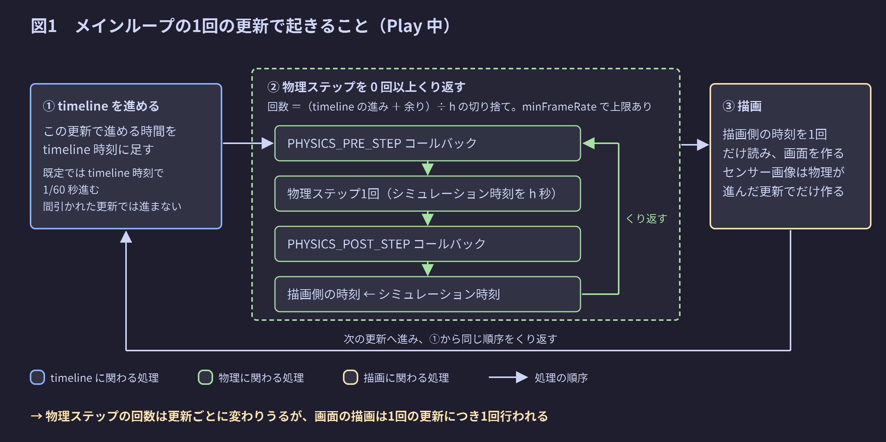
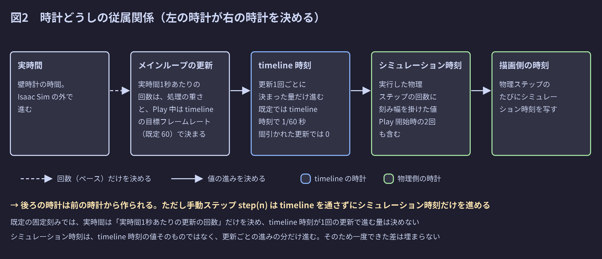
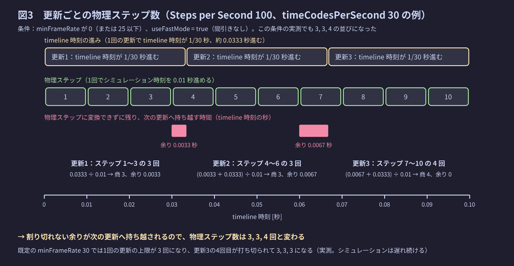
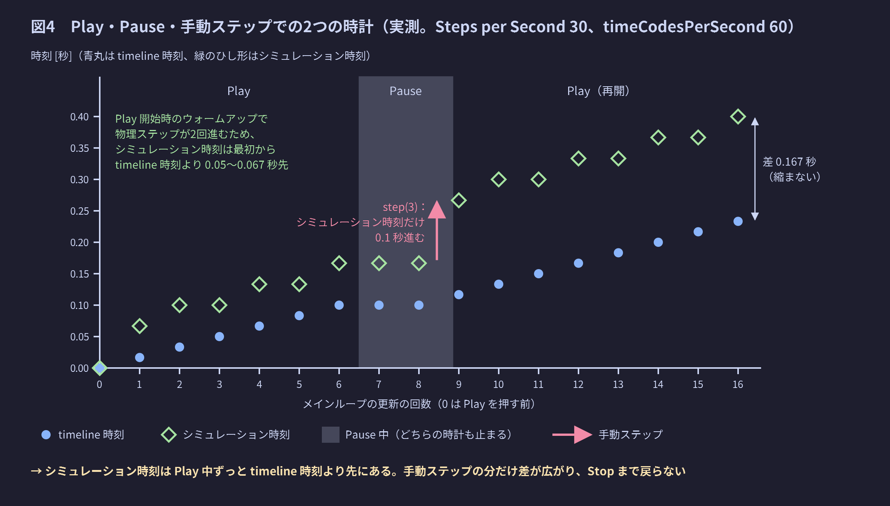

# 時間と物理ステップ

Isaac Sim では、timeline の時刻・物理の時刻・描画の時刻が、決まった順序で決まっていく。このノートは、その順序を全体像から順に説明する。読み終えると、次の3つに答えられるようになる。

- 1回の更新で、物理ステップが何回実行されるか。そして、その回数がなぜ更新ごとに変わるのか。
- timeline の時刻と物理の時刻は、どれだけずれうるか。
- Play・Pause・手動ステップで、それぞれの時刻がどう動くか。

## このノートの読み方

- 節は「全体像 → 時計の関係 → 物理ステップの回数 → 速さ → 状態ごとの違い → 手動ステップ → 物理ステップ1回の中身 → 刻み幅の決め方 → 観測のしかた」の順に並べている。前の節を読んでいれば、後ろの節が読める順序である。
- 記号は、使う直前に意味を書く。式を後の節で使うときも、式そのものと意味をその場で書き直す。
- 確度の表記：表記なしは公式ドキュメントかソースで確認した事実、「（実測）」は Isaac Sim 6.2.0 を実際に動かして測った結果（2026-11-09）である。測り方は末尾の「実測の方法」の節にある。
- ソースは、Isaac Sim 6.2.0（`C:\isaac\IsaacSim\source`）と omni.physx 110.3（`C:\isaac\src\PhysX-omni-110.3`）を読んだ。6.2.0 が実際に使う omni.physx は 110.4.4 で、ソースとわずかに版が違う。そのため、ソースから読んだ動作は、すべて実測でも確かめている。
- 「view」や「バックエンド」など、時間以外の用語は [用語集](../01_用語と概念/01_用語集.md) で定義している。

---

## 全体像：メインループの1回の更新で起きること

まず、このノートで使う4つの語を定義する。

| 語 | 意味 |
|---|---|
| メインループ | Isaac Sim（Kit アプリケーション）が、起動から終了まで繰り返し実行する処理の流れ |
| 更新 | メインループの1回分の繰り返し。`omni.kit.app.get_app().update()` の1回にあたる。このノートでは「1周」「1フレーム」という語を使わず、「更新」に統一する |
| timeline | `omni.timeline` が管理する時計。画面下部のタイムラインに表示される時刻（timeline 時刻）を持つ |
| 物理ステップ | 物理エンジン（PhysX や Newton）が、物理の状態を決まった時間だけ先へ進める、1回分の計算。この時間は、次の節で定義するシミュレーション時刻で測る |

Play 中の1回の更新では、次の3つの処理がこの順序で行われる[^clock]。

1. メインループが、この更新で timeline をどれだけ進めるかを決めて、timeline 時刻を進める。
2. 物理の更新処理が、この更新で timeline 時刻が進んだ分（と前の更新からの余り）を物理ステップの回数に変換し、物理ステップを 0 回以上実行する。公式ドキュメントはこれを「timeline 時刻に追いつくまで」と表現している[^clock]。物理ステップの直前と直後には、`isaacsim.core.simulation_manager.SimulationManager.register_callback()` で登録したコールバック（PHYSICS_PRE_STEP と PHYSICS_POST_STEP）が呼ばれる。物理ステップが1回終わるたびに、描画が参照する時刻が書き換えられる。
3. 描画が、描画用の時刻を1回だけ読み、画面を作る。カメラセンサーの画像は、物理ステップが1回以上実行された更新でだけ作られる[^clock]。



2番目の処理だけが「0 回以上くり返す」処理である。そのため、1回の更新で行われる物理ステップの回数は、更新ごとに変わりうる。一方、描画は1回の更新につき必ず1回である。物理ステップの回数がなぜ変わるのかは、後の「1回の更新で物理ステップが何回実行されるか」の節で、数値を使って説明する。

---

## 時計どうしの従属関係

このノートでは、次の4つの時計を扱う。

| 時計 | 意味 | 読み出し方 |
|---|---|---|
| 実時間 | 壁にかかった時計の時間。Isaac Sim の外で進む | `time.perf_counter()` の差で経過時間を測る |
| timeline 時刻 | timeline が持つ時刻。更新のたびに進む | `omni.timeline.get_timeline_interface().get_current_time()` |
| シミュレーション時刻 | 物理側の時刻。実行済みの物理ステップの回数に、物理ステップ1回で進める時間を掛けた値。Play 開始時のウォームアップの2回も回数に含む（後の「timeline 時刻とシミュレーション時刻のずれ」の節） | `isaacsim.core.simulation_manager.SimulationManager.get_simulation_time()` |
| 描画側の時刻 | 描画（Hydra）が参照する時刻。Fabric のプリム `/ExternalSimulationTime` の属性 `omni:time` に書かれる | usdrt で読める（下のコード）。実測では、どの更新でもシミュレーション時刻と同じ値だった |

描画側の時刻は、Fabric を読み書きする Python モジュール usdrt で読める。

Script Editor に貼って実行するコード（ファイルではない）
```python
# 描画側の時刻（Fabric のプリム /ExternalSimulationTime の属性 omni:time）を読む
import omni.usd  # 開いているステージの ID を取得するために使う
from usdrt import Usd as RtUsd  # Fabric 上のステージを扱うモジュール

rt_stage = RtUsd.Stage.Attach(omni.usd.get_context().get_stage_id())  # 開いているステージの Fabric 側に接続する
prim = rt_stage.GetPrimAtPath("/ExternalSimulationTime")  # 描画側の時刻を持つプリムを取得する
print(prim.GetAttribute("omni:time").Get())  # 描画側の時刻を表示する
```



4つの時計は、図2の左から右の順に決まる。

- 実時間は、実時間1秒あたりに更新が何回行われるかだけを決める。GUI の既定設定（`/app/player/useFixedTimeStepping = true`）では、1回の更新で timeline 時刻が進む量は、その更新にかかった実時間に左右されない。
- timeline 時刻は、更新のたびに決まった量だけ進む。ただし、間引かれた更新では進まない（後の「1回の更新で timeline 時刻が進む時間」の節）。
- シミュレーション時刻は、timeline 時刻が進んだ分を物理ステップに変換して実行した結果として決まる。timeline 時刻そのもの（絶対値）は見ていない。
- 描画側の時刻は、物理ステップのたびにシミュレーション時刻を書き写した値である[^clock]。

したがって、後ろの時計は前の時計から作られている。例外は手動ステップ `isaacsim.core.simulation_manager.SimulationManager.step(n)` で、timeline を通さずにシミュレーション時刻だけを進める（後の「手動ステップ」の節）。また、シミュレーション時刻が受け取るのは timeline 時刻の「進み」だけで、timeline 時刻の値そのものは見ていない。そのため、2つの時計の差は、いったんできると後から埋まらない。

### 時間の長さを書くときの約束

時計が複数あるので、このノートでは、時間の長さや「1秒あたり」を書くときに、どの時計で測ったかを必ず書く。

| 書き方 | 意味 |
|---|---|
| 実時間で 1/60 秒、実時間1秒あたり | 壁にかかった時計で測った長さ |
| timeline 時刻で 1/60 秒、timeline 時刻1秒あたり | timeline 時刻の差で測った長さ |
| シミュレーション時刻で 0.01 秒、シミュレーション時刻1秒あたり | シミュレーション時刻の差で測った長さ |

timeline 時刻とシミュレーション時刻は、どちらもシミュレーションの中の時間を表す時計であり、シミュレーション時刻は timeline 時刻の進みに合わせて進む。そのため、この2つの「秒」は同じ長さとして比べられる。一方、実時間の秒とは、処理が重いと一致しなくなる（後の「物理の進む速さと、ループの上限周波数」の節）。

---

## 1回の更新で物理ステップが何回実行されるか

この節では、図1の2番目の処理で物理ステップが何回実行されるかを求める。手順は「timeline 時刻がどれだけ進むか → 進んだ時間を物理ステップに変換する手順 → 数値例 → 式」の順に説明する。

### 物理ステップ1回で進める時間（刻み幅）

物理ステップ1回でシミュレーション時刻が進む時間を、刻み幅と呼ぶ。刻み幅は、Physics Scene の属性 Steps per Second（シミュレーション時刻1秒あたりに物理ステップを何回行うか）の逆数である。Steps per Second は、実時間1秒あたりの回数ではない。Physics Scene がない場合、Steps per Second は 60 になる[^fund]。

式で書くために、Steps per Second を $S$、刻み幅を $h$ と書く。$S$ の単位は「シミュレーション時刻1秒あたりの回数」、$h$ の単位は「シミュレーション時刻の秒」である。

$$
h = \frac{1}{S}
$$

たとえば Steps per Second が 100 なら、刻み幅はシミュレーション時刻で 0.01 秒である。刻み幅は `isaacsim.core.simulation_manager.SimulationManager.get_physics_dt()` で読める。

### 1回の更新で timeline 時刻が進む時間

1回の更新で timeline 時刻が進む時間は、設定によって次の3通りに分かれる。

| 場合 | 条件 | 1回の更新で timeline 時刻が進む時間 |
|---|---|---|
| 固定刻み | `/app/player/useFixedTimeStepping = true`。`isaac-sim.bat`（GUI）の既定である | timeline 時刻で、ステージの timeCodesPerSecond（timeline 時刻1秒あたりのコマ数）の逆数だけ進む。timeCodesPerSecond が 60 なら、timeline 時刻で 1/60 秒進む。ただし、更新が実時間1秒あたり timeCodesPerSecond 回より速く回り、かつ `/app/player/useFastMode = false`（既定）のときは、一部の更新で timeline を進めない（間引き） |
| manual mode | `useFixedTimeStepping = false` で、メインループの manual mode が有効。`isaacsim.exp.base.kit` の構成である | timeline 時刻で、manual mode の刻みの分だけ進む。刻みの既定値は 1/60 秒（下の説明） |
| 実時間に合わせる | `useFixedTimeStepping = false` で、manual mode が無効 | 1つ前の更新にかかった実時間と同じ長さだけ、timeline 時刻が進む |

固定刻みと実時間に合わせる場合は公式ドキュメントに書かれた事実であり[^clock]、manual mode の場合は `isaacsim.exp.base.kit` のコメントに書かれている。timeCodesPerSecond は、Layer タブの Root Layer で変更できる[^fund]。3つの場合を実測すると、次のようになった（Steps per Second 60、timeCodesPerSecond は表に書いた値）。

| 設定 | 実測した1回の更新の実時間 | 実測した timeline 時刻の進み |
|---|---|---|
| 固定刻み、timeCodesPerSecond 60 | 16.7 ms | 毎回 1/60 秒 |
| 固定刻み、timeCodesPerSecond 30 | 16.7 ms | 1/30 秒、0、1/30 秒、0、…（2回に1回だけ進む） |
| 固定刻み、timeCodesPerSecond 10 | 16.7 ms | 0.1 秒の後に 0 が5回続く（6回に1回だけ進む） |
| 固定刻み、timeCodesPerSecond 30、`useFastMode = true` | 16.7 ms | 毎回 1/30 秒（間引かないので、実時間の2倍の速さで進む） |
| manual mode、timeCodesPerSecond 30、1回の更新に 30 ms の重い処理を足す | 38 ms | 毎回 1/60 秒（timeCodesPerSecond にも実時間にも左右されない） |
| 実時間に合わせる、重い処理なし | 9.2 ms | 0.009〜0.010 秒（1つ前の更新の実時間とほぼ同じ） |
| 実時間に合わせる、30 ms の重い処理を足す | 37〜44 ms | 0.04 秒前後 |

この表から分かることは次の3つである。

- **間引きの仕組み。** 固定刻みで Play しているとき、メインループは実時間1秒あたり 60 回で回った。timeCodesPerSecond が 30 や 10 でも 60 回のままで、timeline は 60 回のうち timeCodesPerSecond 回だけ進む。Kit の timeline のヘッダ（`kit/dev/include/omni/timeline/ITimeline.h` の `setTargetFramerate`）には、「目標フレームレートが Play 中のメインループの回数を決める。実際の回数は timeCodesPerSecond の倍数になる」と書かれている。目標フレームレートの既定値は 60 だった（`omni.timeline.get_timeline_interface().get_target_framerate()` の実測値）。60 回のメインループに対して timeline が進むのは timeCodesPerSecond 回なので、残りの更新では timeline 時刻も物理も進まない。
- **manual mode の刻みの既定値は 1/60 秒。** Isaac Sim のメインループの実装（`omni.kit.loop-isaac` の `RunLoopRunner.cpp` のコンストラクタ）が、刻みを `1.0 / 60.0` で初期化している。`omni.kit.loop._loop.acquire_loop_interface().get_manual_step_size()` の実測値も 0.016667 だった。
- **GUI では Play 中だけ manual mode が有効になる。** `isaacsim.exp.full.kit` でも manual mode は有効と書かれているが、起動直後の実測値は無効だった。拡張機能 isaacsim.core.throttling が、設定 `/exts/isaacsim.core.throttling/enable_manualmode = true` のとき、起動時と Pause・Stop 時に manual mode を無効にし、Play 時に有効にしている（`isaacsim/core/throttling/extension.py`）。ただし固定刻みが有効なら、manual mode が有効でも無効でも timeline 時刻の進みは同じだった（実測）。

### 進んだ時間を物理ステップに変換する手順

公式ドキュメントには「物理の更新処理は、timeline の時刻に追いつくまで、刻み幅ごとの物理ステップを 0 回以上実行する」と書かれている[^clock]。omni.physx の C++ 実装（`PhysXScene::computeSubstepping`）を読むと、実際の手順は次のとおりである。

1. 前の更新で物理ステップに変換しきれなかった時間（余り）に、この更新で timeline 時刻が進んだ時間を足す。最初の更新では、余りは 0 である。
2. 足した結果を刻み幅で割る。商（小数点以下を切り捨てた整数）が、この更新で実行する物理ステップの回数になる。
3. ただし、設定 `/persistent/simulation/minFrameRate`（以下 minFrameRate）が 0 でなければ、回数に上限がかかる。上限は「Steps per Second ÷ minFrameRate」を切り捨てた整数（0 になるなら 1）である。
4. 割り切れずに残った時間を、余りとして次の更新へ持ち越す。上限がかかっている場合、持ち越す余りも「上限 × 刻み幅」までに切り詰められ、それを超えた分は捨てられる。

PhysXScene.cpp（omni.physx 110.3）抜粋。読みやすくするために省略を加えた。抜粋なので、このままでは実行できない。
```cpp
// PhysXScene.cpp（omni.physx 110.3）抜粋：1回の更新で実行する物理ステップの回数を決める
void PhysXScene::computeSubstepping(float elapsedSecs, float fixedTimeStep, float timestepsPerSecond)
{
    // elapsedSecs: この更新で timeline 時刻が進んだ時間、fixedTimeStep: 刻み幅 h、mRemaining: 前の更新からの余り
    uint32_t steps = (uint32_t)((elapsedSecs + mRemaining) * (1.f / fixedTimeStep));  // 余り＋進みを h で割って切り捨てる
    const uint32_t minFrameRate = /* 設定 /persistent/simulation/minFrameRate */;
    if (minFrameRate)  // minFrameRate が 0 でなければ
    {
        const uint32_t floorSteps = (uint32_t)timestepsPerSecond / minFrameRate;  // 上限 = Steps per Second ÷ minFrameRate（切り捨て）
        const uint32_t maxIters = floorSteps > 0 ? floorSteps : 1;  // 上限は最低でも 1
        if (steps > maxIters)
            steps = maxIters;  // 回数を上限で打ち切る
        mRemaining = fminf((elapsedSecs + mRemaining) - (fixedTimeStep * steps), maxIters * fixedTimeStep);  // 余りも「上限 × h」までに切り詰める
    }
    else
    {
        mRemaining = (elapsedSecs + mRemaining) - (fixedTimeStep * steps);  // 割り切れなかった分を、そのまま次へ持ち越す
    }
    mCurrentStep = steps;  // この更新で実行する物理ステップの回数
}
```

計算はすべて 32 ビットの浮動小数点数（float）で行われる。また、minFrameRate の既定値は 30 で、ステージを新しく作ったり開いたりすると 30 に戻る（実測。0 にしてから新しいステージを作ると、30 に戻っていた）。上限が効く条件と、効いたときの結果は、後の「このずれの範囲が成り立たない場面」の節で実測値を示す。

### 数値例：Steps per Second 100、timeCodesPerSecond 30

刻み幅はシミュレーション時刻で 0.01 秒、1回の更新で timeline 時刻が進む時間は 1/30 秒（約 0.0333 秒）である。上の手順を3回の更新に当てはめると、次の表になる。表の「秒」は、すべて timeline 時刻とシミュレーション時刻で測った秒で、実時間の秒ではない。

| 更新 | 前の更新からの余り [秒] | この更新で timeline 時刻が進む時間 [秒] | 合計 [秒] | 合計 ÷ 刻み幅 | 物理ステップの回数 | 次へ持ち越す余り [秒] |
|---|---|---|---|---|---|---|
| 1 | 0 | 0.0333 | 0.0333 | 3.33 | 3 | 0.0033 |
| 2 | 0.0033 | 0.0333 | 0.0367 | 3.67 | 3 | 0.0067 |
| 3 | 0.0067 | 0.0333 | 0.0400 | 4.00 | 4 | 0 |



物理ステップの回数は 3, 3, 4 の繰り返しになる。3回の更新で timeline 時刻は 0.1 秒進み、物理ステップは合計 10 回実行されて、シミュレーション時刻も 0.1 秒進む。公式ドキュメント[^fund45] の「ほとんどの更新で3回、ときどき4回」という記述と一致する。

ただし、この 3, 3, 4 が実際に出るのは、minFrameRate を 25 以下（または 0）にしたときだけである。既定の minFrameRate 30 では、上限が 100 ÷ 30 = 3.33 → 3 回になり、4回目が打ち切られる。実測すると次のようになった（`useFastMode = true` にして、間引きなしで毎回 timeline を 1/30 秒進めた）。

| minFrameRate | 実測した物理ステップの回数の並び | 1秒（30回の更新）後の (timeline 時刻の進み) − (シミュレーション時刻) |
|---|---|---|
| 0（上限なし） | 3, 3, 4, 3, 3, 4, … | −0.02 秒（範囲内で一定。理由は後の「ずれ」の節） |
| 30（既定値） | 3, 3, 3, 3, … | +0.08 秒（更新ごとに 0.0033 秒ずつ増え続ける。10 秒後には +0.98 秒） |

既定値のままだと、4回目に当たる時間は持ち越されずに捨てられ、シミュレーションは timeline から遅れ続ける。図3と上の表の手順は、上限がかからない場合の説明である。

GUI の既定（`useFastMode = false`）では、さらに間引きが入る。timeCodesPerSecond 30 ではメインループ2回に1回しか timeline が進まないので、minFrameRate 0 のときの実測値は 3, 0, 3, 0, 4, 0, … になった。物理ステップが実行される更新だけを拾うと、3, 3, 4 の並びはそのままである。

3回目の更新で、合計 ÷ 刻み幅が浮動小数点の丸めで 3.99999… になる心配は、この設定では起きなかった（実測で 4 回）。ただし、丸めが実際に効く組み合わせもある。Steps per Second 60、timeCodesPerSecond 10（minFrameRate 0）で実測すると、最初の更新は 6 回ではなく 5 回だった。0.1 × 60 が float では 6 をわずかに下回り、切り捨てで 5 になるためである。その後は、刻み幅をわずかに下回る余りが持ち越され続け、毎回 6 回で安定した。シミュレーション時刻は、本来より物理ステップ1回分遅れたまま進む。この遅れは、後で導く範囲の内側に収まる。

ほかの設定でも、同じ手順の計算結果と実測値は一致した（minFrameRate は既定の 30。どの行も上限に当たらない）。

| Steps per Second | timeCodesPerSecond | 刻み幅（シミュレーション時刻の秒） | 1回の更新で timeline 時刻が進む時間（timeline 時刻の秒） | 計算した物理ステップの回数の並び | 実測（60 回の更新） |
|---|---|---|---|---|---|
| 60 | 60（どちらも既定値） | 1/60 | 1/60 | 1, 1, 1, … | 1, 1, 1, …。公式ドキュメントの既定の挙動と一致する |
| 120 | 60 | 1/120 | 1/60 | 2, 2, 2, … | 2, 2, 2, …。公式ドキュメント[^clock] の例と一致する |
| 100 | 30 | 0.01 | 1/30 | 3, 3, 4, 3, 3, 4, … | 上の表のとおり、minFrameRate が 25 以下のときだけ一致する |
| 30 | 60 | 1/30 | 1/60 | 0, 1, 0, 1, … | 0, 1, 0, 1, …。公式ドキュメント[^clock] の「刻み幅がループの刻みより大きいと、更新ごとに 0 回か 1 回になり、センサーは物理が進んだ更新でだけ描画される」と一致する |

最後の行のように、物理ステップが 0 回の更新では、シミュレーション時刻も描画側の時刻も進まない（実測でも、0 回の更新では描画側の時刻が前の更新と同じ値だった）。

### 式で書く

上の手順を式で書く。ここで使う記号は次のとおりである。

- $k$：更新の通し番号（Play を開始してから何回目の更新か）。
- $\Delta\tau_k$：$k$ 回目の更新で timeline 時刻が進む時間（timeline 時刻の秒）。
- $b_k$：$k$ 回目の更新で、前の更新からの余りにこの更新の進みを足した時間（timeline 時刻の秒）。
- $N_k$：$k$ 回目の更新で実行する物理ステップの回数。
- $a_k$：$k$ 回目の更新の後に残る余り（timeline 時刻の秒）。最初の更新の前は $a_0 = 0$ である。
- $h$：刻み幅（シミュレーション時刻の秒）。
- $\lfloor x \rfloor$：$x$ を超えない最大の整数（切り捨て）。

手順1（余りに進みを足す）は次の式になる。

$$
b_k = a_{k-1} + \Delta\tau_k
$$

手順2（刻み幅で割って切り捨てる）と手順3（余りを持ち越す）は次の式になる。

$$
N_k = \left\lfloor \frac{b_k}{h} \right\rfloor ,
\qquad
a_k = b_k - N_k \, h
$$

これは minFrameRate が 0 の場合の式である。minFrameRate を $m$（0 でない）とすると、上限 $M = \max\!\left(1,\ \lfloor S / m \rfloor\right)$ を使って、次の式に変わる。

$$
N_k = \min\!\left( \left\lfloor \frac{b_k}{h} \right\rfloor ,\ M \right),
\qquad
a_k = \min\!\left( b_k - N_k \, h ,\ M h \right)
$$

$\lfloor b_k / h \rfloor$ が $M$ を超えない限り、2つの式は同じ結果になる。以下の導出は、上限に当たらない場合について行う。

### timeline 時刻とシミュレーション時刻のずれ

上の手順から、timeline 時刻とシミュレーション時刻のずれを求める。結論は次のとおりである。

> Play 中は、timeline 時刻が開始時刻から進んだ量からシミュレーション時刻を引いた値が、刻み幅の −2 倍以上、刻み幅の −1 倍未満に収まる。つまり、シミュレーション時刻は timeline 時刻より先に進んでおり、その差は物理ステップ1回分より大きく、2回分以下である。

差が負になるのは、Play 開始時のウォームアップで実行される2回の物理ステップも数えられるからである。ウォームアップでは、`isaacsim.core.simulation_manager.SimulationManager.initialize_physics()` が `simulate(h, 0.0)` を2回呼ぶ（ソース）。この2回は、シミュレーション時刻にも `isaacsim.core.simulation_manager.SimulationManager.get_num_physics_steps()` にも数えられる（実測。Steps per Second 60、timeCodesPerSecond 60 で、最初の更新の後に timeline 時刻 1/60 秒、累計回数 3、シミュレーション時刻 3/60 秒だった）。シミュレーション時刻は、omni.physx が数えた物理ステップの通算回数を Steps per Second で割った値で（`isaacsim.core.simulation_manager` の `PluginInterface.cpp` の `onPhysicsStep`）、ウォームアップの2回もこの通算回数に入る。

この結論を導く。新しく使う記号は次のとおりである。

- $K$：ずれを調べる時点までに行った更新の回数。
- $\tau_0$：timeline の開始時刻 [秒]（Play を開始したときの timeline 時刻）。
- $\tau_K$：$K$ 回目の更新の後の timeline 時刻 [秒]。
- $w$：Play 開始時のウォームアップで実行される物理ステップの回数。6.2.0 では $w = 2$ である。
- $n_K$：1回目から $K$ 回目までの更新で実行した物理ステップの累計回数（ウォームアップを含まない）。`isaacsim.core.simulation_manager.SimulationManager.get_num_physics_steps()` が返すのは、これにウォームアップを足した $w + n_K$ である。
- $t_K$：$K$ 回目の更新の後のシミュレーション時刻 [秒]。

timeline 時刻は、開始時刻に、各更新での進みを足し合わせた値である。

$$
\tau_K = \tau_0 + \sum_{k=1}^{K} \Delta\tau_k
$$

物理ステップの累計回数は、各更新での回数を足し合わせた値である。シミュレーション時刻は、ウォームアップを含めた通算回数に刻み幅を掛けた値である。

$$
n_K = \sum_{k=1}^{K} N_k ,
\qquad
t_K = (w + n_K) \, h
$$

**ステップ1：余りの式から、進みを余りと回数で表す。** 余りの式 $a_k = b_k - N_k h$ に、$b_k = a_{k-1} + \Delta\tau_k$ を代入する。

$$
a_k = a_{k-1} + \Delta\tau_k - N_k \, h
$$

この式を $\Delta\tau_k$ について解く。

$$
\Delta\tau_k = (a_k - a_{k-1}) + N_k \, h
$$

**ステップ2：1回目から K 回目まで足し合わせる。** 両辺を $k = 1$ から $K$ まで足す。

$$
\sum_{k=1}^{K} \Delta\tau_k = \sum_{k=1}^{K} (a_k - a_{k-1}) + h \sum_{k=1}^{K} N_k
$$

右辺の第1項を書き並べると、$(a_1 - a_0) + (a_2 - a_1) + \cdots + (a_K - a_{K-1})$ となり、隣り合う項が打ち消し合って、最後の $a_K$ と最初の $a_0$ だけが残る。$a_0 = 0$ なので、第1項は $a_K$ になる。

$$
\sum_{k=1}^{K} (a_k - a_{k-1}) = a_K - a_0 = a_K
$$

右辺の第2項は、累計回数の式 $n_K = \sum N_k$ と、シミュレーション時刻の式 $t_K = (w + n_K) h$ から、シミュレーション時刻からウォームアップの分を引いた値になる。

$$
h \sum_{k=1}^{K} N_k = h \, n_K = t_K - w h
$$

左辺は、timeline 時刻の式 $\tau_K = \tau_0 + \sum \Delta\tau_k$ を移項した値である。

$$
\sum_{k=1}^{K} \Delta\tau_k = \tau_K - \tau_0
$$

以上を代入すると、次の式が得られる。

$$
\tau_K - \tau_0 = t_K - w h + a_K
$$

つまり、timeline 時刻が開始時刻から進んだ量とシミュレーション時刻の差は、その時点の余り $a_K$ からウォームアップの分 $w h$ を引いた値である。

**ステップ3：余りの範囲を求める。** $N_k$ は $b_k / h$ を切り捨てた整数なので、切り捨ての定義から次の不等式が成り立つ。

$$
N_k \;\le\; \frac{b_k}{h} \;<\; N_k + 1
$$

各辺に $h$ を掛ける（$h > 0$ なので不等号の向きは変わらない）。

$$
N_k \, h \;\le\; b_k \;<\; N_k \, h + h
$$

各辺から $N_k h$ を引く。

$$
0 \;\le\; b_k - N_k \, h \;<\; h
$$

真ん中の $b_k - N_k h$ は余り $a_k$ そのものなので、すべての $k$ について $0 \le a_k < h$ が成り立つ。$k = K$ の場合をステップ2の結果に代入し、$w = 2$ を入れると、結論の式が得られる。

$$
-2h \;\le\; (\tau_K - \tau_0) - t_K \;<\; -h
$$

**実測による確認。** 上限にも間引きの影響にも当たらない4つの設定（Steps per Second と timeCodesPerSecond が 60 と 60、120 と 60、30 と 60、100 と 30 で minFrameRate 0）で、各 30〜60 回の更新のすべてがこの範囲に入った。たとえば Steps per Second 60、timeCodesPerSecond 60 では、差は毎回 −0.0333 秒（= −2h）で一定だった。Steps per Second 100、timeCodesPerSecond 30 では、余りが 0.0033 → 0.0067 → 0 と変わるのに合わせて、差は −0.0167 → −0.0133 → −0.0200 秒をくり返した。間引きのある設定や、実時間に合わせる設定（timeline の進みが毎回ばらばら。minFrameRate 0）でも、範囲は崩れなかった。

公式ドキュメントは「timeline 時刻をタイムスタンプに使わないこと」「2つの時計はずれることがあり、物理ステップのときにだけ揃い直す」と注意している[^clock]。実測から言えるのは次のことである。普段のずれは、上の範囲のとおり物理ステップ1〜2回分である。ただし、次の節の場面では、ずれがいくらでも広がる。物理の状態の時刻には、シミュレーション時刻を使う。

### このずれの範囲が成り立たない場面

上の「−2h 以上、−h 未満」という範囲は、次の3つの場面では成り立たない。どれも実測で確かめた。共通する原因は、物理の更新処理が timeline 時刻の「進み」だけを見て、timeline 時刻そのものを見ていないことである。いったん広がった差を、後から埋め合わせる仕組みはない。

| 場面 | 何が起きるか（実測） | ずれへの影響（実測） |
|---|---|---|
| minFrameRate による打ち切り | 1回の更新の物理ステップが「Steps per Second ÷ minFrameRate」回で打ち切られる[^perf]。打ち切った分は「上限 × 刻み幅」までしか持ち越されず、それを超えた分は捨てられる | Steps per Second 60、timeCodesPerSecond 10、間引きなし、minFrameRate 30 では、6 回必要な更新が毎回 2 回で打ち切られ、差は更新ごとに +0.067 秒ずつ広がった（12 回の更新で +0.77 秒）。minFrameRate 0 では毎回 6 回実行され、差は −h のまま一定だった。実時間に合わせる設定でも同じことが起きる。Steps per Second 60 で上限周波数を 30 にすると、1回の更新が実時間で約 36 ms になり、2.2 回分の進みに対して上限の 2 回で打ち切られて、40 回の更新で差が +0.215 秒まで広がった |
| 手動ステップ `isaacsim.core.simulation_manager.SimulationManager.step(n)` | timeline を進めずに、物理ステップだけを n 回実行する。持ち越していた余りも 0 に戻る | 差が −n·h（に、捨てられた余りを足した分）だけずれ、Stop するまで戻らない（後の「手動ステップ」の節） |
| `/app/player/playSimulations = false` | 更新しても物理ステップを実行しない[^clock] | timeline だけが進み、差は更新ごとに 1/60 秒ずつ広がった。true に戻すと物理ステップは 1 回ずつに戻るが、広がった差（10 回の更新で +0.133 秒）は埋まらずに残った |

---

## 物理の進む速さと、ループの上限周波数

この節では、シミュレーションが実時間と比べてどれだけの速さで進むかを求める。

### 上限周波数が保証すること・しないこと

`/app/runLoops/main/rateLimitFrequency` は、メインループが実時間1秒あたりに行う更新の回数の**上限**である（以下、上限周波数と呼ぶ）。`/app/runLoops/main/rateLimitEnabled = true` のとき有効になる。

| 項目 | 保証されるか | 根拠 |
|---|---|---|
| 実時間1秒あたりの更新回数が上限周波数を超えない | される | メインループの実装（`omni.kit.loop-isaac` の `RunLoopRunner.cpp`）が、更新の終わりに「更新の開始時刻 + 1 ÷ 上限周波数」まで待機している |
| 実時間1秒あたりの更新回数が上限周波数に達する | されない | 1回の更新の処理時間が、実時間で「1 ÷ 上限周波数」秒を超えると、待機する時間がなくなり、更新の間隔は処理時間で決まる |

上限周波数の既定値は、`isaacsim.exp.full.kit` のコメントにある 60 ではなく **120** である。`omni.kit.loop-isaac` の `extension.toml` が `app.runLoops.main.rateLimitFrequency = 120` を設定しており、起動中の GUI から読んだ値も 120 だった（実測）。それでも GUI で Play すると更新は実時間1秒あたり 60 回になる。これは、前の節で見た timeline の目標フレームレート（既定 60）が、Play 中のメインループの回数を決めているためである。実測では、固定刻みで Play しているとき、上限周波数を 30 にしても、上限そのものを無効にしても、1回の更新は 16.7 ms のままだった。目標フレームレートを 120 にすると 8.35 ms になった。

### 式で書く

使う記号は次のとおりである。

- $F$：上限周波数（実時間1秒あたりの更新回数の上限）。
- $p_k$：$k$ 回目の更新で、計算と描画に実際にかかった処理時間（実時間の秒）。
- $\Delta w_k$：$k$ 回目の更新の開始から次の更新の開始までにかかった時間（実時間の秒）。処理時間と、上限周波数による待ち時間の和である。
- $C$：ステージの timeCodesPerSecond（timeline 時刻1秒あたりのコマ数）。
- $f$：実時間1秒あたりに実際に行われた更新の回数。
- $r$：実時間1秒あたりに、timeline 時刻（とシミュレーション時刻）が何秒進むか。1 なら実時間どおり、1 未満ならスローモーションである。

上限周波数が有効なとき、1回の更新にかかる実時間は、実時間で「1 ÷ 上限周波数」秒と、処理時間の大きい方になる。`RunLoopRunner.cpp` は、更新の処理にかかった時間が「1 ÷ 上限周波数」秒より短ければ、その時刻まで `sleep_until` で待つ。実時間に合わせる設定（timeline の目標フレームレートが効かない設定）で測ると、上限周波数 30 で平均 36.1 ms（最短 33.6 ms）、120 で平均 9.2 ms（最短 8.6 ms）、上限なしで平均 7.4 ms だった。どれも次の式どおり、「1 ÷ 上限周波数」を下回らない。

$$
\Delta w_k = \max\left( \frac{1}{F},\; p_k \right)
$$

上限周波数が無効なときは、待ち時間がないので $\Delta w_k = p_k$ である。

実時間に対する速さ $r$ は、timeline 時刻が進んだ時間の合計を、かかった実時間の合計で割った値である。

$$
r = \frac{\displaystyle \sum_{k=1}^{K} \Delta\tau_k}{\displaystyle \sum_{k=1}^{K} \Delta w_k}
$$

固定刻みで間引きがない場合、1回の更新で timeline 時刻が進む時間は常に timeline 時刻で $1/C$ 秒なので、分子は $K/C$ になる。分母を $K$ で割った値の逆数が、実時間1秒あたりの更新回数 $f$ である。

$$
r = \frac{K / C}{\displaystyle \sum_{k=1}^{K} \Delta w_k} = \frac{f}{C} ,
\qquad
f = \frac{K}{\displaystyle \sum_{k=1}^{K} \Delta w_k}
$$

上限周波数が有効なとき、上の $\Delta w_k = \max(1/F, p_k)$ から、すべての更新で $\Delta w_k \ge 1/F$ が成り立つ。$K$ 回分を足すと $\sum \Delta w_k \ge K/F$ になり、これを $f$ の定義に代入すると、次の上限が得られる。

$$
f \le F
$$

GUI の既定値では、Play 中の更新の回数は timeline の目標フレームレートで $f \le 60$ に抑えられ、timeCodesPerSecond も 60 である。このとき $r = f/60$ かつ $f \le 60$ なので、$r \le 1$ になる。処理が軽ければ実時間どおりに進み、重くて実時間1秒に60回更新できなければスローモーションになる。これは公式ドキュメントの記述[^clock] と一致する。上の式の $F$ は、固定刻みで Play している間は、上限周波数ではなく目標フレームレート（を timeCodesPerSecond の倍数にした回数）に置き換えて読む。

実測でも、1回の更新に 30 ms の重い処理を足すと、更新は 1 回あたり平均 38.2 ms になった。timeline 時刻の進みは毎回 1/60 秒のままだったので、$r = (1/60) / 0.0382 \approx 0.44$ のスローモーションになった。

スローモーションになっても、刻み幅と、1回の更新あたりの物理ステップの回数は変わらない。変わるのは、時計が実時間に対して進む速さだけである。そのため、同じ timeline 時刻での物理の状態は変わらない。実測では、落下する立方体の高さを、重い処理なし・5 ms・30 ms の3条件で 90 回の更新にわたって記録した。3条件の値は、すべての更新で完全に一致した。

### 関係する設定と API

| 名前 | 内容 |
|---|---|
| `/app/runLoops/main/rateLimitEnabled` | 上限周波数を有効にするか。`isaacsim.exp.full.kit` では true、`isaacsim.exp.base.kit` では false |
| `/app/runLoops/main/rateLimitFrequency` | 上限周波数の値。full.kit のコメントには既定 60 とあるが、実際の既定値は 120（`omni.kit.loop-isaac` の `extension.toml`。実測でも 120） |
| `omni.timeline.get_timeline_interface().get_target_framerate()` / `set_target_framerate()` | timeline の目標フレームレート。固定刻みで Play している間の更新の回数を決める。既定 60（実測） |
| `/persistent/simulation/minFrameRate` | 1回の更新で実行する物理ステップの回数の上限を決める。既定 30。ステージを作ったり開いたりすると 30 に戻る（実測） |
| `isaacsim.core.rendering_manager.RenderingManager.set_dt(dt)` | 上限周波数、timeline の目標フレームレート、ステージの timeCodesPerSecond をまとめて揃える[^clock] |
| `isaacsim.core.rendering_manager.RenderingManager.get_dt()` | 上限周波数が有効なら「1 ÷ 上限周波数」（実時間の秒）を返す。返すのは設定値で、実測値ではない（ソースの docstring） |

設定値の一覧は [設定一覧](../04_設定/01_設定一覧.md) にまとめている。

---

## Play・Pause・Stop で時計がどう動くか



図4は、Steps per Second 30（刻み幅はシミュレーション時刻で 1/30 秒）、timeCodesPerSecond 60（1回の更新で timeline 時刻が 1/60 秒進む）で実測した値をそのまま描いたものである。

- **Play 中。** 物理ステップは更新2回に1回だけ実行されるので、シミュレーション時刻は階段状に進む。最初の更新で、物理ステップは 0 回なのにシミュレーション時刻が 0.067 秒（2回分）になっている。これがウォームアップの2回である。そのため、シミュレーション時刻は最初から timeline 時刻より先にあり、差は 0.05〜0.067 秒（刻み幅の 1.5〜2 倍）を行き来する。
- **Pause 中。** timeline も物理も止まる。
- **手動ステップ。** Pause 中に `step(steps=3)` を実行すると、シミュレーション時刻だけが 0.1 秒（3 × 1/30 秒）進み、0.167 秒から 0.267 秒になった。timeline 時刻は 0.1 秒のままだった。
- **再開後。** Play を再開しても、timeline 時刻が追いつくまで物理が待つことはない。逆に timeline 時刻が先へ飛ぶこともない。物理ステップは以前と同じ 0, 1, 0, 1, … 回で進み、差は 0.15〜0.167 秒のまま変わらなかった。差が元に戻るのは Stop したときである。

まとめると、シミュレーション時刻は手動ステップの前から timeline 時刻より先にあり、手動ステップはその差をさらに広げる。広がった差は Stop まで残る。

状態ごとの違いを表にすると、次のようになる。「tensor の view」は、物理エンジンの内部データをまとめて読み書きする窓口で、詳しくは [viewとは何か](../01_用語と概念/03_viewとは何か.md) で説明している。

| 状態・経路 | timeline 時刻 | 物理ステップ | 描画 | tensor の view |
|---|---|---|---|---|
| Stop | 開始時刻に戻って止まる | 実行されない | 実行される | ない |
| Play | 更新ごとに進む（間引かれた更新では進まない） | 更新ごとに 0 回以上 | 実行される | ある |
| Pause | 止まる | 実行されない | 実行される | あるまま |
| Play 中に `/app/player/playSimulations = false` | 進む | 実行されない[^clock] | 実行される | ある |
| 手動ステップ `isaacsim.core.simulation_manager.SimulationManager.step(n)` | 進まない | n 回 | 実行されない | 使わない |

表の内容は、次のソースと実測で確かめた。

- **tensor の view。** view を Play で作り、Stop で無効化する処理は、`isaacsim.core.simulation_manager.SimulationManager._on_play()` と `isaacsim.core.simulation_manager.SimulationManager._on_stop()` に書かれている（ソース）。Pause のときに view を無効化する処理は登録されていない。実測でも、Pause 中の `isaacsim.core.simulation_manager.SimulationManager.get_physics_sim_view()` は有効な view を返し、Stop 後は None を返した。手動ステップの本体（後の節の抜粋）は `simulate()` を呼ぶだけで、view を使わない。
- **Stop。** timeline 時刻は開始時刻に戻った。開始時刻を 0 秒にした場合も、1 秒にした場合も同じだった（実測）。シミュレーション時刻、物理ステップの累計回数、描画側の時刻はどれも 0 に戻った（実測。累計回数については公式ドキュメント[^nodes] にも記述がある）。`getSimulationTimeMonotonic` という時刻は 0 に戻らず、次の Play で続きから進んだ（実測。2.80 秒で Stop した後、次の Play の最初の更新で 2.85 秒になった。公式ドキュメント[^ism] の記述とも一致する）。もう一度 Play すると、ウォームアップの2回がまた実行された。
- **Pause。** timeline 時刻、シミュレーション時刻、累計回数は止まったまま変わらなかった（実測）。物理ステップに変換しきれずに持ち越していた余りは、Pause をまたいでも保たれた（実測。Steps per Second 100、timeCodesPerSecond 30 で、余り 0.0067 秒の時点で Pause し、再開した最初の更新の回数は、余りを持ち越した場合の 4 回だった）。
- **描画。** 描画フレームのイベント（`isaacsim.core.rendering_manager.RenderingEvent.NEW_FRAME`）は、Stop・Play・Pause のどの状態でも、平均して更新1回につき1回出た（実測。各状態 60〜600 回の更新で、平均 0.88〜1.10 回）。ただし、1回の更新だけを見ると 0 回や 2 回のこともあった（Play 中は全体の 3〜9%、Stop 中は 22〜25%）。イベントが次の更新にずれて届くことがあるためである。
- **手動ステップ。** 後の節で実測値を示す。

---

## 手動ステップ（isaacsim.core.simulation_manager.SimulationManager.step）

`isaacsim.core.simulation_manager.SimulationManager.step(steps=n)` は、メインループの更新を経由せずに、物理ステップだけを n 回実行する。

### 通常の更新との違い

通常の Play では、図1のとおり「timeline を進める → 物理ステップを0回以上実行する → 描画する」の順に処理が行われる。手動ステップは、このうち物理ステップだけを n 回行う。

| 処理 | 通常の更新 | 手動ステップ `step(n)`（実測） |
|---|---|---|
| timeline 時刻を進める | 進める | 進めない。前後で timeline 時刻は同じ値だった |
| 物理ステップ | timeline 時刻の進み（と余り）を刻み幅で割った回数 | 指定した n 回。PHYSICS_PRE_STEP と PHYSICS_POST_STEP のコールバックも n 回ずつ呼ばれた |
| 持ち越していた余り | 次の更新へ持ち越す | 0 に戻る |
| 物理の結果を USD と Fabric に反映する | 設定に従って反映する | `update_fabric=False`（既定）でも、`step()` から戻った時点で、USD・Fabric・PhysX のどこから読んでも物体の位置が新しい値になっていた（omni.physx.fabric は無効、`/physics/updateToUsd = true` の既定の構成） |
| 描画 | 行う | 行わない。前後でメインループの更新番号（`omni.kit.app.get_app().get_update_number()`）が変わらず、描画フレームのイベントも 0 回だった |

`step()` の中身は、「`omni.physics.core.get_physics_simulation_interface().simulate()` を n 回呼ぶ（引数で指定すれば Fabric の更新とコールバックも呼ぶ）」だけである。メインループの更新を経由しないので、timeline も描画も動かない。

simulation_manager.py（isaacsim.core.simulation_manager, v6.2.0）抜粋。読みやすくするために省略を加えた。抜粋の中の `cls` は `isaacsim.core.simulation_manager.SimulationManager` クラス自身、`cls._physics_sim_interface` は `omni.physics.core.get_physics_simulation_interface()` の戻り値である。抜粋なので、このままでは実行できない。
```python
# simulation_manager.py（v6.2.0）抜粋：SimulationManager.step の本体
dt = cls.get_physics_dt()  # 物理の刻み幅 h を取得する
for step in range(steps):  # 指定された回数だけ繰り返す
    simulation_time = cls.get_simulation_time()  # ステップを実行する前のシミュレーション時刻を読む
    cls._physics_sim_interface.simulate(dt, simulation_time)  # 物理ステップを1回実行する
    if update_fabric and cls._engine == "physx":  # update_fabric=True で物理エンジンが PhysX の場合だけ
        ...  # omni.physx.fabric のインターフェースで、物理の結果を Fabric に反映する
    if callback is not None:  # コールバックが指定されていれば
        if callback(step + 1, steps) is False:  # コールバックが False を返したら
            break  # 残りのステップを打ち切る
```

### 時計のずれへの影響

手動ステップは timeline 時刻を進めずに、シミュレーション時刻だけを物理ステップ n 回分進める。そのため、前の節で導いた「timeline 時刻が開始時刻から進んだ量からシミュレーション時刻を引いた値は、−2h 以上、−h 未満」という範囲から外れ、差はさらに n·h だけ負の側へずれる。図4の手動ステップの矢印が、この状態を表している。

その後の挙動は、Steps per Second 60、timeCodesPerSecond 60 で実測すると次のようになった。

| 時点 | timeline 時刻の進み [秒] | シミュレーション時刻 [秒] | 差 [秒] | 累計回数 |
|---|---|---|---|---|
| Play から 120 回の更新の後、Pause した直後 | 2.0000 | 2.0333 | −0.0333（−2h） | 122 |
| Pause 中の更新3回の後 | 2.0000 | 2.0333 | −0.0333 | 122 |
| Pause 中に `step(steps=3)` を実行した直後 | 2.0000 | 2.0833 | −0.0833（−5h） | 125 |
| Play 再開から 1 回目の更新の後 | 2.0167 | 2.1000 | −0.0833 | 126 |
| Play 再開から 30 回目の更新の後 | 2.5000 | 2.5833 | −0.0833 | 155 |
| Play 中に `step(steps=3)` をもう一度実行した後、10 回の更新の後 | 2.6667 | 2.8000 | −0.1333（−8h） | 168 |
| Stop の後 | 0（開始時刻） | 0 | 0 | 0 |

再開後、物理ステップは毎回 1 回のままで、差は −0.0833 秒から1回の更新も動かなかった。物理の更新処理は、timeline 時刻そのものではなく、timeline 時刻が「この更新で進んだ量」だけを見て回数を決めるからである。先に進んだシミュレーション時刻に timeline 時刻が追いつくまで物理が止まって待つこともなければ、timeline 時刻が先へ飛ぶこともない。手動ステップは Play 中に実行しても同じ効果で、ずれは足し算で積み重なり、Stop するまで残る。

もう一つ、手動ステップは持ち越していた余りを 0 に戻す。Steps per Second 100、timeCodesPerSecond 30（minFrameRate 0、間引きなし）で、余りが 0.0067 秒の時点で Pause して比べた。手動ステップなしで再開すると、最初の更新の回数は 4, 3, 3, … だった。`step(steps=3)` をはさんで再開すると、3, 3, 4, … になった。余りが 0 から数え直されたことになる。このとき捨てられた余り 0.0067 秒の分だけ、差は −3h よりわずかに小さくずれた（実測で −0.0433〜−0.0367 秒）。

ソースとの対応は次のとおりである。omni.physx の `PhysXUpdate.cpp` では、直接 `simulate()` を呼んだときの経路（`physxSimulate`）が `PhysXScene::setSubstepping(1, dt)` を呼び、その中で余り `mRemaining` を 0 にしている。`omni.physics.core` の `simulate()` を PhysX につなぐ部分（omni.physics.physx 拡張）はソースが手元にないが、実測した余りの消え方はこの経路と一致する。

### 観測のしかた

1. Pause 中に [clock_probe](../05_観測Snippet/03_clock_probe.md) を実行しておく。
2. 別の Script Editor のタブで、次のコードを実行する。

Script Editor に貼って実行するコード（ファイルではない）
```python
# Pause 中に物理ステップを3回だけ手動で進め、前後の値を表示する
from isaacsim.core.simulation_manager import SimulationManager  # 手動ステップと計数の API を持つクラス

print("before:", SimulationManager.get_num_physics_steps(), SimulationManager.get_simulation_time())  # 実行前の物理ステップの累計回数とシミュレーション時刻
SimulationManager.step(steps=3)  # 物理ステップを3回実行する
print("after :", SimulationManager.get_num_physics_steps(), SimulationManager.get_simulation_time())  # 実行後の物理ステップの累計回数とシミュレーション時刻
```

刻み幅がシミュレーション時刻で 1/60 秒で、Play から 120 回の更新の後に Pause したときの実際の出力（実測）
```text
before: 122 2.033333333333333
after : 125 2.0833333333333335
```

120 回の更新の後なのに累計回数が 122 になるのは、ウォームアップの2回が累計回数とシミュレーション時刻に含まれるためである（このとき timeline 時刻は 2.0 秒だった）。

3. その後 Play を再開し、clock_probe の `lag` 列（timeline 時刻の進みからシミュレーション時刻を引いた値）を見る。実測では −0.0833 秒（ウォームアップの2回と手動ステップの3回、合わせて5回分）で、再開後もこの値から動かなかった。clock_probe の `in_range` 列は「−2h 以上、−h 未満」で判定するので、手動ステップの後は False になる（手動ステップをしなければ True）。
4. [step_probe](../05_観測Snippet/02_step_probe.md) を併用すると、PHYSICS_POST_STEP のコールバックが3回呼ばれることも確かめられる（実測で PRE_STEP、POST_STEP とも3回）。

---

## 物理ステップ1回の中で起きること（simulate）

`omni.physics.core.get_physics_simulation_interface().simulate(dt, 現在時刻)` は、物理エンジンに「シミュレーション時刻 t の状態から、シミュレーション時刻 t + dt の状態を計算する」物理ステップを1回実行させる関数である。図1の「simulate：物理の状態を h 秒進める」の箱が、この関数の呼び出しにあたる。

### どこから呼ばれているか（6.2.0 のソースで確認した）

- `isaacsim.core.simulation_manager.SimulationManager` は、`omni.physics.core.get_physics_simulation_interface()` で物理のシミュレーション用インターフェースを取得し、そのインターフェースの `simulate()` メソッドを呼ぶ。
- 手動ステップ `isaacsim.core.simulation_manager.SimulationManager.step()` は、2つ目の引数に、ステップを実行する前のシミュレーション時刻（つまりステップの開始時刻）を渡す。
- Play 時の初期化（`isaacsim.core.simulation_manager.SimulationManager.initialize_physics()`）は、`simulate(h, 0.0)` を2回呼ぶ。この2回は、シミュレーション時刻と累計回数に数えられる（実測。前の「ずれ」の節）。
- GUI で Play しているときの物理の更新処理は、`simulate()` を呼ばない。omni.physx のステージ更新（`PhysXStageUpdate.cpp` の `physXStageUpdate`）から `physXUpdate` → `physXUpdateNonRender` と進み、`PhysXScene::computeSubstepping` で回数を決めてから、`PhysXScene::step` を回数分くり返す（omni.physx 110.3 のソース）。`simulate()` は別の入口（`physxSimulate`）から同じ `PhysXScene` の計算に入るが、回数の計算をせず、刻み幅を1回だけ進めて余りを 0 に戻す。前の節で実測した「手動ステップで余りが消える」挙動は、この違いによる。

### 物理ステップ1回で行われる計算

ここは物理エンジン一般の処理として述べる。PhysX の内部実装は読んでいない。

1. 時刻 t での力を求める。重力、関節ドライブの力、外から加えた力が含まれる。
2. 接触と関節の拘束を、シーン内のすべての物体についてまとめて解く。
3. 速度と位置を、シミュレーション時刻で dt 秒ぶん積分する。

手順2で、すべての物体を1つの問題としてまとめて解くので、物体を1つずつ順番に動かすわけではない。同じ物理ステップの中では、すべての物体が同時に動いた扱いになる。

2つ目の引数「現在時刻」は、USD に時刻ごとの値（time sample）として書かれたアニメーションを、その時刻で読むために使われる。omni.physx の `PhysXUpdate.cpp` は、この値を `UsdLoad::update(currentTime + ...)` に渡し、キネマティックな物体などの位置をその時刻の USD の値で更新する。`omni.physics.core` の Python バインディングの説明にも、「時刻ごとに値を持つ座標変換を適用するために使われることがある」と書かれている。物理の計算そのもの（何秒進めるか）には、1つ目の引数の dt だけが使われる。

### 結果の取り出し

旧来の `omni.physx` のインターフェースについては、NVIDIA の担当者が「`omni.physx.get_physx_simulation_interface().simulate()` の後に `omni.physx.get_physx_simulation_interface().fetch_results()` を呼ぶ」という手順を示している[^forum]。6.2.0 の `isaacsim.core.simulation_manager.SimulationManager` は `omni.physics.core` のインターフェースを使い、`simulate()` しか呼んでいない。

`omni.physics.core` の `simulate()` は、結果の取り出しまで済ませてから戻る。Python バインディングの説明（omni.physics の `BindingsPhysicsSimulation.cpp`）に「計算の完了を待ち、結果を受け取ってから戻る」と書かれている（非同期版は別の `simulate_async()`）。実測でも、`step(steps=3)` から戻った直後に、落下する立方体の高さを PhysX から直接（`omni.physx.get_physx_interface().get_rigidbody_transformation()`）、USD から、Fabric（usdrt）から読むと、3つとも同じ新しい値（−15.446 m → −16.459 m）になっていた。

---

## 物理の刻み幅 h の決め方

現実と一致させるために必要な刻み幅に、決まった値はない。必要な細かさは「シーンの中で一番速く変化する現象」と「許せる誤差」で決まる。刻み幅を半分にしても結果がほとんど変わらなくなった値が、そのシーンにとって十分な刻み幅である（収束テスト）。

### 物理の刻み幅は、1回の更新で timeline 時刻が進む時間より小さいのか

常に小さいわけではない。既定値では、刻み幅（シミュレーション時刻で 1/60 秒）と、1回の更新で timeline 時刻が進む時間（timeline 時刻で 1/60 秒）は等しい[^fund]。刻み幅を小さくするかどうかは、利用者が選ぶ。公式の既定値は、物理エンジンによって異なる。

| 物理エンジン | 既定の物理ステップ頻度 | 出典 |
|---|---|---|
| PhysX | シミュレーション時刻1秒あたり 60 回（Physics Scene がない場合） | [^fund] |
| Newton | シミュレーション時刻1秒あたり 600 回（`NewtonConfig.physics_frequency` の既定値） | [^newton] |

### 刻み幅を小さくする理由

1. **積分の誤差が小さくなる。** 刻み幅を小さくすると精度は上がるが、計算量は増える[^perf601]。
2. **硬い関節ドライブや接触が安定する。** 刻み幅が大きいと、硬いばねのような力が振動したり発散したりしやすい（物理シミュレーション一般の性質）。
3. **速い物体のすり抜けを防ぐ。** 物体が速すぎると、あるステップでは床の上にあり、次のステップでは床を通り抜けていて、衝突を捉えられない[^fund]。

### 描画には細かい刻みが要らない理由

描画は積分をしない。その時点での最新の状態を1枚の画像にするだけである。図1のとおり、1回の更新で物理ステップが複数回あっても、描画が使うのは最後に書かれた値だけで、途中のステップを補間するわけではない[^clock]。画面の描画は更新1回につき1回で（実測。前の「Play・Pause・Stop」の節）、その頻度は人が見るのに必要な実時間1秒あたりの枚数で足りる。カメラセンサーの画像は、物理が進んだ更新でだけ作られる[^clock]。そのため、センサーの画像の間隔は、描画の頻度ではなく物理の進み方で決まる。

### 「現実は連続的に、同時に動いている」こととの関係

- **同時性について：** 1回の物理ステップの中では、接触と関節の拘束をすべての物体についてまとめて解く（前の節の「物理ステップ1回で行われる計算」の手順2）。物体を1つずつ順番に動かすわけではないので、同時に動くことは各ステップの中で扱われている。
- **連続性について：** 時間を区切ることで生じる誤差（離散化誤差）は、刻み幅を小さくすると減る。一方、接触・摩擦・材料のモデルが現実と違うことによる誤差（モデル誤差）は、刻み幅をいくら小さくしても減らない。現実との差を議論するときは、この2つを分けて考える必要がある。

### 十分な刻み幅を決める方法：収束テスト

同じシーンを、刻み幅 $h$ と、その半分の刻み幅 $h/2$ で実行し、両方に共通する時刻で位置を比べる。使う記号は次のとおりである。

- $t_k$：2つの実行に共通する時刻（$k$ 番目の比較時刻。シミュレーション時刻の秒）。
- $x_h(t_k)$：刻み幅 $h$ で実行したときの、時刻 $t_k$ での位置 [m]。
- $x_{h/2}(t_k)$：刻み幅 $h/2$ で実行したときの、時刻 $t_k$ での位置 [m]。
- $\lVert \cdot \rVert$：ベクトルの長さ（2つの位置の距離）。
- $e(h)$：すべての比較時刻での距離のうち、最大のもの [m]。
- $\varepsilon$：許せる誤差 [m]。

$$
e(h) = \max_{k} \; \bigl\lVert \, x_{h}(t_k) - x_{h/2}(t_k) \, \bigr\rVert
$$

次の条件を満たす最大の $h$ を、そのシーンの刻み幅にする。

$$
e(h) < \varepsilon
$$

### 干渉判定で効いてくる量：姿勢を調べる間隔

形状どうしの干渉を、ある時刻の姿勢ごとに調べる場合、調べた2つの時刻の間にロボットが動く距離が問題になる。使う記号は次のとおりである。

- $\Delta s$：姿勢を調べる間隔（シミュレーション時刻の秒）。
- $v_{\max}$：ロボット表面の最大速度（シミュレーション時刻1秒あたりに動く距離 [m]）。
- $d$：調べる間隔の間にロボット表面が動く距離の上限 [m]。
- $\delta$：見落としたくない最小の隙間や部品の厚み [m]。

調べる間隔の間に動く距離の上限は、最大速度に間隔を掛けた値である。

$$
d = v_{\max} \, \Delta s
$$

この距離 $d$ が最小の厚み $\delta$ より大きいと、その間で起きた接触を見落とすおそれがある。見落とさないための条件は、$d < \delta$ に上の式を代入し、両辺を $v_{\max}$ で割った次の式である。

$$
v_{\max} \, \Delta s < \delta
\quad\Longleftrightarrow\quad
\Delta s < \frac{\delta}{v_{\max}}
$$

具体例として、最大速度を 1 m/s、最小の厚みを 5 mm（0.005 m）とすると、調べる間隔の上限は次のようになる。

$$
\frac{\delta}{v_{\max}} = \frac{0.005\ \text{m}}{1\ \text{m/s}} = 0.005\ \text{s}
$$

この例では、姿勢をシミュレーション時刻で 0.005 秒（シミュレーション時刻1秒あたり 200 回）より細かい間隔で調べる必要がある。

---

## 観測のしかた

| Snippet | 何を確かめるか |
|---|---|
| [clock_probe](../05_観測Snippet/03_clock_probe.md) | 描画フレームごとに、1回の更新にかかった実時間、timeline 時刻の進み、物理ステップの回数、timeline 時刻の進みとシミュレーション時刻の差を表示する。差が「−2h 以上、−h 未満」に収まっているかを `in_range` 列で判定する |
| [step_probe](../05_観測Snippet/02_step_probe.md) | 物理ステップの前後でコールバックが呼ばれる順序と、「n ステップ後に実行」の予約が何ステップ後に実行されたかを表示する |
| [env_fingerprint](../05_観測Snippet/01_env_fingerprint.md) | このノートに出てくる設定値（固定刻み、上限周波数、timeCodesPerSecond、刻み幅など）を一覧表示する。各観測の前に実行して、前提の設定を記録する |

数値例の表を確かめるには、Physics Scene の Steps per Second とステージの timeCodesPerSecond を表の値に設定してから clock_probe を実行し、`N=` の列（その更新での物理ステップの回数）が表と同じ並びになるかを見る。Steps per Second 100、timeCodesPerSecond 30 で 3, 3, 4 を見たい場合は、ステージを開いた**後に** minFrameRate を 0 にする（ステージを開くと 30 に戻るため）。上限周波数の効果は、固定刻みの Play 中には見えない（目標フレームレートが更新の回数を決めるため）。見たい場合は `/app/player/useFixedTimeStepping` を false にし、clock_probe の `wall_dt` 列（1回の更新の実時間の実測値）が「1 ÷ 上限周波数」秒を下回らないことを確かめる。

### 実測の方法

このノートの「（実測）」は、2026-11-09 に次の方法で測った。

| 項目 | 内容 |
|---|---|
| 実行環境 | Isaac Sim 6.2.0（`C:\isaacsim-6.2.0`）、Windows 11、RTX 3060。GUI と同じ構成ファイル `apps/isaacsim.exp.full.kit` を指定し、`python.bat` から `isaacsim.SimulationApp` をヘッドレスで起動した。起動中の GUI のステージは変更していない |
| GUI と同じ設定であることの確認 | 起動中の GUI から、時間に関わる設定（固定刻み、useFastMode、上限周波数 120、manual mode、minFrameRate 30、playSimulations）を読み出し、ヘッドレスの起動直後の値と一致することを確かめた |
| シーン | 新しいステージに Physics Scene（CPU、重力 9.81 m/s²）と、質量 1 kg の落下する立方体を1つだけ置いた。Steps per Second と timeCodesPerSecond は実験ごとに変えた |
| 1回の更新で記録した値 | 更新の実時間、timeline 時刻とその進み、PHYSICS_PRE_STEP と PHYSICS_POST_STEP のコールバックの回数、物理ステップの累計回数、シミュレーション時刻、描画側の時刻（usdrt）、`getSimulationTimeMonotonic`、描画フレームのイベントの回数、立方体の高さ（PhysX・USD・Fabric） |
| 重い処理 | メインループの更新イベントに、指定した時間だけ `time.sleep()` するコールバックを登録した |
| スクリプトと生データ | [measurements/](measurements/) に置いた。`time_lab.py` が共通部分と1回目の実験一式、`time_lab2.py`〜`time_lab5.py` が追加の実験、`results/run1.jsonl`〜`run5.jsonl` が更新ごとの記録、`analyze.py` が集計用である。図4（`images/time-states.png`）は `images/make_time_states.py` が `run5` の値から描いている。図1〜3は `images/` の SVG が元で、HTML と PNG はそこから作っている |

実行のしかた（PowerShell。`C:\isaacsim-6.2.0` で実行する）
```powershell
# ヘッドレスの Isaac Sim で1回目の実験を実行し、更新ごとの記録を run1.jsonl に書く
$env:PYTHONUTF8 = "1"  # 日本語を含むスクリプトを UTF-8 で読ませる
.\python.bat CodeByClaude\isaac-sim-backend-lab\03_時間と物理ステップ\measurements\time_lab.py C:\isaacsim-6.2.0\apps\isaacsim.exp.full.kit run1.jsonl
```

## このノートに出てくる API の import

このノートでは、関数とクラスを `モジュール名.クラス名.メソッド名` の完全修飾名で書いている。Script Editor で使うときは、次の import を先に実行する。import した後は、完全修飾名からモジュール名の部分を除いた名前で呼べる。たとえば `isaacsim.core.simulation_manager.SimulationManager.get_num_physics_steps()` は `SimulationManager.get_num_physics_steps()`、`isaacsim.core.rendering_manager.RenderingManager.get_dt()` は `RenderingManager.get_dt()` と書く。

Script Editor に貼って実行するコード（ファイルではない）
```python
# このノートに出てくる API の import
import time  # 実時間の計測（perf_counter）

import omni.kit.app  # Kit アプリケーション（メインループ）のインターフェース
import omni.physics.core  # 物理シミュレーションのインターフェース（simulate など）
import omni.physics.tensors  # view を作るモジュール
import omni.physx  # 旧来の PhysX シミュレーションインターフェース
import omni.timeline  # timeline のインターフェース
from isaacsim.core.rendering_manager import RenderingManager  # メインループの刻みと描画のコールバックを扱うクラス
from isaacsim.core.simulation_manager import SimulationManager  # シミュレーションの状態・物理ステップ・コールバックを扱うクラス
```

## 理解度確認問題

1. Steps per Second が 120、timeCodesPerSecond が 60 のとき、1回の更新で物理ステップは何回実行されるか。

> [!note]- 答え
> 2回である。刻み幅はシミュレーション時刻で 1/120 秒、1回の更新で timeline 時刻が進む時間は 1/60 秒である。毎回の合計（timeline 時刻で 1/60 秒）を刻み幅で割ると 2 になり、余りは 0 である。

2. Steps per Second が 30、timeCodesPerSecond が 60 のとき、物理ステップが 0 回の更新では、描画される画像はどうなるか。

> [!note]- 答え
> 物理が進まないので、シミュレーション時刻も描画側の時刻も前の更新と同じになり、物体の位置は前の更新と同じ画像になる。描画そのものは毎回の更新で1回行われる。

3. Play 中に timeline 時刻をタイムスタンプとして記録すると、どんな問題が起きるか。

> [!note]- 答え
> timeline 時刻の進みとシミュレーション時刻の差は、刻み幅の −2 倍以上、−1 倍未満の範囲でずれている（ウォームアップの2回のため）。つまり、timeline 時刻は物理の状態より、物理ステップ1回分より多く2回分以下だけ前の時刻を指す。minFrameRate による打ち切り、手動ステップ、`playSimulations = false` があると、差はさらに広がって戻らない。物理の状態の時刻としては、シミュレーション時刻を使う。

4. GUI の既定値（上限周波数 60、timeCodesPerSecond 60）で、重いシーンのため実時間1秒に 30 回しか更新できなかった。シミュレーションは実時間の何倍の速さで進むか。

> [!note]- 答え
> 0.5 倍である。つまり、実時間1秒あたりに timeline 時刻とシミュレーション時刻が 0.5 秒進む。速さは「実時間1秒あたりの更新回数 ÷ timeCodesPerSecond」なので、30 ÷ 60 = 0.5 になる。物理ステップの刻み幅と回数は変わらないので、同じ timeline 時刻での物理の状態は変わらない（実測で、重い処理の有無にかかわらず、立方体の高さが更新ごとに完全に一致した）。

5. Pause 中に `isaacsim.core.simulation_manager.SimulationManager.step(steps=3)` を実行した後、Play を再開すると、timeline 時刻の進みとシミュレーション時刻の差はどうなるか（Steps per Second 60、timeCodesPerSecond 60）。

> [!note]- 答え
> 手動ステップの前の差は −2/60 ≒ −0.033 秒である（ウォームアップの2回分）。手動ステップでシミュレーション時刻だけが 3/60 = 0.05 秒進むので、差は −5/60 ≒ −0.083 秒になる。再開後は物理ステップが毎回1回ずつ進むだけなので、差は −0.083 秒のまま変わらず、Stop するまで戻らない（実測）。

## 前後のノート

| 前 | 全体の目次 | 次 |
|---|---|---|
| [バックエンド選択の仕組み](../02_バックエンド選択の仕組み/01_バックエンド選択の仕組み.md) | [README](../README.md) | [設定一覧](../04_設定/01_設定一覧.md) |

[^clock]: [Three-Clock Architecture — Isaac Sim 6.2.0](https://docs.isaacsim.omniverse.nvidia.com/6.2.0/sensors/isaacsim_sensors_multitick_rendering.html#isaac-sim-sensors-multitick-clock-relationships)
[^fund]: [Physics Simulation Fundamentals — Isaac Sim 6.2.0](https://docs.isaacsim.omniverse.nvidia.com/6.2.0/physics/simulation_fundamentals.html)
[^fund45]: [Physics Simulation Fundamentals — Isaac Sim 4.5.0](https://docs.isaacsim.omniverse.nvidia.com/4.5.0/physics/simulation_fundamentals.html)
[^perf]: [Isaac Sim Performance Optimization Handbook](https://docs.isaacsim.omniverse.nvidia.com/latest/reference_material/sim_performance_optimization_handbook.html)
[^perf601]: [Isaac Sim Performance Optimization Handbook — 6.0.1](https://docs.isaacsim.omniverse.nvidia.com/6.0.1/reference_material/sim_performance_optimization_handbook.html)
[^newton]: [isaacsim.physics.newton API — Isaac Sim 6.0.0](https://docs.isaacsim.omniverse.nvidia.com/6.0.0/py/source/extensions/isaacsim.physics.newton/docs/api.html)
[^nodes]: [isaacsim.core.nodes — Isaac Sim 5.1.0](https://docs.isaacsim.omniverse.nvidia.com/5.1.0/py/source/extensions/isaacsim.core.nodes/docs/index.html)
[^ism]: [ISimulationManager — Isaac Sim](https://docs.isaacsim.omniverse.nvidia.com/latest/py/api/structisaacsim_1_1core_1_1simulation__manager_1_1_i_simulation_manager.html)
[^forum]: [NVIDIA Developer Forums — Unclear Unit update_simulation elapsed time](https://forums.developer.nvidia.com/t/unclear-unit-update-simulation-elapsed-time/261843)
