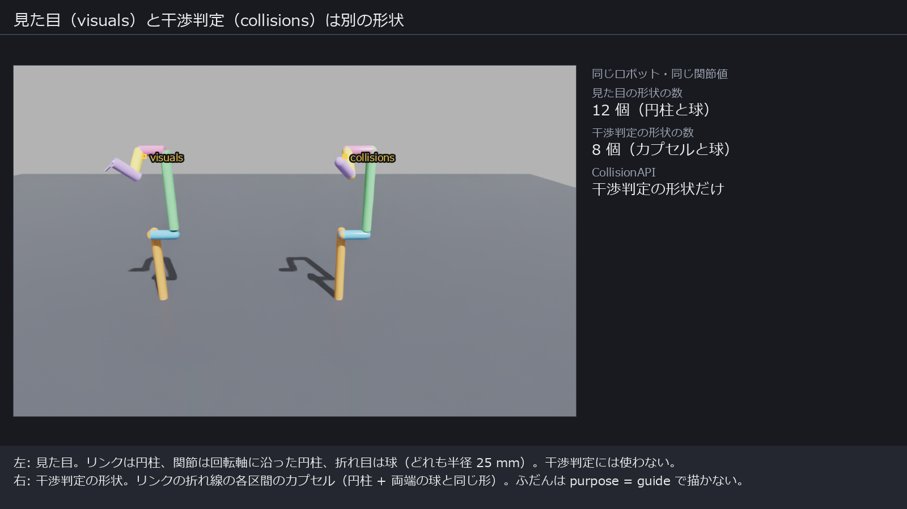
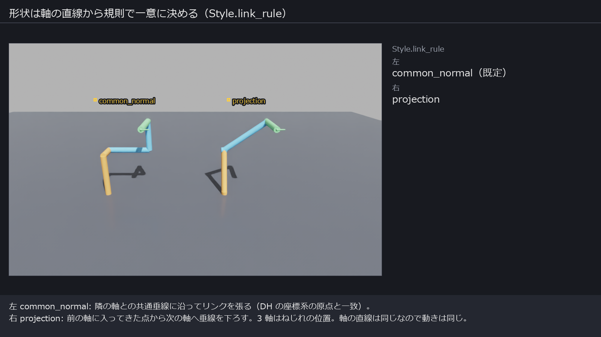
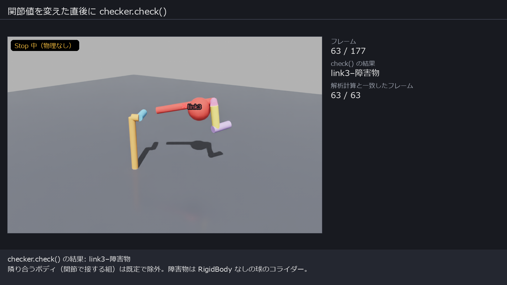
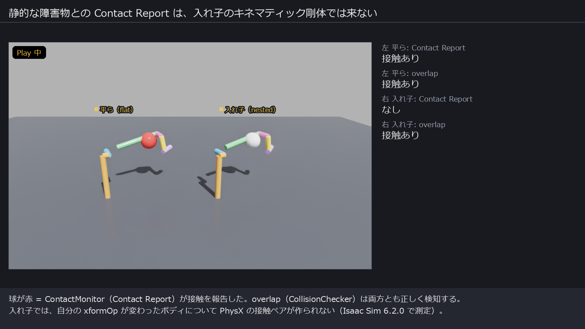
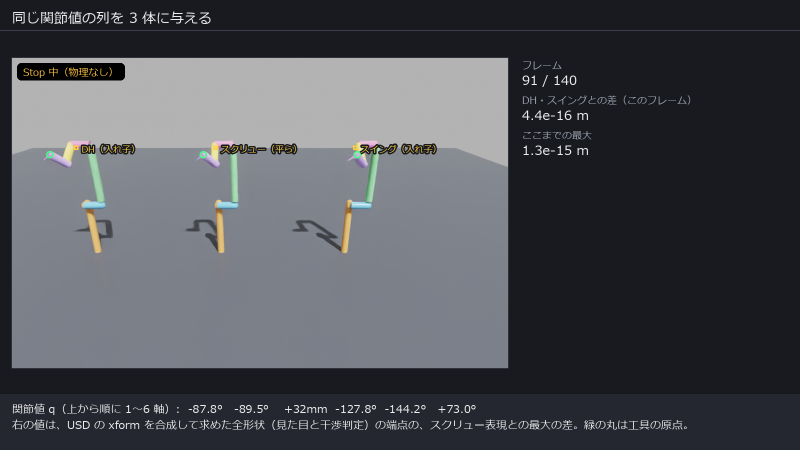
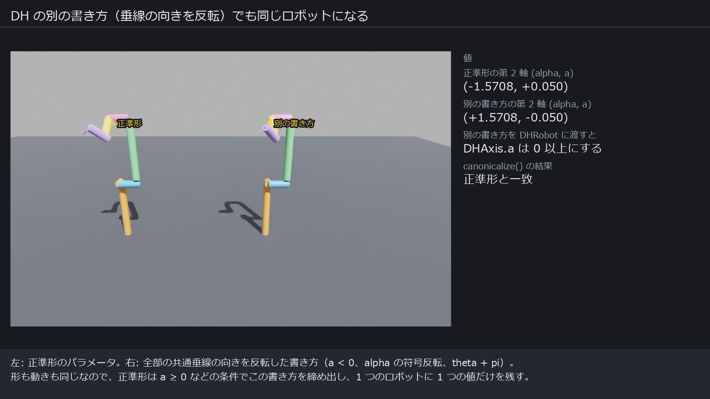

# ロボット表現の選び方（DH / スクリュー / スイング）

コード: GitHub `Koji-Morimoto/LearnOmni` の `RobotRepresentation/`（パッケージ `robot_repr`）。
この文書と検証の画像・動画は GitHub には置いていない（コードだけを push した）。

検証環境: Isaac Sim 6.2.0（omni.physx 110.4.4）、headless、RTX 3060。2026-11-05。

---

## 1. 前提：このパッケージでの「ロボット」と「同型」

### ロボットの範囲

- ベースは固定。関節は 1 自由度の回転（R）か直動（P）で、直列につながる。
- 先端に工具座標系を 1 つ持つ。
- 関節ごとに可動範囲（lower, upper）を持つ。

### ロボットそのもの（共通形 `LineChain`）

全関節値 q = 0 のときの各関節軸を「向き付きの直線」で持ち、工具座標系の位置姿勢と合わせたもの。
3 つの表現はどれも、この共通形との間で 1 対 1 に変換できる（`to_chain()` / `from_chain()`）。

- q の正の向きは直線の向き（回転なら右ねじ、直動なら進む向き）。
- 直動関節も直線を持つ。動きに効くのは向きだけで、直線の位置は軸の円柱とリンクが付く場所になる（途中の直動関節にレールは付けない）。

### 形状（リンクの生え方）

軸の直線と工具座標系から、規則 `Style.link_rule` でリンクの折れ線（各軸の上の「入ってくる点」と「出ていく点」を結ぶ線）を
一意に決め、その折れ線から見た目と干渉判定の形状を別々に作る。形状は表現によらず共通形から作るので、
同じロボットなら 3 表現で同じ形になる。太さは `Style.link_radius` = 25 mm（robot_urdf_gen の `LINK_RADIUS_MM` と同じ）。

| | 見た目（`<body>/visuals/`） | 干渉判定（`<body>/collisions/`、purpose = guide で描かない） |
|---|---|---|
| リンク（隣の軸へ渡る区間） | 円柱 | カプセル（= 円柱 + 両端の球。robot_urdf_gen の「リンクの円柱 + 関節の球」と同じ形） |
| 関節の軸の上の区間 | 回転軸に沿った円柱（長さは 50 mm 以上。回転軸の向きが見えるように） | カプセル（長さ 0 なら作らない。関節の点はリンクのカプセルの端の球が覆う） |
| 折れ目・ルート原点 | 球 | カプセルの端の球 |
| 途中の直動関節 | 固定側のリンクの端に球（レールは付けない） | 同上（レール無し） |
| 工具の原点と x 軸の印 | 小さな球と細い円柱 | 無し |

CollisionAPI は干渉判定の形状だけに付ける。



| 規則 | リンクの張り方 |
|---|---|
| `common_normal`（既定） | 隣り合う 2 軸の共通垂線に沿って張る。DH の座標系の原点と一致する。2 軸が平行なときは、手前の軸に入ってきた点から垂線を下ろす |
| `projection` | 手前の軸に入ってきた点から、次の軸へ垂線を下ろして張る |



### 同型の定義

**どの関節値 q でも、全リンクの位置姿勢と形状が一致するとき、同じロボット（同型）とみなす。**
各表現は「同じロボットを 2 通りのパラメータで書けない」ように正準形の条件を持ち、
条件を破った値はコンストラクタが `ValueError` で拒む。`canonicalize()` は条件を破った値から正準形を作る。

この定義では、**関節の向き（q の符号）と 0 点（q = 0 の姿勢）はロボットの一部**として数えている。
理由は、関節値の指令と可動範囲が q で書かれるので、符号や 0 点が違うと同じ q で違う姿勢になるため。

関節の向きと 0 点まで同一視したい（機構として同じなら同じとみなしたい）場合は、
まだ重複が残る（関節ごとに符号の 2 通り、回転関節の 0 点の連続的なずれ）。外し方は表現で難しさが違う。

| 表現 | 符号と 0 点を外す追加の規約 |
|---|---|
| DH | 回転関節の theta を 0 に固定し（0 点 = 前後の共通垂線がそろう姿勢）、軸の向きを alpha の範囲で決める。規約だけで外せる |
| スイング | 0 点を決める自然な規約がない（q = 0 の姿勢そのものを持つ表現なので） |
| スクリュー | 同上。0 点を変えると下流の全部の軸の値が変わる |

---

## 2. 3 つの表現の中身

| | DH（修正 DH = Craig） | スクリュー（PoE） | スイング（入れ子のローカル座標系） |
|---|---|---|---|
| 軸ごとの値 | `DHAxis(kind, alpha, a, theta, d, lower, upper)` | `ScrewAxis(kind, direction, moment, lower, upper)` | `SwingAxis(kind, swing, offset, lower, upper)` |
| 値の意味 | alpha, a: 前の軸からの入り方（共通垂線回りのねじれと長さ）。theta, d: この軸から次のリンクが生える位置 | ルート座標系での軸の Plücker 座標（単位向き u、モーメント m = 点 × u） | swing: 前の座標系の z 軸を最短で倒す回転ベクトル（xy 平面内）。offset: 前の原点から軸へ下ろした垂線の足の位置 |
| ベース・工具 | `DHBase(theta, d)`、`DHTool(alpha, a, theta, d)` | `ScrewTool(position, rotation)`（ルート座標系） | `SwingTool(position, rotation)`（最後のボディから見た値） |
| 正準形の条件 | a ≥ 0、角度は (−π, π]。交わる（a = 0）とき 0 < alpha < π。平行（alpha ∈ {0, π}）なら 1 つ前の d = 0。同じ直線なら 1 つ前の theta も 0 | \|u\| = 1、u・m = 0、rotation は回転行列 | \|swing\| < π、または swing = (π, 0)。rotation は回転行列 |
| 場合分け | 4 つ（一般・交わる・平行・同じ直線） | なし | 1 つ（真逆に倒す） |
| USD の組み方（既定） | ボディを入れ子。各ボディに `rotateX(alpha) translate(a) rotateZ(theta+q) translate(d)` | ボディを平ら（ルート直下）。各ボディに exp(S₁q₁)…exp(S_kq_k) の `transform` | ボディを入れ子。各ボディに `orient(swing) translate(offset) rotateZ(q)` |
| 6 軸の例での数（可動範囲込み） | 42（最小。制約なし） | 60（制約 18） | 48（軸ごとは最小。工具の回転行列で制約 6） |

自由度は 6 軸で 4 × 6（軸の直線）+ 6（工具）+ 12（可動範囲）= 42。DH はちょうどこの数で、
スクリューとスイングは制約付きの冗長な数で持つ。

---

## 3. 選び方（結論）

| やりたいこと | 向いている表現 | 理由 |
|---|---|---|
| 3 軸が 1 点で交わる（球面手首、Pieper の条件）・平行・直交などの構造を条件として課す、数え上げる | **DH** | 条件が座標の等式になる（下の表） |
| 離れた軸がすべて同じ点を通る（RCM：遠隔運動中心）条件を課す | **スクリュー** | 点 c を通る ⇔ m = c × u。u を決めれば c について線形 |
| 値を連続に少しずつ動かす（最適化など）、平行を含む構造を連続に扱う | **スクリュー**（次点スイング） | スクリューは全域で連続・一意。スイングは真逆に倒す 1 点だけが切れ目 |
| 制約なしの最小の数で持ちたい | **DH** | 値の範囲の条件だけ |
| ある軸の値を変えたら、その先が剛体的に付いてきてほしい（リンク長を伸ばしたら先端も動く） | **DH / スイング** | 前の軸からの相対で書く |
| ある軸の値を変えても、ほかの軸は動いてほしくない | **スクリュー** | 各軸がルート座標系の絶対値 |
| USD 上で DH の値をそのまま見たい・GUI で確かめたい | **DH**（入れ子） | xformOp の値が DH の値そのもの |

DH で書きやすい条件（i は 0 始まりの軸番号、MDH の値は「軸 i の入り方」が `axes[i].alpha, axes[i].a`）:

| 構造 | 条件 |
|---|---|
| 軸 i−1 と軸 i が交わる | `axes[i].a = 0` |
| 軸 i−1 と軸 i が平行 | `axes[i].alpha ∈ {0, π}` |
| 軸 i−1 と軸 i が直交 | `axes[i].alpha = ±π/2` |
| 軸 i, i+1, i+2 が 1 点で交わる | `axes[i+1].a = axes[i+2].a = 0` かつ `axes[i+1].d = 0`（`DHRobot.wrist_center(i)`） |

スクリューで書きやすい条件:

| 構造 | 条件 |
|---|---|
| 軸 i が点 c を通る | `moment_i = c × direction_i`（`ScrewRobot.common_point(indices)`） |
| 軸 i と軸 j が交わる、または平行 | `u_i・m_j + u_j・m_i = 0`（相反積が 0） |
| 軸 i と軸 j が平行 | `u_i × u_j = 0` |

---

## 4. 各表現の有利・不利

### DH

有利

- 最小の数で、値の範囲以外の制約がない。一般的な連続値のソルバにそのまま渡せる。
- 構造の条件（交わる・平行・直交・3 軸 1 点）が「値 = 0」「値 = π/2」の形になる。構造を離散的に数え上げるのに向く。
- 産業ロボットのカタログの DH 表と対応がつく。

不利

- 場合分けが 4 つあり、その境目で値が不連続になる。特に**ほぼ平行な 2 軸は共通垂線が遠くへ飛ぶ**
  （ねじれ角 alpha → 0 で、垂線の足の位置 d が発散する）。平行な構造は「ちょうど 0」の値でしか取れず、
  連続に平行へ近づけていくと値が大きく跳ぶ。
- 正準形の条件が前後のオブジェクトにまたがる（軸 i が平行なら軸 i−1 の d = 0、同じ直線なら theta も 0）。
  1 軸ずつ独立に値を選べないので、軸ごとのモジュール性の一部が崩れる。
- 上流の値を変えると、下流の軸の位置が全部変わる（相対表現）。

最適化で使うとき: 制約なしで扱えるのは利点。ただし平行・交差の近くで値が跳ぶので、
平行や交差を候補に含めるなら「構造の種類（離散）＋その中の連続値」に分けて扱う方が安定する。
勾配は平行の近くで急に大きくなる。

### スクリュー（Plücker 座標）

有利

- 場合分けがない。向き付きの直線と Plücker 座標は 1 対 1 なので、全域で連続かつ一意。
- 各軸がルート座標系の絶対値なので、1 軸の値を変えてもほかの軸は動かない。軸ごとに独立に扱える。
- 「軸が点 c を通る」が m = c × u と書けるので、RCM のように離れた軸どうしの条件が書きやすい。
- 順運動学が exp の積で、関節値についての微分（ヤコビアン）の列がねじり S そのもの。

不利

- 冗長。軸ごとに 6 個の数と 2 個の制約（|u| = 1、u・m = 0）、工具は 12 個の数と 6 個の制約。
  値を自由に動かすと制約から外れるので、正規化・射影するか、制約付きで扱う必要がある。
  射影する場合、射影で消える方向（u の長さ、m の u 方向の成分）は結果に効かない平らな方向になる。
- 隣り合う軸の関係（交わる・平行）は双線形の条件になり、上流の軸を動かしても下流は付いてこない
  （手首の 3 軸の交点などの関係は、軸をまとめて動かさないと崩れる）。
- q = 0 の姿勢そのものを値に持つので、0 点の取り方を変えると全部の軸の値が変わる。

最適化で使うとき: 連続で場合分けがないので勾配を使う方法と相性がよい。
向き u は球面上、m は u に垂直な平面上にあるので、その上で動かす（毎回正規化・射影する、
または u を制約のない 3 次元ベクトルで持って正規化する）。

### スイング（入れ子のローカル座標系）

有利

- 軸ごとに 4 個の数（最小）で、制約は |swing| ≤ π だけ。
- 平行（swing = 0）を含めて連続。切れ目は「軸を真逆に倒す」1 か所だけ。
- USD の入れ子の Xform（orient と translate）にそのまま対応する。
- 前の座標系からの相対なので、上流を変えると下流が付いてくる。

不利

- 真逆に倒す（|swing| = π）近くで、座標系の軸回りの向きが跳び、その先の軸の offset の値が不連続になる。
- 交わる・3 軸 1 点などの条件が DH ほど単純な式にならない（「軸 i が前の座標系の原点を通る ⇔ offset = 0」は単純だが、
  隣の軸どうしの交差は swing と offset の関係式になる）。
- 工具は回転行列で持つので、そこだけ冗長。

最適化で使うとき: 平行を含む構造を連続に扱いたいときに DH より扱いやすい。真逆に倒す近くだけ注意する。

### なぜ DH とスイングには切れ目があり、スクリューには無いか

軸の向きは球面 S² の点である。これを 2 個の実数で表すと、Borsuk–Ulam の定理（球面から平面への連続写像は、
ある正反対の 2 点を同じ点に送る）により、どこかで不連続になるか、同じ向きに 2 つ以上の値が付く。
周期的な角度で表しても、球面はトーラスに 1 対 1 で連続には載らないので同じことになる。

- DH の（theta, alpha）とスイングの（sx, sy）は、向きを 2 個の数で表すので切れ目が避けられない。
  スイングは切れ目が最小（1 点）。DH は共通垂線を使う作り方のために、平行・交差でも切れ目ができる。
- スクリューは向きを 3 個の数（単位ベクトル）で持つので切れ目が無い。代わりに |u| = 1 の制約が付く。

---

## 5. 干渉検知の選び方：RigidBody なし / キネマティック

### 違い

| | RigidBody なし（`collision="static"`、既定） | RigidBody + kinematicEnabled（`collision="kinematic"`） |
|---|---|---|
| PhysX から見ると | 静的コライダー（動かない壁）。ただし xform を書き換えると PhysX 側の位置もすぐ更新される | 指定どおりに動く剛体。重力や力では動かない。物理ステップのときに目標の位置へ動く |
| Stop 中 | 書いた直後から位置が反映される | **PhysX 側の位置が追従しない**（物理ステップが回らないため） |
| 接触の取り方 | `CollisionChecker`（overlap 問い合わせ）。静的どうしの接触はシミュレーションでは計算されないので Contact Report は来ない | `CollisionChecker`（Play 中のみ）と `ContactMonitor`（Contact Report） |
| 動的な物体 | 押さない（動的な物体の方がぶつかって止まる） | 押せる |

**物理演算は不要で接触検知だけしたいなら、RigidBody なし（`collision="static"`）＋ `CollisionChecker` を使う。**
キネマティックは「Play 中に動的な物体を押したい」ときだけ選べばよい。

### 測定結果

| 項目 | 結果 |
|---|---|
| static：`CollisionChecker` と解析計算（カプセル間距離）の一致 | ランダムな 300 姿勢 × 6 体（3 表現 × 入れ子/平ら）ですべて一致。うち 25 姿勢が干渉（自己干渉 19、障害物 6） |
| static：書いた直後の反映（Stop 中、`app.update()` なし） | 20 / 20 |
| static：1 回の時間（干渉判定の形状 8 個のロボット） | `set_joint_positions` 0.5 ms、`check()` 0.4 ms（中央値） |
| kinematic：Stop 中に関節値を変えたとき | PhysX 側の位置が 1.28 m ずれたまま。`app.update()` でも変わらず、`update_simulation()` で追従（1.2e-7 m） |
| kinematic：Play 中の PhysX と USD の位置の差 | 最大 5.6e-7 m（293 フレーム） |
| kinematic：Play 中の `CollisionChecker` と解析計算 | 293 / 293 フレームで一致 |
| kinematic：`ContactMonitor` の報告の境目 | 形状が触れる手前から報告される。既定の contactOffset で、すき間 約 1.0〜1.2 cm で始まり・終わる。contactOffset = 1 mm にするとすき間 1.6〜2.7 mm。contactOffset = 2 cm（和 4 cm）では、すき間 3.2 cm（測定の範囲の端）から最後まで報告が続いた |
| kinematic：入れ子のボディ | 自分の xformOp が変わるボディは、静的な障害物との Contact Report が来ない（0 件）。平らに並べると来る。動的な球を同じ動きで押した距離は入れ子 0.126 m、平ら 0.269 m。このため kinematic の既定は平ら（`layout="flat"`） |




---

## 6. 3 表現の同等性と一意性の検証

### numpy（`tests/test_representations.py`）

801 個のロボット（3 軸・6 軸。一般の配置に加え、平行・逆平行・交差・同じ直線・逆向きの同じ直線・
ルートの Z 軸と一致・ルートの Z 軸と平行・直交・混合、直動関節を含む）で確かめた。すべて合格。

| 確かめたこと | 件数 |
|---|---|
| 共通形 → 各表現 → 共通形が元に戻る（各表現は共通形を全部表せる） | 2403 |
| 各表現 → 共通形 → 各表現がパラメータまで元に戻る（正準形どうしは別のロボット） | 2403 |
| 各表現の独自の積（DH の Rx Tx Rz Tz、スイングの入れ子、PoE の exp）で求めたボディの動きと工具が一致（誤差 < 1e-9） | 9612 |
| 2 種類の形状の規則で、3 表現の見た目の形状と干渉判定の形状（端点）が一致 | 801 × 2 × 2 |
| 同じロボットの別の書き方（DH：垂線の向きの反転、スクリュー：向きの大きさと軸上の点、スイング：座標系を軸回りに回し軸上で動かす）が canonicalize で正準形に戻り、DH のコンストラクタは 801 件すべて拒む | 801 × 3 |
| 正準形の範囲で値を 1 つだけ 1e-4 変えると別のロボットになる | 6403 |
| 正準形でない値 13 種類をコンストラクタが拒む | 13 |

### Isaac Sim（`tests/isaac_verify.py`）

| 確かめたこと | 結果 |
|---|---|
| ランダムな 300 姿勢で、USD の xform を合成して求めた全形状（見た目と干渉判定）の端点が 3 表現 × 2 並べ方で一致し、numpy の順運動学とも一致 | 最大の差 1.4e-15 m |
| Play → Stop で関節値と xformOp がずれない | 3 表現とも一致 |




---

## 7. 使い方（抜粋）

```python
from robot_repr import DHRobot, DHAxis, DHBase, DHTool, ScrewAxis, ScrewRobot, convert
from robot_repr.scene import build_robot, SceneRobot
from robot_repr.collision import CollisionChecker

robot = DHRobot(base=DHBase(), axes=[DHAxis("R", d=0.3), DHAxis("R", alpha=1.5708, a=0.05), ...], tool=DHTool(d=0.1))
screw = convert(robot, "screw")             # 同じロボットのスクリュー表現（正準形）
names, values = robot.flat()                # 名前付きの数値列
robot2 = robot.with_flat(values)            # 数値列から作り直す（関節の種類はそのまま）

sr = build_robot(stage, "/World/MyRobot", robot, collision="static")
sr.set_joint_positions([0.1, -0.5, 0.3])    # ラジアン / メートル
sr.set_joint_positions_deg([10, -30, 0.05])
checker = CollisionChecker(sr)
checker.check()                             # [("link1", "link3"), ("link4", "/World/Table"), ...]
```

Script Editor で動くデモは `examples/demo_scene.py`（3 表現を並べて同じ関節値で動かし、干渉を赤く塗る）。

---

## 8. 注意と制限

- 平行・交差・同じ直線の判定と正準形の判定は、閾値 `TOL = 1e-9` で行う。境目のすぐ近くの値は、
  数値誤差の範囲で正準形の判定が変わりうる。
- 隣り合うボディ（関節でつながった組）は関節の所で必ず重なるので、`CollisionChecker` は既定で除外する。
  同じ直線上の関節が続く配置では、1 つ飛ばしのボディも重なることがある。`touching_pairs()` で確かめて `ignore_pairs` に足す。
- 形状の太さ（`Style.link_radius`）はロボット全体で共通。軸ごとの太さは持たない。
- Contact Report と入れ子のキネマティック剛体の挙動は Isaac Sim 6.2.0 / omni.physx 110.4.4 での測定。版が変わると変わりうる。
